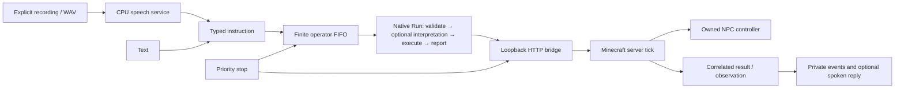

# Companion lab

**Unofficial Minecraft integration. Neither Mojang nor Microsoft approves or is associated with this project.**

Publisher: LychD contributors · Contact: [hexanomicon@proton.me](mailto:hexanomicon@proton.me).

Speak a short instruction, see it enter the companion's queue, and receive a result tied to what
the server actually did. This experimental profile develops that journey separately from the
authenticated-player [bounded mission](index.md#contract). Its first body is a controlled vanilla
wolf. It is an NPC, with no player account, inventory privileges, mining or building authority.

## First session

| Story | Required behavior |
| --- | --- |
| Ask for the current state in Slovak, Czech or English | Exact supported wording reaches the same typed request as text. An explicitly selected local interpreter can classify a bounded paraphrase; ambiguous requests clarify or refuse. |
| Say `prepni deň/noc` or `počasie jasno` | Separately enabled clock/weather effects return their own correlated engine readback. Exact named modes remain available without a model. |
| Tell the companion to look, move a short distance or follow | The server validates the actor, world generation, bounds, target and deadline. Starting navigation is reported separately from reaching a destination. |
| Walk with a companion that leaves room | Following waits inside its configured stopping distance and resumes only outside a larger distance. The band prevents close-contact repathing; target loss and the finite lease still end following. |
| Give another instruction while work is active | A finite FIFO retains operator commands with a capacity and expiry. New movement instructions replace the prior movement goal when executed. Read/chat requests need not cancel movement. |
| Leave the companion idle | It may look around under a finite lease, without wandering, mining or model calls. Idle ticks do not build a command backlog. |
| Stop at any time | A priority path fences older requests and clears their queue. The server acknowledges stopping only after applying the fence on its tick thread. Gravity and unrelated game physics can continue. |
| Match every queued outcome to its instruction | Even expiration or cancellation before native admission retains the operator request UUID and private evidence; it does not invent a Run UUID. |
| Hear a useful answer | A state reply describes the correlated observed mode and coordinates. Movement replies describe activation, and uncertainty remains explicit in Slovak, Czech and English. |
| Lose a reply or restart | An uncertain action is not replayed. Server restart changes its boot identity and starts idle; the caller must bind again. |
| Test without free GPUs | Compilation, dedicated server, deterministic native graphs and the speech profile use CPU only. Optional interpretation needs its separately selected model service. Client rendering and microphone/listening checks have separate acceptance. |

## Chosen construction

The first target is Fabric on Minecraft 26.3, matching the currently prepared human client version.
Fabric and NeoForge both satisfy the necessary API floor; this is a reversible implementation
choice, not evidence that Fabric is faster, more reliable or inherently more agentic. No required
modpack or measured maintenance advantage currently breaks that comparison. The complete Java,
Gradle, Loom, Loader and Fabric API tuple must be pinned and built before delivery is claimed.

The adversarial comparison tested the same requirements against both loaders, then exchanged
their strongest objections. Fabric supplies [entity](https://docs.fabricmc.net/develop/entities/first-entity),
[networking](https://docs.fabricmc.net/develop/networking) and
[testing](https://docs.fabricmc.net/develop/automatic-testing) seams; NeoForge supplies corresponding
[entity](https://docs.neoforged.net/docs/entities/),
[payload](https://docs.neoforged.net/docs/networking/payload/) and
[GameTest](https://docs.neoforged.net/docs/misc/gametest/) seams. These establish suitability, not
comparative reliability. NeoForge's capabilities are useful when a required content ecosystem
needs them; Fabric also has typed lookup, transfer and attachment facilities. Neither eliminates
Minecraft version migrations or turns a helper fake player into an authenticated visible player.
The first slice therefore chooses one small working actuator and keeps the wire boundary portable.
Reopen the loader choice for a required incompatible modpack, a measured upgrade burden or a
missing concrete engine hook. Hypothetical future agents writing more code do not settle those costs.

LychD owns intent, language interpretation, native Run/Graph execution, the operator queue and
private evidence. The Java delivery client owns a bounded transport mailbox and Minecraft-thread
actuation. The wire protocol addresses actor UUIDs and capabilities, not a wolf-specific graph.
No model inference executes in a server tick. A later custom entity, talking item or client UI
can reuse this boundary without moving cognition into Minecraft.

The local bridge authenticates a private token and listens only on literal loopback. It binds
each action to protocol version, server boot, actor, native Run, action identity, stop generation
and expiry before handing it to the game. HTTP acceptance alone does not establish execution.
World and entity access occurs only on the server thread; endpoint workers see immutable
observations, and stop takes priority over ordinary commands.

Within one boot, duplicate identities must recover the same action without repeating its effects.
Changed content under an old identity refuses. Queue and result storage stay finite. After a
crash or lost acknowledgement, retain unknown rather than infer a result: these process-local
records establish no durable exactly-once guarantee.

Keep a separate finite history for stop identities so ordinary action capacity cannot consume it.
A newer stop may supersede a pending stop before its tick barrier; settle the earlier record as
cancelled and keep it queryable. When the final stop-history slot is used, seal new ordinary
admission for that boot while preserving the priority barrier. Further unknown identities refuse
until an explicit server restart. Never evict or reuse a retained identity silently.

Only the owned actor is controlled. Vanilla movement and target-selection goals must not compete
with its admitted controller. A missing, unloaded, dead or changed actor refuses dependent work.
Following binds an exact target UUID and finite distance/lease; loss stops it. Movement remains
bounded and does not authorize teleportation, digging or chunk exploration. Ordinary chat never
becomes a server console command.

### Explicit server weather

The separate `weather@1` contract changes shared server weather, rather than extending the NPC's
spatial authority. Its closed arguments are revision `1`, scope `server_weather`, mode `clear`
or `rain`, and duration `600` engine ticks. The overworld is an observation anchor; Minecraft
26.3 keeps weather data on the server, shared by weather-capable dimensions. Thunder, arbitrary
durations, console commands and gamerule changes are outside this operation.

Host policy `allow_weather` and server configuration `allow_weather` default to false. A trusted
local session must explicitly select `--allow-weather`; its native admission then also carries
`blockworld:weather`, checked again before physical handoff. Neither the existing companion
scope nor the NPC's control box grants this effect. The server independently checks its opt-in
and current weather advancement setting before applying anything. Disabled advancement refuses.

After admission, the weather owner calls the engine's typed API on the server thread. It returns
a separate `blockworld.weather@1` observation recording requested mode/timer, actual flags/timers,
global scope, overworld anchor, boot/actor/generation, world tick and timestamp. The outer record
binds action and Run identities; a pose or cell observation cannot confirm this weather result.

The timer programme is finite, but it promises neither thirty wall-clock seconds nor restoration
of earlier weather or immunity from later world changes. Ordinary natural cycling resumes, and
later natural thunder is not excluded.

Exact text or transcript forms include `weather clear`, `weather rain`, Slovak `počasie jasno`
and `počasie dážď`, Czech `počasí jasno` and `počasí déšť`, and the fixed phrases `daj jasno`,
`spusti dážď`, `nastav jasno`, `spusť déšť`, `clear weather` and `make it rain`.
Bare weather toggles and malformed weather commands refuse rather than entering interpretation.
The shared finite FIFO, native Graph, mailbox, deduplication and original instruction deadline
remain their existing owners. A composite actuator routes weather beside the NPC controller;
weather cannot replace or renew its movement goal or lease. Priority stop cancels queued weather
and stops the NPC; it does not undo weather already applied. Unknown acknowledgement never
authorizes replay. Existing NPC-only sessions retain their authority ceiling.

This expands the experimental lab Pattern to revision `3`, implementation `py.5`, checkpoint
`companion-state-v5`; it does not change the authenticated-player bounded-mission contract.
Earlier Pattern closures are not migrated by shape compatibility. Delivery evidence remains in
[State of Work](../../state-of-the-work.md#composition-portfolio-delivery).

### Explicit day and night clock

The independent `time@1` operation advances the selected `minecraft:overworld` clock to the
next or equal day marker (1000) or night marker (13000) in its 24000-tick cycle. Its closed
arguments are revision `1`, scope `overworld_clock`, and mode `day`, `night` or `toggle`.
Toggle samples the clock at execution: phase below 12000 selects night; otherwise day.
No operation sets the clock backward. An already-day request just after marker `1000` can advance
23999 ticks; repeated distinct toggles can advance calendar and moon counts. This is an explicit
placement policy, not proof of safety for every consumer. Linked schedules outside the overworld
can also change. An operator preference for same-cycle editing reopens this choice.

Host policy `allow_time` and server configuration `allow_time` default false. Explicit local
`--allow-time` adds native `blockworld:time`; policy and scope are checked again at handoff.
The server independently checks its permission and current bound clock/timeline/markers and
overworld default-clock/timeline/fixed-time profile. Missing or incompatible profiles refuse
before mutation. Other timeline tracks and visible brightness are not certified by this check.

With nonnegative cumulative ticks, the owner computes the forward delta modulo `24000` and refuses
64-bit overflow. An equal marker skips the setter, preserving fractional progress; a positive
placement resets the fraction to zero through the engine API. Existing finite rate (including
zero or negative), pause and time-advancement settings are preserved and reported. No response
promises future cycling. Simulation ticks, weather and the original NPC controller/lease are
separate and remain unchanged by this immediate operation.

Verify the clock placement through its own closed `blockworld.clock@1` readback. It retains
requested/resolved modes, clock/scope/anchor, before/after ticks, phases, cycles and cycle increment,
exact delta, fractional readings, rate, pause and advancement settings, plus
boot/actor/generation/world tick/timestamp. The outer record binds action and Run. The host
recomputes placement from this evidence; another observation kind cannot confirm it.

Stop cancels queued clock work but cannot undo an applied placement. Unknown acknowledgement
never authorizes replay. The existing FIFO, mailbox, history and original deadlines retain their
owners.

Exact forms include `time day`, `time night`, `time toggle`, Slovak `čas deň`, `čas noc`,
`prepni deň noc` and `prepni deň/noc`, Czech `čas den`, `čas noc`, `přepni den noc`, and English
`toggle day night`. Documented ASCII forms are accepted. Malformed clock wording stays outside
the optional state/idle/follow interpreter. This expands the experimental Pattern to revision
`4`, implementation `py.6`, checkpoint `companion-state-v6`; it migrates no older pinned closure.
Delivery and human speech checks remain in State of Work.

The explicit `inspect@1` operation reads one integer cell: `inspect X Y Z`, Slovak
`blok X Y Z`, or Czech `blok X Y Z`. It shares the ordinary FIFO, native Run, mailbox,
identity history, stop fence and original deadline. Both cell corners must fit the host and
server boxes; the integer cell origin must be within the admitted distance of the owned NPC.
The server reads an already loaded chunk on its tick thread without loading or generating one.
It returns a separate closed `blockworld.cell@1` observation with dimension, complete registry
block state/properties, coordinates, boot/actor/generation and server time/tick. This provenance
is neither a canonical world epoch nor permission or evidence for placement. An unloaded cell
refuses; a missing or mismatched observation remains unknown.

The protocol-1 action envelope and existing pose observation retain their exact shapes.
`inspect` has explicit argument revision 1 and its own typed observation variant; existing
actions cannot accept that variant, and inspection cannot accept a pose as its answer. An older
server may refuse the new operation. Reading preserves any valid movement/follow controller
and its original lease. Full state stays in the private result; bounded localized feedback
describes the observed cell without reading block-entity text, inventories or other contents.
This is world observation only; building and material custody remain unfinished.

The private server configuration owns the follow distance band. Optional `follow_stop_distance`
and `follow_resume_distance` default to two and three blocks respectively. Require
`0.5 <= follow_stop_distance < follow_resume_distance <= 8`. A companion waiting near its target
retains the finite follow controller, so a later short walk can resume navigation. Distance
selection does not widen the control box, the maximum target separation or the action lease.

The bridge holds one private, nonpersistent entity-ticking ticket at the home chunk. Minecraft
requires a supporting halo around that anchor. Shutdown and initialization failure remove the
owned ticket; the persistent created marker remains with the world. This keeps the home actor
available without a human client. It does not establish entity ticking throughout the entire
control box: movement beyond the home chunk can depend on ordinary player loading. Snapshot
`yaw` and `pitch` describe head gaze, so a turned head can be observed independently of body yaw.
The CLI's bounds narrow admission; the server configuration owns the continuing control box.

## Explicit operation

### Reviewed phrases and confirmations

The opt-in `--dialogue` console profile develops a model-free conversation before the ordinary
FIFO. Ask `možnosti`, `možnosti počasia`, `možnosti času` (or Czech/English equivalents), choose
a numbered option or give an exact supported command, then answer its confirmation. An unknown
phrase can be associated with the selected command after execution. The catalogue describes
the host's closed operations and selected permissions; it is not a live registry of every game
command. Structure placement and `/summon` currently have no admitted actuator and must be
reported unavailable, without inventing choices or executing chat as a console command.

`--confirmation unremembered` is the dialogue default. Effects require confirmation unless an
exact reviewed phrase explicitly permits skipping it. `always` requires it even for remembered
phrases; `never` omits this conversational check. State and cell reads do not need effect
confirmation. These settings do not replace native admission, server permissions or stop.
The confirmation repeats the concrete command. Only an unambiguous `áno`/`ano`/`yes` admits that
frozen proposal. Rejection, another instruction, expiry, target change or stop discards it.
Selection and confirmation cannot renew the original instruction deadline or stop generation.

Ask `Je to v poriadku?` only after a matched applied result. A positive answer can then offer
remembering: `áno` retains the meaning, while `áno bez potvrdenia` also permits future confirmation
skipping in `unremembered` mode. A negative, unknown, cancelled or failed outcome never teaches
a phrase.

Reuse is exact after Unicode normalization, case folding and outer whitespace removal, partitioned
by language and configured server/actor namespace. Each reuse creates a fresh request and passes
the ordinary native checks. A remembered follow command binds the currently selected target anew
instead of retaining an old player UUID. Original strict commands cannot be redefined as a
different action.

Without a separately selected memory database profile, reviewed phrases last only for this
console session. Cross-session records belong to Phylactery, not a JSON shadow database or the
public-note Archive. The explicit private `--memory-profile` selects a prepared local PostgreSQL
connection and owner; startup neither provisions nor migrates it. A missing schema or storage
failure refuses memory access rather than pretending it was a cache miss or retrying an action.
The profile is separate from voice/model selection. `:forget PHRASE` removes one exact phrase
in the current language and namespace; forgetting does not undo a game action.

This is a bounded lab dialogue, not durable Consent, full agent memory, semantic matching or an
arbitrary-command interpreter. Its pending conversation does not survive restart. Live voice,
game, PostgreSQL and timing qualification remain separate from offline source checks.

For a later voice trial, append `--dialogue --confirmation unremembered
--instruction-timeout 60` to the existing launch command. Selection and a spoken confirmation
share that original sixty-second lifetime. No model interpreter is selected by this profile.
The memory profile has exactly `version` (integer 1), `owner_id` (UUID), literal-loopback `host`,
`port`, `user`, `database` and private `password`. Use the prepared data-only runtime role;
administrative credentials are refused by the ordinary connection authority guard. Keep this
file in the declared private workspace. Never put it in the checkout or command-line arguments.

### Dump & Search score

`blockworld.companion.search@1` is an explicitly assembled, inactive native Pattern:
Dump → LiteralSearch → Report. A source adapter returns at most 256 items/128 KiB, exact
source/revision/digest and whether the catalogue is complete. Escaped literal matching first
narrows a request such as `castle` or `hrad`; the result keeps the match count, at most sixteen
candidates and three short choices with source-provided characteristics. A truncated dump cannot
claim how many matches exist in its unseen remainder. Data labels are discovery facts, never
instructions or executable commands.

A separately supplied ranking proposal contains only candidate IDs and binds the exact source,
query and candidate digest. It can reorder those choices but cannot invent an item or authorize
its execution. This is the input boundary for later admitted agent work, not a delivered
subagent adapter. It launches no agent, model or foreign runtime. A future delegation must use
the existing AgentJob/Graph authority and privacy boundaries; this score cannot bypass them.

The current game bridge has no structure/entity catalogue adapter. Consequently this score is
testable with an injected catalogue but is not connected to spoken castle search or live
structure/summon execution. Those require their own authoritative catalogue and typed game
operations. The spoken companion continues to report them unavailable.

The [Java project](https://github.com/hexanomicon/lychd/blob/main/clients/minecraft/README.md) owns the pinned build and server-side
installation. The Python entry is `scripts/companion_lab.py`; it opens one private external
workspace, an exact bridge profile, fresh finite policy and the existing native memory runtime.
Text commands and explicitly recorded or supplied WAV use the same parser and FIFO. `:record 3`
arms one three-second utterance; it does not enable continuous listening. `stop` and Ctrl-C remain
independent of speech inference. A failed or uncertain recorder/player retirement closes further
audio admission while preserving text control and the known game result. A recording failure
with proved recorder retirement refuses that utterance but permits a new explicit gesture;
it neither retries nor reuses the failed request identity. Stop during final recorder retirement
still cancels the utterance before transcription. Unknown launch or retirement cannot report
recording off or reopen capture and replies.

The console stamps each line's first bytes observed by its reader, before the consumer can wait
on stop settlement. This is reader observation, not the time a key was pressed in the terminal.
Its original stop generation and finite deadline cannot be renewed by that
wait. Ordinary input received during console stop settlement refuses, including recording and
target changes; stop and quit retain priority. An explicitly new line after settlement remains
usable. Target changes follow console order, and a recording binds that ordered target before
asynchronous capture starts. Waiting for audio ownership does not extend a recording trigger's
deadline or permit an expired trigger to start the microphone.

Select `--output human` for a private, readable foreground console; JSON remains the default.
The human view shows the original recognized words before command parsing, including refused
wording. It escapes terminal controls and bounds visible text while keeping the retained
transcript unchanged. This explicit private display is separate from structural diagnostics;
ordinary JSON output does not add raw recognized words. Existing localized feedback remains
the game-result wording, and speech generation, player settlement and evidence retention are
shown separately. A failed native receipt is reported even when a queued cancellation resolved
before publication; a failed audio artifact remains distinct from successfully generated bytes
and a retained reply record. No result or display failure authorizes replay.

`:status` reads a process-local snapshot of the existing operator FIFO and current audio
operations. It performs no game/model request, native Run admission, queue expiry or evidence
settlement. A passed deadline is not a terminal disposition until its owner settles it. The
local pending queue is distinct from the server mailbox. Target changes and ordinary controls
retain the same reader generation/deadline rule. Stop notices distinguish requested from
acknowledged or unknown; presentation failure cannot erase a known outcome or bypass retirement.
Audio labels describe finite operations requested or pending, not verified device readiness,
audible start or human hearing. This console view is separate from the optional focused-game
controls below; it does not qualify a physical microphone.
The shared [Linux recorder](../../sepulcher/extensions/echo-local-probe.md#probe-contract) uses
the host's ALSA `default` input. Select the intended microphone in the host sound settings;
the lab neither changes routing nor retries on another device.
Selected reply playback likewise uses the host's ALSA `default` output. The shared helper accepts
only an explicit supported `pulse` alternative; failure never selects another output. Playback
forwards the inspected WAV unchanged and does not alter host routing or volume.

To inspect delay, use the private `REQUEST_ID-timing.json` (`companion-host-timing@1`) retained
for each accepted voice input. Timing begins at host voice admission, before the utterance is
scheduled; it does not begin at a physical key press or speech onset.

Fixed stages distinguish audio ownership wait, capture or supplied-WAV read, source/transcript
retention, transcription, instruction admission, queue/native outcome wait, reply audio wait,
synthesis, reply artifact retention, player retirement and the existing evidence-write attempts.
Spoken stop has its own stage. Relative monotonic milliseconds and directly measured local elapsed
time are observations, not deadlines. Unavailable clocks yield null, and unattempted work differs
from a measured zero. Stages may overlap, so their durations must not be summed.

Queue/native outcome wait includes local scheduling, FIFO, Run/Graph and transport, and often
native evidence publication. It does not separate queue time from game computation. The record
distinguishes a supplied native result from local settlement without one. It closes once the
existing voice and optional reply watcher retire, including cancellation before coroutine entry
and disabled replies; it adds no wait or retry. Open intervals close as locally retired with
work unknown. Failed/cancelled speech calls do not establish remote computation stopped, and
player retirement does not establish hearing. The timing record's own write/presentation is
outside its elapsed interval. Timing retention failure is reported separately and cannot change
the game result, audio ownership or original input identity/deadline. This host-lab observation
does not claim native Echo timing or physical microphone qualification.

The prepared CPU speech route is an engineering baseline, not a completed SK/CS/EN quality
qualification. A twelve-case generated-WAV check applied four ordinary commands, applied spoken
stop and refused a negative instruction; six other examples refused, including synthetic Slovak
`stav` and all three basic Czech examples. This does not isolate the synthesizer from the
recognizer, nor predict human accuracy. Start a human test with a fresh explicit recording,
compare its unmodified transcript to the supported text grammar and keep text control available.
Do not turn a similar-sounding refusal into a guessed action. The
[provider study](../../sepulcher/extensions/echo-research.md) lists comparison candidates;
none is selected automatically after a failure.

For an explicit comparison in the same console, `:language` reports the configured input and
reply languages without a speech or game request. `:language cs` selects Czech transcription
for later input and preserves the reply setting; `:language cs cs` explicitly selects Czech
input and generated replies. Only `sk`, `cs` and `en` are accepted, and both requested settings
must be declared by the already selected profile before either changes. An omitted reply
argument preserves disabled replies. Enabling replies this way does not enable playback.

A change refuses while a voice input or reply is still owned; it is never queued or retried.
Finish or stop that work before entering a fresh change. Querying remains observational, and
the existing reader generation/deadline and stop rules still apply. Selection changes no
provider, model, device, profile file or game authority and does not qualify language quality.

### Optional focused-game controls

The held-input extension adds a third, initially unbound push-to-talk mapping beside
fixed-duration recording and stop. With the matching private control and speech profiles,
explicit `--hold-seconds 15` enables held capture with a fifteen-second maximum. The six-field
control profile stays unchanged; `record_seconds` still selects the fixed recording duration.
Choose each binding in the private Minecraft instance's Controls screen; no particular key is
a universal default.

Press requests capture for one original voice occurrence. Release finishes that same capture
and permits its existing transcription/native admission only after at least 250 milliseconds
of usable captured PCM and confirmed recorder retirement. Releasing before capture arms
discards the gesture. Reaching the hard limit without release also discards it. Holding either
capture key never repeats an utterance. Continuous listening and wake words remain unimplemented;
these controls need no global keyboard hook or administrator privileges.

Menu, pause, focus, world and observed host-context boundaries suppress a held release and
request best-effort stop for outstanding dispatched input. They also discard unsent old work.
All three controls must be released before another fresh edge. A console `:target` change
selects later input; an already-owned hold retains its captured target. A host-context change can
trigger client cancellation only after the client observes it.

Private `/v1/hold` and `/v1/release` control mutations retain the original voice UUID, context,
generation and absolute instruction expiry. Release has a separately frozen three-second
forwarding window; it cannot renew the original deadline. Per-phase digests retain duplicate
observations, and bounded release-before-start tombstones prevent delayed capture. The exact
six-field private profile and fixed `/v1/record` operation retain their existing meanings.
Held capture accepts only bounded even PCM after intentional SIGINT and confirmed recorder-group
retirement; canceled, too-short, forced or uncertain retirement never supplies transcription.
The early-finish exit-status rule is qualified against local ALSA `arecord` 1.2.16 on its `null`
device; it does not establish compatibility with every recorder version or a physical input.
Release requests and actual captured PCM/retirement remain distinct from physical microphone or
hearing proof. [State of Work](../../state-of-the-work.md#composition-portfolio-delivery) owns
qualification; physical keys, microphone capture and human hearing still need live acceptance.

The separate [voice client](https://github.com/hexanomicon/lychd/tree/main/clients/minecraft-voice)
installs only in the local Fabric player instance. Its README owns the pinned build, private
profile shape and installation. The dedicated-server actuator remains a separate artifact.
Without the instance's explicit `config/lychd-voice.json`, controls and network workers are absent.
All three mappings default to unbound; select fixed recording, held recording and stop in
Minecraft's Controls screen. A function key for stop also works through the client's menu input
path. Stop keeps priority over capture. Physical focus, key handling and audio require their
own live acceptance.

Opt the foreground console into the matching private control profile with `--control-profile`;
that file must be inside its declared private workspace. The distinct control bearer never uses
the game actuator credential. Its literal-loopback endpoint exposes only finite recording,
priority stop and query-only local operation state. It accepts no transcript, media path, target,
provider selection or game command. The profile's player and server address guard the local
client context; they neither select the host's follow target nor authenticate the game server.
Linux/POSIX private-file custody is required; Windows and remote multiplayer are unqualified.

One fresh press requests one bounded utterance. Original UUID, context, generation and deadlines
precede worker waiting. The complete instruction lifetime must fit the remaining console session;
it is never shortened or renewed. Ordinary work, held release and stop use separately reserved
bounded workers, so a blocked start exchange cannot occupy the release or stop lane. Identity
histories remain finite. Stop fences the existing console queue synchronously, and a fresh
same-session stop remains available after recording authority expires to retire
already-owned audio. Final console shutdown seals recording before its final audio retirement.
A lost mutation acknowledgement permits only lookup of that original UUID, never replay.

The local Slovak/Czech/English multiline HUD follows the host's observations. It distinguishes
a capture request from the first observed PCM (`recording`) and recorder retirement (`finishing`).
Known game outcome, reply generation, playback and retained evidence remain separate stages. The
HUD receives no recognized words or foreign diagnostic prose, and terminal native evidence cannot
regress to an older pending snapshot.

These context guards and status labels are source contracts, not proof of a physical key press,
active microphone or heard reply. Retire uncertain audio through the console before starting a
new session. If the console session changes, restart the client explicitly.

The view wraps the complete result within current scaled GUI bounds and leaves missing fields
unreported. If it cannot fit, retain the own ID in a notice directing the player to enlarge the
display or use the foreground console. Never replace the full result with a success-only subset.

Without `--intent-profile`, commands use the exact parser. Select a private version 1 intent
profile explicitly to enable state, idle and bound-follow paraphrases. It requires a literal
loopback HTTP `/v1` endpoint with an explicit port, exact served model ID and finite budgets.
Defaults are 4096 context tokens, 512 output tokens, fifteen seconds per model attempt and sixteen
model requests per session. The respective ceilings are 8192, 512, fifteen seconds and thirty-two
requests. The model service must already be available; this entry cannot install or activate it.
`--instruction-timeout` defaults to thirty seconds and accepts one to sixty seconds, measured
from original capture rather than after transcription or queuing.

Exact look, movement and chat commands bypass the model even when interpretation is enabled.
In particular, `say`, `povedz` and `řekni` begin ordinary game-chat syntax. Malformed reserved
commands, embedded controls, slash commands, UUIDs and coordinate-bearing paraphrases are not
repaired through inference. A clarification ends the current instruction; the operator supplies
a fresh instruction rather than starting an autonomous model loop.

Speech profiles select their recognizer explicitly. A version 1 profile uses audio.cpp for both
operations; a version 2 profile can select whisper.cpp transcription and retain audio.cpp
synthesis with separate operation pins. Whisper requires `--language sk`, `cs` or another language
declared by that exact profile. No failed request switches recognizers or selects a hosted service.
The voice path removes only outer spaces, tabs and line endings before strict parsing while
retaining the original transcript. It does not repair misrecognized words or admit embedded
control characters. Synthetic success does not qualify the player's microphone or pronunciation.

A voice instruction captures its request identity, stop generation, absolute expiry and explicitly bound player
before recording or transcription begins. Changing `:target` affects later utterances; it cannot
redirect an utterance already being processed or supply a target that was absent at capture.
Its private source, transcript and voice record correlate with the subsequently admitted command
by the same request identity. An unrecognized utterance records no invented native Run.

Voice failures retain their failed host boundary: input eligibility, recording, supplied audio,
source retention, transcription, transcript retention or instruction admission. Fixed
Slovak/Czech/English feedback reaches both the foreground and the existing game-control feedback
field. It names the failed operation, not a guessed device/provider cause. A known pre-admission
rejection has no game disposition; an uncertain admission cannot assert that no game action was
sent. A later known native result remains authoritative. Failed spoken-stop settlement reports
an unknown stop for the original voice identity without inventing a server-stop ID or retrying.
A capture failure permits fresh recording only when recorder retirement is proved. Unknown audio
ownership keeps audio disabled and directs the person to text control; this recovery advice cannot
turn uncertain command admission into a refusal. Other recoverable failures require an
explicit new input; the original request, expiry and stop generation are never renewed or
automatically replayed. Failure feedback makes no claim that remote speech inference retired.

Keep the request UUID even when an admitted command expires or is cancelled before a Run exists.
Resolve those early results immediately with private evidence pending, then retain eventual
evidence status separately. The session joins publication on stop or close. A failure to retain
evidence cannot rewrite a known game outcome.

Use only the matched observation's mode and rounded coordinates in state feedback; do not speak
player identifiers or raw diagnostic prose. Movement feedback describes the applied instruction
without claiming observed progress or arrival.
An applied idle, look, movement or follow result retains `controller_expires_at_ms`, the exact
outgoing host authorization deadline after the lease, session and original instruction limits
are combined. This optional local metadata is separate from the Minecraft wire receipt.
Correlated feedback describes a finite upper bound and can direct a fresh `stav`/`state`
instruction to inspect the current server mode. The controller may end earlier. A passed host
deadline is not an observed stop acknowledgement or an explanation for why the controller ended;
`:status` remains a local queue/audio snapshot. Identical request identities never renew a lease.

`scripts/qualify_companion_lab.py` is the explicit CPU-only functional proof against an already
prepared, empty test server. It moves only the admitted NPC within its home chunk, exercises the
real native Graph/HTTP boundary, and writes private evidence outside every checkout. It is not a
server provisioner and must not be used against a shared play session. Human microphone, playback
and Prism joining have their own next-session checks.

## Qualification boundary

### Focused-input boundary

A focused-game input adapter must originate in the explicitly opted-in local player client.
A game-server packet, chat message or shared-world command cannot authorize local microphone
capture. The adapter must preserve the original gesture identity, context, stop generation and
finite deadline through the existing voice path. One held key must not become repeated utterances;
focus or world changes must discard unsent old gestures. Stop needs independent admission and a
synchronous fence before asynchronous retirement. A displayed request is not verified recording,
a game result or human hearing.

Any such adapter remains separate from the dedicated-server actuator and native cognition. Its
private control credential, finite capture-attempt budget, operation observations, unknown-result
handling and cleanup need their own evidence. Passing server or synthetic voice tests does not
qualify actual focused-client interaction.

The separate opt-in client GameTest has exercised the actual production initializer, mappings,
ticks, menu transitions and disconnect against a synthetic local protocol fixture. Five record
requests and four stops retained their original identities and deadlines; a held key did not
replay, and the reserved stop arrived before a blocked ordinary response. The actual stopping
event recorded retired production and fixture workers. Minecraft selected Vulkan llvmpipe inside
a resource-limited CPU container; no GPU/audio nodes, human account or existing world were supplied.
This qualifies client ingress and submitted HUD projection, with no native host/game action or
speech request. Fabric substitutes input/focus, so physical interaction remains outside the proof.
Five display cases cover three synthetic mixed-result payloads: SK/CS/EN game-applied/reply-failed
with 400-character literal feedback, uncertain playback/server work, and player exit with hearing
unconfirmed. At 640×480 with the default font, all complete rows fit the 320×240 scaled GUI and
the settled screenshots retain the own ID and independent outcomes. F1/menu checks require GUI
extraction progress; recovery requires a fresh matching panel. Other fonts and transient overlay
occlusion remain unqualified. The voice-client README owns fixture preparation and artifact exclusion.

### Optional local interpretation

The optional slice interprets one short paraphrase as state, idle, following the explicitly
bound player, no action, or a clarification. Exact look, movement and chat syntax remains
available through the strict path. Interpretation creates one native Run in the existing FIFO;
it does not create a second command queue or let a model enqueue its own tasks.

One explicitly selected literal-loopback model profile supplies a native Dispatcher chat grant
to an Agent with no tools or writes. It may return only bounded plain text that must decode to
the closed decision schema. There is one model request, no repair retry, a finite token/time
budget and no model or remote-provider fallback. An unavailable or incomplete interpretation
produces no game action. Deterministic commands remain usable independently of that model.
Exact response identity and explicit completion metadata are checked before Agent output
processing. A bounded provider reasoning part is discarded there; only the closed decision can
enter Agent history, Graph state and the native decision log.

The original request identity, target, stop generation, material references and absolute
instruction expiry survive capture, queuing and inference. Expiry is checked again after model
waiting and at physical handoff; a new lease cannot renew an old instruction. The host resolves
the bound player, validates the resulting typed command and retains stop priority. A model cannot
invent coordinates, choose another player or issue an arbitrary Minecraft command. No-action and
clarification results are explicit terminal outcomes, with private input custody even before Run
admission. Restored Graph state must preserve the original envelope and the exact derived command.
Optional interpretation entered at Pattern revision 2; typed requests retain their original three-node path.
The clock-result shape uses Pattern `4`, implementation `py.6` and checkpoint schema
`companion-state-v6`. The weather cohort used `3`/`py.5`/`companion-state-v5`; the cell cohort used `py.4`/`companion-state-v4`; the earlier
controller-deadline cohort used `py.3`/`companion-state-v3`.
An older result without optional clock/weather/cell/deadline facts remains structurally parseable; that does
not migrate or rebind an older Run's exact retained Pattern closure.

A bounded live check used the explicitly selected local Qwen service and CPU Whisper/Supertonic
speech. Synthetic Slovak idle, Czech state and English idle crossed the native Graph into the
game. Negative follow, unsupported building and multiple-action examples produced no game action;
the model decision was checked separately so an offline player could not mask a wrong proposal.
An affirmative bound-follow proposal was refused by the host while its configured player was
offline. This qualifies those particular examples, not general language accuracy or human following.
The optional model check is separate from the CPU-only deterministic server and speech proof.

### Controller and refusal acceptance

The opt-in controller qualification runs the same production controller and mailbox in a fresh,
disposable server GameTest world. A synthetic server player must enter Minecraft's actual player
list, so UUID lookup and real pathfinding are exercised. Observed wolf displacement, waiting,
resuming, lease expiry, target loss and stop acknowledgement matter separately from action
acceptance. The fixture owns controller and player cleanup on success, failure and shutdown;
it never opens the operator's saved world or substitutes for authenticated-human following.
The Java project's `-PcontrollerGameTest=true` profile owns the exact command and retained
observations. It uses normal entity physics and an explicit synthetic lease clock advancing
50 milliseconds per controller tick. An independent copy whose follow policy always waited
failed on missing displacement; both positive and negative worlds released their owned actors,
players and controller tickets. This establishes a useful motion oracle, not human latency or
navigation across chunks. Default builds do not start the GameTest server, and delivery archives
exclude its test-only mod and accessor.

Operator feedback distinguishes host-known reasons for refusal using a closed vocabulary.
A target absent from the bounded observation is described as unavailable, rather than assumed
offline. Bounds refusal, an exhausted interpretation budget and a command cancelled before native
admission have different recovery guidance. Foreign diagnostic text is never classified or spoken
as authority. Interrupted effects retain uncertainty; a reason cannot authorize another attempt.
When both native and session dispositions are supplied, their request identity, kind and reason
must agree before feedback describes a specific outcome. Conflicting records report uncertainty.
An unavailable interpreter, exhausted interpretation budget or rejected model response leaves
exact commands such as `stav` usable without model dispatch. These reasons stay outside the
Minecraft action-record wire schema; they do not reinterpret arbitrary server diagnostics.

### Reply evidence acceptance

The experimental reply path keeps the known game outcome separate from speech generation, retained
audio and player settlement. Each admitted command must retain its request identity and real
Run identity, or an explicit absent Run for outcomes settled before native admission. Optional
audio records identify the same instruction; synthesis metadata stays unchanged and cannot
claim playback. Player exit means the owned player and descendants settled, not that a human
heard or understood the reply.

Retain generated bytes in private `REQUEST_ID-reply.wav` and the unchanged synthesis observation
in `REQUEST_ID-reply.json`. Use `REQUEST_ID-reply-evidence.json` to correlate the request, real or
absent/unknown Run, game disposition, retained artifacts and player settlement separately.

If retaining that evidence fails, report the failure rather than claim a saved receipt. Cancelling
the caller's wait still leaves the console-owned native outcome available for the reply.

Stop must settle owned reply work even when requested before its coroutine starts, while
synthesis is pending, or during playback. A cancelled synthesis wait cannot prove that the
speech server stopped working. Unknown player retirement keeps audio admission closed;
text control and known game outcomes survive. Reply/evidence failure never causes game replay
or erases a known action result. Operator diagnostics remain value-free and correlated.

This page initially records the construction and acceptance contract. Executable delivery and
the actual build, server, transport, native graph and speech evidence belong in
[State of Work](../../state-of-the-work.md#composition-portfolio-delivery). A generated Quadlet or
configuration file alone is not a running service receipt. An opt-in local lab does not register
the profile at normal application boot or implement managed Sentinel placement.

The first live proof must cross the real native graph and local transport into a headless server,
then return an identity-correlated observation. Challenge malformed/full/expired requests, stale
boot and stop generations, duplicate identities, cancellation, missing actors, lost replies and
restart. Human Prism joining, microphone recognition and listening remain separately recorded
checks. Keep this first slice small before admitting inventory, building or arbitrary mod tools.

Return to [Blockworld](index.md).
