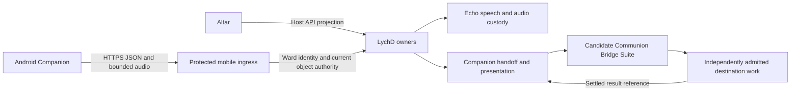

# :material-cellphone-sound: Companion Android Foundation

Build Companion first as a native Android Bridge and foreground voice client on the Samsung
S20 FE. Pair with the operator's LychD, record a short deliberate utterance, review its transcript,
submit the chosen words, and present the settled reply with optional speech. A folder-first music
player, selected photos, and explicit copy sync can grow from that foundation.

This candidate study, opened **2026-10-09**, develops the construction choices beside
[`companion.mobile` revision `3`](index.md). It accepts no successor Composition, Suite, remote
ingress, or phone execution contract. The priority is now Bridge and voice; [Phone
Workspace](phone-workspace.md) retains the broader everyday-phone direction. [State of
Work](../../state-of-the-work.md#composition-portfolio-delivery) owns delivery.

[Android Development](android-development.md) now describes the first implementation under
`clients/android/**`: a schema-derived Bridge fixture and bounded local recording/replay.
Pairing, live transport, transcription, synthesis, semantic event subscription and the native
handoff/result journey in this study remain future work.

## Language and frameworks

Keep **Kotlin and Jetpack Compose** for Android. Keep **Python and Litestar** on the host and
**Svelte 5 with static SvelteKit** for Altar. The clients share generated wire contracts and
compatibility fixtures; each owns its platform UI and interaction state. They reference the same
authorized host records rather than acquiring application authority through a shared client
library.

| Layer | Initial construction choice | Reason and boundary |
| --- | --- | --- |
| Android UI | Kotlin, Compose, Material 3 | Direct access to Android capture, lifecycle, credentials, storage, and media APIs. |
| Interaction state | ViewModel, coroutines, StateFlow | Explicit recording, review, submission, reconnect, and presentation transitions. |
| HTTP and events | Ktor client with one explicitly selected CIO engine candidate | Coroutine-based HTTPS uploads, JSON, and SSE; exact TLS/Keystore and lifecycle behavior must pass the handset probe. |
| Wire data | Generated Kotlin DTOs compatible with kotlinx.serialization | Host-owned schemas, with handwritten client orchestration and semantic validation around generated shapes. |
| Credentials | App-scoped Android Keystore | Device/application key custody; actual security level and invalidation behavior are device facts. |
| Capture | AudioRecord | Count samples and bytes, stop locally, and produce one bounded recording. |
| Reply playback | Media3 ExoPlayer in the foreground | Decode admitted speech artifacts; background music later adds MediaSessionService and its own controls. |
| Speech execution | Host Echo with the accepted audio.cpp candidate profile | The phone needs no inference runtime for the first journey. |
| Preferences | DataStore | Non-secret settings and selected host preferences. Add a database only when retained client records require one. |
| Build | Gradle Kotlin DSL and a pinned wrapper | One reproducible Android project under `clients/android/**`. |

[Compose setup](https://developer.android.com/develop/ui/compose/setup) supplies the native
project route. [Keystore](https://developer.android.com/privacy-and-security/keystore) protects
key material but does not guarantee StrongBox or hardware backing on every device. Credential
secrets must not become ordinary DataStore preferences.

The first implementation uses an Android `app` and a pure JVM `core` for SDK-independent wire
and interaction tests. Keep platform capture, playback and UI inside `app`; extract additional Gradle modules when a
second feature or app establishes the need. Android's [modularization
guide](https://developer.android.com/topic/modularization) supports sharing features across app
modules and also identifies the overhead of excessive subdivision. Avoid a speculative module
tree, dependency-injection framework, database, or plugin runtime before the first journey needs it.

### Alternatives and reopening conditions

| Alternative | Useful strength | Condition that would justify it here |
| --- | --- | --- |
| Flutter and Dart | Shared mobile UI with typed native integration through Pigeon/platform channels | Simultaneous Android and iOS delivery becomes a concrete requirement worth maintaining Dart and native integrations. |
| React Native and TypeScript | React UI plus typed native module specifications and Codegen | A real React mobile product or reusable React codebase establishes the benefit. Current Svelte screens supply no direct React reuse. |
| Kotlin Multiplatform | Shared Kotlin logic across clients | A second supported client needs an identified transport/state library. Android UI can remain Compose. |
| Direct OkHttp | Thin Android HTTP/SSE integration | Its publication lineage is verified and a matched transport probe establishes an advantage over Ktor. |
| Rust or C++ core | Portable native compute and established engines | A measured inference, DSP, integrity, or existing native-library requirement earns JNI/ABI packaging. |

The platform integration requirements are documented in [Flutter's
guide](https://docs.flutter.dev/platform-integration/platform-channels) and [React Native's native
module guide](https://reactnative.dev/docs/turbo-native-modules-introduction). Kotlin's [platform
table](https://kotlinlang.org/docs/multiplatform/supported-platforms.html), Ktor's [engines](https://ktor.io/docs/client-engines.html)
and [SSE client](https://ktor.io/docs/client-server-sent-events.html), and Android's [native
ABIs](https://developer.android.com/ndk/guides/abis) establish available mechanisms. The preference
for native Kotlin is a construction judgment for this Android-first workload, not a measured
battery, memory, or latency result.

Ktor earns its place through coroutine cancellation and its existing SSE plugin, independently of
any later Multiplatform extraction. Keep all Ktor artifacts on one reviewed version, select the
engine explicitly, and disable automatic reconnect until the retained-result recovery contract
passes. Keep private-content diagnostic buffering off. CIO supports Android and HTTP/1.x; an
HTTP/2 requirement or failed Android Keystore/TLS integration reopens the engine choice. Change
the engine through the same transport probe rather than weakening the credential contract.

The strongest cost is separate Android and Svelte presentation code. Shared schemas reduce wire
drift; they do not remove that UI work. A demonstrated second-platform requirement can reopen
the mobile sharing choice without reopening Altar's accepted architecture.

## Bridge and the host boundary

Companion reaches **LychD's protected API**, not the Altar browser process. Altar and Android are
two projections of host-owned work. Existing text Bridge behavior is useful evidence, but its
send operation immediately admits a Run. Companion submission instead settles an exact handoff
before the destination independently decides whether to admit work. Relabeling a Bridge response
would lose that distinction.

The host's current [Bridge controller](https://github.com/hexanomicon/lychd/blob/main/src/lychd/interface/web/bridge.py)
and [web contracts](https://github.com/hexanomicon/lychd/blob/main/src/lychd/domain/web/contracts.py)
provide session reads, `sendBridgeMessage`, Run snapshots, cancellation, and semantic events.
`MessageIntent` currently carries a request UUID and text prompt; it supplies no Companion device,
utterance, expiry, disclosure, or exact requested Pattern binding. Its request identity is not a
complete mobile authority or recovery contract.

The first product promising capture through an eventual answer needs a **named candidate
Suite**, with **Communion Bridge** as its proposed working name. Its construction design must coordinate:

1. Echo recording/transcription and the operator's reviewed words.
2. Companion's separately settled `submit_turn@1` handoff.
3. Independently admitted destination work, with exact Pattern and Invocation/Run correlation.
4. Aggregate wait, destination cancellation, interruption, expiry, and recovery.
5. A fresh authorized `present_result@1` against the exact settled destination reference.

The Suite identity and accepted score remain an owner decision before implementation. A smaller
fixture can prove separate submission and presentation against a typed handoff sink and a
pre-settled result. It must describe that smaller promise. [Utterance](utterance.md) and
[Return](return.md) own the accepted handoffs; the Suite does not move destination effects or
finish judgment into the phone.

### Pairing and authorization

Implement a separately admitted mobile ingress before a real LAN journey. The current
credential-gated loopback Altar must retain its existing boundary; neither forwarding it nor
copying its password provides remote identity. [Ward](../../sepulcher/extensions/ward.md) owns
enrollment, credentials, sessions, grants, and revocation; [Remote
IAM](../../state-of-the-work.md#remote-iam) records the missing execution seam.

A first pairing candidate uses a standard TLS client-certificate credential adapter with an
app-generated Keystore key for the initial single-operator owned-device fixture. An
operator-initiated, expiring enrollment offer conveys the expected host identity through a QR
or manually verified channel. Enrollment proves key possession and
binds the phone application separately from the initiating human. Ward resolves the credential
to a Principal and evaluates current object-scoped authority; a valid certificate alone grants
no application operations. Exact certificate issuance, rotation, revocation, host trust and
host-key replacement must be specified and tested before exposing the ingress. Use established
TLS/credential implementations rather than designing encryption or signing primitives.

This private profile proves the enrolled application key, not the identity of the human currently
holding the phone. Ward separately retains the initiating human, permitted acting-for relation,
and current grants; a certificate subject, QR possession, or phone unlock cannot create them.
For a product requiring human login, shared devices, account switching, or sign-in across Altar
and several apps, prefer a Ward-owned native OAuth authorization-code flow with PKCE through an
external browser and a reviewed [AppAuth implementation](https://github.com/openid/AppAuth-Android).
[Native OAuth guidance](https://www.rfc-editor.org/rfc/rfc8252.html) supports that flow; it does not
require OAuth for the private device fixture. The host issuer, audience, redirects, token
lifecycle, and browser-trusted HTTPS origin must exist first. QR trust installed in the app does
not establish browser trust. Device enrollment remains separate; DPoP or another sender constraint
needs its own admitted implementation and cannot be inferred from PKCE or Keystore use.

Complete enrollment before Familiar body admission, then use that admitted body for Companion
device/session admission. Pin credential and policy generations and the phone capability epoch.
Android permission and URI access add local checks; the target/platform matrix must also resolve
Android's [local network permission rules](https://developer.android.com/privacy-and-security/local-network-permission).

After admission, every protected read, stream, artifact download, submission and effect still
checks the requesting object and current authority. Revocation closes affected live access and
refuses new work. LAN discovery and later VPN reach may change addresses, but they do not change
these grants.

No provider, database, host-lifecycle, signing, or workflow secret belongs in the phone. APK signing,
device credentials, and a later Tether key have separate lifecycles. Reinstallation, key
invalidation, and restoration require explicit reconciliation or enrollment rather than a copied
credential backup.

## First voice profile

Use visible foreground push-to-talk and **record and send**. A proposed device fixture admits
mono PCM16 WAV at 16 kHz, at most 15 seconds and 512 KiB. Its maximum PCM payload is 480,000
bytes; the container also counts toward the byte ceiling. These are candidate fixture limits,
subject to capture and decoder verification on the exact S20 FE variant and installed OS.
[AudioRecord](https://developer.android.com/reference/android/media/AudioRecord) gives the app
sample reads; it does not itself supply the WAV file or lifecycle policy.

Stop capture on button release, local stop, permission loss, lock, or leaving the foreground.
Release the microphone and show failure if capture ends unexpectedly. The first path has no
background microphone service. Later service use must satisfy Android's [microphone foreground
service rules](https://developer.android.com/develop/background-work/services/fgs/service-types#microphone).

Upload the completed bounded file over authenticated HTTPS to the future host custody interface.
Validate actual codec, channels, rate, duration, bytes, digest, parser limits, retention, and
authority before transcription. Raw voice remains restricted and ephemeral by default, excluded
from logs, analytics, Graph checkpoints, queue bodies, and device backups. Offline material is an
expiring reviewable draft; reconnect never sends or executes it automatically.

[Echo](../../sepulcher/extensions/echo.md) already selects audio.cpp as the first local runtime,
Parakeet TDT 0.6B v3 as an Ear candidate, and Supertonic 3 as a Voice candidate. Upstream
[audio.cpp](https://github.com/0xShug0/audio.cpp) and the [Parakeet model
card](https://huggingface.co/nvidia/parakeet-tdt-0.6b-v3) declare Slovak and English support for the
relevant profiles. Declared languages still need the exact runtime/model bake. Parakeet's
automatic language detection does not prove a language-forcing parameter. Low-confidence or
uncertain words require review; recognition must never silently translate an utterance.

Show the transcript as an attributed draft. Edits retain their relation to the recognized words;
only explicit Send admits the final words. Always retain the authorized settled text result if
TTS fails. Optional speech uses a selected exact output language and voice, visible playback,
speech audio attributes, audio focus, and immediate local stop. Handle calls and focus loss under
Android's [audio focus rules](https://developer.android.com/media/optimize/audio-focus).
Use Media3 ExoPlayer for the admitted foreground reply. A later [music
service](https://developer.android.com/media/media3/session/background-playback) adds its own media
session and background lifecycle; speech and music retain separate operation and receipt state.

Capture stop, playback stop, Companion session cancellation, and Suite/destination cancellation
are distinct actions. Record offered, received, playback started, completed, interrupted, and
unknown separately. A playback callback is device-observed delivery evidence, not proof that a
person heard or understood the reply.

Android's [SpeechRecognizer](https://developer.android.com/reference/android/speech/SpeechRecognizer)
may use a remote service. Explicit on-device recognition requires platform and engine availability;
its API proves neither an open engine nor Slovak support on this phone. Platform TTS has similar
engine and network qualifications. The first host speech route therefore keeps the engine,
models, custody, and languages explicit.

Start with HTTPS upload/download and JSON/SSE for control and observation. Batch audio needs no
WebRTC or bidirectional socket. Response streaming can follow after capture closes. Full duplex
requires the separate timeline, echo cancellation, barge-in, turn ownership, and epoch fences in
[Audio](../../adr/37-audio.md#streaming-without-pretending-a-socket-is-a-protocol).

## API design coverage

The following is a **candidate operation inventory**, not an implemented route catalogue or
frozen wire schema. It covers the first batch journey and identifies each receiving owner.
Controller paths, operation IDs, concrete DTOs, error variants, and security metadata must be
closed in the owning backend contract before Kotlin generation. Companion has no universal
`execute`, shell, arbitrary Intent, or phone-admin operation.

| Operation group | Required request and result meaning | Receiving owner |
| --- | --- | --- |
| Contract and capability negotiation | Supported protocol/operation revisions, required features and server-owned limits; compatible profile or explicit refusal | Each receiving owner and protected ingress |
| Enrollment offer and redemption | Expected host identity, one-use expiring offer, key proof, application identity; exact credential and Principal references | Ward |
| Credential status, renewal and revocation | Exact credential transition/generation and revocation result; operator-authorized revocation distinct from local disconnect | Ward |
| Body and device admission | Exact capability snapshot/epoch, limits/stops, Ward references; Familiar body and Companion device records | Familiar, then Companion |
| Session open and close | Exact device/body, current grant, purpose, configuration, privacy and feature profile; session identity and settled closure | Companion |
| Audio upload and commit | Identified upload, actual bounded bytes, digest and validated audio facts, expiry/retention; immutable artifact reference or exact refusal | Echo and Reliquary custody |
| Transcription request and retrieval | Exact artifact, admitted Ear profile and language policy, attempt identity; attributed draft transcript, uncertainty, or failure | Echo |
| Reviewed turn submission | Exact reviewed Intent, requested Pattern, device/session/utterance, Principal, expiry, disclosure and correlation; idempotent settled handoff | Companion |
| Handoff lookup | Authorized utterance/request identity; settled handoff, exact absence, or refusal without resubmitting | Companion |
| Coordinated round trip | Handoff reference and destination admission; aggregate state, settled references, wait/cancel/recovery account | Candidate named Communion Suite |
| Destination observation | Exact authorized Invocation/Run; snapshot, retained result and bounded semantic events | Destination and existing host projection owners |
| Result presentation | Exact settled terminal reference, utterance/device, fresh authority, text/speech policy; presentation identity and receipt | Companion using Echo |
| Speech synthesis and download | Exact accepted words, Voice/language/profile, custody and expiry; audio artifact and scoped byte access | Echo and custody owner |
| Device delivery account | Presentation/attempt/artifact, local epoch and sequence, observed receipt/playback stages; accepted account or rejected stale report | Companion and Echo |
| Reconnect and event recovery | Object/account identity and acknowledged cursor; authoritative replacement or explicit capture gap | Each record owner |
| Material discard, deletion and export | Exact authorized material, retention and provenance; observed custody result separately from enrollment or destination cancellation | Custody and material owners |

Local recording controls require no server response to stop. Local disconnect releases connections
and capture; it does not invent server revocation or destination cancellation. A protected artifact
reference is not a bearer download URL. Capability reports describe observations, not permission
to execute a reported capability.

### Wire and recovery rules

Give each effectful candidate operation a stable request identity and canonical request hash.
Bind exact operation/version, target, expiry, current grant/credential/policy generations, and
correlation. The host must check declared generations against its own state before accepting
them as more than caller claims.

The first admitted terminal result wins. An identical duplicate returns the retained account;
changed payload under the same identity conflicts. Specify duplicate-in-flight behavior, retention
and replay horizon explicitly. If acknowledgement is lost, query the original identity before
proposing another attempt. Unknown remains unknown until reconciled, and reconnect alone neither
widens nor renews authority.

Saving an operation identity cannot atomically commit a Media3, Binder, filesystem, or external
app effect with its receipt. A crash between the two leaves an explicit reconciliation problem.
Prefer desired-state commands bound to an expected revision where possible; relative changes
such as append or next may remain unknown and must not be blindly replayed. Current observed
state can help reconcile without proving the full action history. An Intent launch reports the
launch/request observation, not another application's completed work.

Separate HTTP acceptance, handoff settlement, destination admission, destination completion,
synthesis, and device playback. Error contracts must distinguish malformed/oversized audio,
authentication failure, wrong object/audience, revocation, expiry, identity conflict, missing
capability, unavailable model/language, storage failure, overload, and unknown outcome. Specify
which failures permit retry and whether they require a new occurrence or reviewed request.
Transcribed words remain input data: they cannot install a Pattern, mint a Grant, change a
credential, or enlarge an effect's admitted scope.

Existing Altar [typed JSON and semantic SSE](../../adr/15-frontend.md#typed-json-and-semantic-sse)
provide the contract-generation route. The current exported schema has no Companion/Echo/Ward
mobile operations; its REST shapes also do not close broad event payload semantics. Publish
security requirements, all actual error responses, upload media types/limits, cursor headers,
pagination, and compatibility policy in the future schema. Keep runtime authorization tests
independent of schema generation, since the existing schema exporter does not run middleware.

Seed the Android event reducer from an authoritative snapshot. For each event, validate schema
version, account/host/object identity, event ID, sequence, kind, and every consumed payload. Ignore
duplicates; a gap or `resync` requires a bounded authoritative refetch.

Fence late responses after logout, host/account switch, revocation, teardown, or local generation
change. Retained results take precedence over incomplete token streams. The SSE socket being
connected proves neither current authority nor durable event retention. Bound queues, event
bytes, concurrent streams, backoff, and request deadlines. After ordinary Android background
suspension, recover from a snapshot on return.

The [OpenAPI Kotlin generator](https://openapi-generator.tech/docs/generators/kotlin/) is a
candidate mechanism, with documented limitations around nulls and composite schemas. A bootstrap
probe must generate a small DTO slice from the exact OpenAPI 3.1 schema and prove absent versus
null fields, enums, discriminators/unions, identifiers, timestamps, errors, and event fixtures
against Python and TypeScript. Pin the successful generator/version/configuration; do not treat
generated code as policy or handwrite a competing transport schema when a generator fails.

## Growing into phone capabilities and more apps

Use the same explicit operation layer from local controls and later authorized agent requests.
Each capability declares its owner, operation revision, Android permission/role, target type,
limits, foreground/background eligibility, expiry, stop/refusal behavior, and observed result.
Local handlers recheck Android access immediately before the effect. Runtime capability data
enables an admitted implementation; it never supplies executable code or new authority.

| Extension form | Construction and authority boundary |
| --- | --- |
| Companion feature | Compile Kotlin/Android code into an operator-built APK; reuse tested transport, UI and platform adapters. |
| Additional owned Android app | Reuse Gradle library modules; give the app its own package, signing/enrollment identity and permissions. Expose only required explicit Intents, content providers, or Binder APIs with caller checks. |
| Host LychD package | Use the selected native Python Contribution surface and receiving owner in [Extensions](../../adr/05-extensions.md); activation follows that host lifecycle. |
| External engine or service | Bind a typed provider/connector contract with its own deployment, license and lifecycle. |

This gives agents a practical development path: change source, build and test a candidate, inspect
the changed permissions and contract, produce a signed APK, then install an authorized release.
New features arrive through that versioned path. Android's [dynamic-code
guidance](https://developer.android.com/privacy-and-security/risks/dynamic-code-loading) favors
including functionality in the application; the first design has no remotely loaded executable
plugin mechanism.

Ordinary apps remain within Android's [application
sandbox](https://source.android.com/docs/security/app-sandbox). Selected file/photo access,
media control, sharing, and deliberate camera use are useful admitted capabilities. A later
launcher or default assistant can request an available qualified [Android
role](https://developer.android.com/reference/android/app/role/RoleManager); that role has its
own privileges and revocation, rather than universal access to other apps' private data.
Fully managed device administration has a separate [provisioning
path](https://developer.android.com/work/dpc/dedicated-devices), including device reset in the
documented production route. It does not enter the existing-phone milestone. Deeper system
ownership remains a separate device/OS undertaking.

After Bridge and voice, add Media3 background music with folder-first SAF access, then selected
photos and verified copy sync. Keep those local features useful without a host. A persistent media
index or effect journal can earn Room and explicit migrations; recoverable transfers can earn
WorkManager with current grants and Android execution limits. The broader media/transfer domain
ownership must pass [Choosing a Home](../choosing-a-home.md) before remote effects are accepted.

## Source visibility and release ownership

Maintain separate entries for app source, dependencies/transitives, SDK tools, engine code,
model/voice weights, platform services, and handset firmware. More open components are preferred;
one open layer cannot establish freedom or source availability for another. The wider owned
technology map stays above Companion in [Atlas](../../divination/altar/technology-map.md).

Kotlin is [Apache-2.0](https://kotlinlang.org/docs/faq.html); Android SDK distribution has
[separate terms](https://developer.android.com/studio/terms), with open-source components retaining
their applicable licenses. audio.cpp's [runtime license](https://github.com/0xShug0/audio.cpp/blob/main/LICENSE)
is Apache-2.0, and Parakeet's model card specifies CC-BY-4.0. Supertonic 3's [weight
license](https://huggingface.co/Supertone/supertonic-3/blob/main/LICENSE) is OpenRAIL-M with use
restrictions. The complete candidate speech stack must not be described as unrestricted FOSS.
Voice-model promotion must account for those terms; watched alternatives remain explicit owner
decisions rather than automatic fallback engines.

Pin AGP with its supported Gradle/JDK combination, min/target/compile SDK, the actual Kotlin
compiler, Compose/serialization compiler plugins, and exact library versions. AGP 9+ has
[built-in Kotlin](https://developer.android.com/build/migrate-to-built-in-kotlin); avoid applying
another Kotlin Android plugin to the same module. A Compose BOM coordinates Compose artifacts,
not every AndroidX dependency. Commit reviewed dependency locks and verification metadata;
catalogues and first-generated checksums alone do not establish provenance. The OkHttp repository
lookup redirected to another organization during this research, so exact publication lineage
must be resolved before reconsidering that artifact. Ktor/CIO still requires reviewed artifact
provenance and the same bounded transport and device-key probe before admission.

Before durable use, choose a stable application ID and versioning scheme. The operator/project
controls the [release signing key](https://developer.android.com/studio/publish/app-signing),
backed up outside the checkout and kept separate from device credentials. Prove how that identity
survives signed upgrades, data migration, key invalidation, and reinstall/re-enrollment.

Recovery also needs API-appropriate cloud-backup and device-transfer extraction exclusions,
excluded custody for sensitive material where applicable, and restore reconciliation tests. Android's [backup
guidance](https://developer.android.com/identity/data/autobackup) explains that `allowBackup=false`
alone can still permit OEM device transfers on API 31+. Android
[PackageInstaller](https://developer.android.com/reference/android/content/pm/PackageInstaller)
can require user action; ordinary app evolution must not promise silent installation.

## Construction sequence and acceptance

| Milestone | Smallest useful result | Required evidence |
| --- | --- | --- |
| Build and contract probe | Installable Compose shell, generated DTO fixtures, fake host and explicit transport states | Compatible locked toolchain, serializer/error/event tests, own APK identity/signing plan. |
| Protected handoff and presentation fixture | Paired device, reviewed text, settled handoff lookup and pre-settled presentation | Host trust, scoped Ward identity, revocation, object guessing refusal, expiry and lost-ack recovery. |
| Foreground speech fixture | Bounded capture, host transcription, reviewed Send, optional authorized reply playback | Exact handset capture, byte custody/limits, language bake, local stops, denied/revoked permission, lock/calls and TTS failure with text retained. |
| Live Communion product | Exact destination admission and eventual result under the named Suite | Accepted score, durable aggregate correlation, separate cancellation scopes, interruption and unknown-outcome recovery. |
| Local and admitted phone features | Folder-first player, then selected photos and copy sync | Media/controller behavior, retained/revoked URI access, no duplicate effect after reconnect, integrity/conflict/storage/migration tests. |
| Later VPN reach | Same protected application journey over another route | Existing identities, scopes and refusals remain effective when the address changes. |

The requested first useful **Bridge and Voice release includes the live Communion milestone**.
The shell, handoff fixture, and speech fixture are intermediate proofs; a pre-settled response
cannot establish a working conversational round trip.

The physical acceptance record names S20 FE model variant, Android/API level, firmware/build,
available storage and actual audio route. Emulator and Compose tests cover interaction/state;
physical tests establish Samsung lifecycle, headset and locked-device behavior. Host fixtures
remain distinct from a real admitted speech-runtime bake.

Before the LAN or speech milestones, the owning backend contracts must close mobile ingress,
Ward identity, audio byte custody, the exact audio.cpp batch dialect and cancellation behavior,
Companion native execution, and the chosen round-trip promise. A documentation design cannot
make these missing prerequisites executable. [Audio
admission](../../state-of-the-work.md#audio-admission) and [Remote
IAM](../../state-of-the-work.md#remote-iam) retain that boundary.

[Companion](index.md) · [Phone Workspace](phone-workspace.md) · [Utterance](utterance.md) · [Return](return.md)
