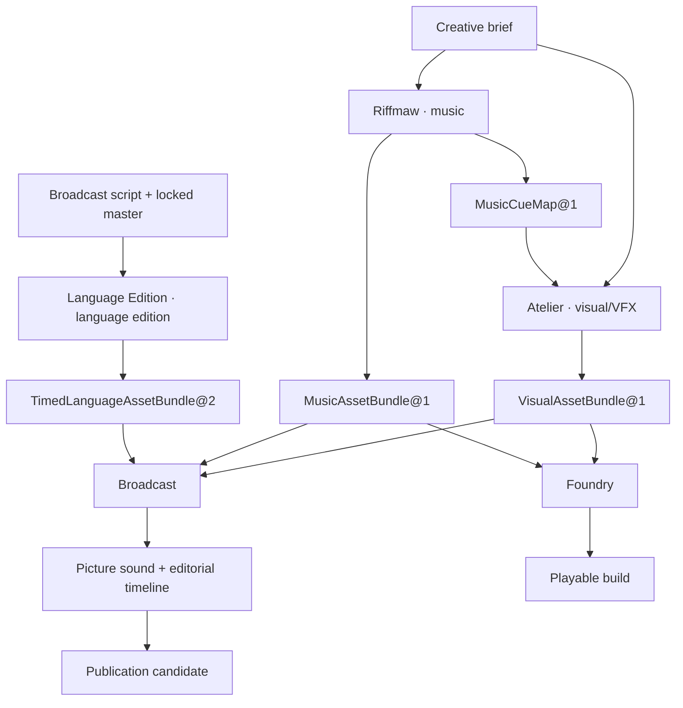

# :material-vector-link: Products and Suites

An editor can assemble a film from visual, music, and language bundles that already exist. A different promise—commission changes in all three and deliver one jointly settled result—must coordinate their live work. The distinction is whether the application receives finished contributions or must coordinate work still in progress.

A **Product** is the promise an operator chooses. It names the profession or market it serves,
the supported jobs, defaults, and support envelope. Its exact revision pins the eligible
Compositions or Suites, their owner-qualified profiles, and the projections through which the
operator meets them.

A **Suite** takes responsibility for the live coordination that a joint result needs. It has its
own authority-qualified identity, revision, and exact coordination Pattern/Scroll. Casting that
score opens a parent Invocation/Run; each participating Composition keeps a separate Invocation
and Run. A direct Intent can cast the Suite without a Product, and several Products may pin the
same eligible Suite.

## From promise to one execution

| Term | Meaning |
| --- | --- |
| Product-supported use case | a class of operator job |
| Deployment | one configured Product or Composition-reference-profile context for an operator |
| Composition Pattern, or Suite-owned coordination Pattern across several | reusable technical realization |
| Invocation | one admitted Circle for requested work |
| Run | the durable execution and ledger identity representing that Invocation |

The coordination contract must say which members and Patterns take part, what typed
ArtifactRef/Intent handoffs they exchange, how their work is correlated, and which aggregate
ceilings and partial-completion rules govern the result. Each member keeps its records, judgment,
policy, consent, secrets, Sigils, credentials, provider grants, and effects. The Product packages
the promise; it acquires neither an executor's nor a scheduler's office.

## Compositions relate without nesting

[Areas](index.md#areas) group Compositions for discovery. A Suite may coordinate members within
one Area or across several; neither shared membership nor crossing a thematic boundary implies
live coordination. For example, a cultivation plan and a physical task could involve Cultivator
from Stewardship & Acquisition and Familiar from Presence & Embodiment. A promise to initiate,
await, and settle both Invocations needs a Suite; passing a settled plan alone does not. Each
member retains its own judgment and effect authority.

Replace a broad `depends_on: composition` edge with the actual relation:

| Relation | Consequence |
| --- | --- |
| Co-packaging | Several capabilities share a Product; no Suite follows. |
| Settled typed reference | Exact record, artifact, observation, receipt, or binding enters as input; no Suite follows. |
| External precondition/reference | A foreign binding, capability, or policy is required but its lifecycle remains outside consumer control; no Suite follows. |
| Live coordination | One result must initiate/admit, await, retry, cancel, recover, correlate, or settle several owners' Invocations; a Suite is required. |

References supply no installation, availability, upgrade, lifecycle, credential, admission, ambient database, or effect authority.

### Avatar and Spectre

Spectre can admit a generic VR Habitat/Encounter without Avatar. Meeting the Lich may require an exact already admitted `ProjectionBinding@2` as an external precondition. Its binding may still be live, but Spectre cannot create, revise, close, await, cancel, or recover it. Attributed results can later cross without a circular dependency.

A promise to admit a new projection, open the Encounter, await their attributed results, cancel both when required, and report partial completion needs a Suite. A Product may package that promise, not create its authority.

### Companion and Familiar

Companion requires an exact Familiar-backed device, while Familiar retains capability, safety, and stop law. Opening the mobile session needs no Suite. Coordinating its conversation with a Familiar mission or real-world effect does.

### Workshop and Scavenger

Proposed Mechanic packages Workshop's passenger-vehicle service profile. A settled part requirement can enter Scavenger without moving diagnosis or seller authority. Joint diagnostic/acquisition cancellation, ceilings, recovery, and partial settlement require a Suite that a later Product may pin.

### Homestead, Keeper, and Cultivator

[Keeper](keeper/index.md) can record a colony in a manually tended test tube, and [Cultivator](cultivator/index.md) can follow a plant without a connected sensor. [Homestead](homestead/index.md) owns physical site assets, resources, stores, provision, and commissioned controls when used. Each care owner retains the subject, placement, life history, needs, and biological interpretation. A shared enclosure can have both Keeper and Cultivator placements referencing one Homestead asset; owning the heater does not decide either occupant's needs.

An exact `KeeperSupplyNeed@1` or `CultivatorSupplyNeed@1` can enter Homestead provision; an attributed yield can later enter stores. An admitted environment requirement can receive a `HomesteadEnvironmentResult@1` in separate work. These settled references need no Suite, and technical success does not settle biological care. A common household Product or dashboard also needs no Suite merely to show the three owners together.

“Prepare care during my absence” needs a Suite when it promises to start care-planning Invocations, await household supply and environment work, and recover or cancel them as one result. Before casting that path, publish its own revision with exact member Patterns, handoffs, deadlines, aggregate ceilings, conflict policy, cancellation, and partial settlement. This example accepts no Suite identity or executable absence workflow.

The joint result must preserve what each member actually did. A refused water allocation leaves the dependent tending plan blocked; a completed purchase remains committed when another member fails. The parent cannot cancel local life-support protection or erase a member's unknown physical effect to declare the household ready.

### Atelier, Riffmaw, Language Edition, and Broadcast

A broader **Atelier studio** is proposed as one workspace for music, visuals, and their shared
timeline. This operator experience is distinct from the accepted visual Composition
`atelier.studio` revision `5`; this example publishes no studio Product or Suite revision.
Riffmaw remains independently usable for musical work and live jam.

A transient audition can present the parts together without accepting their final relation.
Authoritative editorial cuts, timing, selected asset revisions, and audiovisual acceptance belong
to [Broadcast](broadcast/edit.md), even when its finished candidate stays local. Atelier retains
visual judgment, Riffmaw musical judgment, and Language Edition its aligned language contribution.
The shared controls project those records and their declared timebase relations.

A joint audio/video generator performs one technical attempt with shared provenance and
attributable cost. Declared role owners admit their facets without requiring duplicate generation
or separate screens. Separable accepted facets may remain usable within their admitted limits;
refusal of a required inseparable facet blocks the compound use. A missing effect acknowledgement
remains unknown and must be reconciled before another attempt.

Changing a drop's position within the musical work creates successor music and cue revisions.
Moving unchanged music on Broadcast's timeline instead revises the editorial arrangement without
changing Riffmaw's master. Timing changes stale dependent synchronization approvals; changes to
source revisions, consent, or use boundaries still follow each owner's invalidation rules. The
earlier pairing remains attributable history, with no guarantee that its approval is still valid.
A Suite coordinates changes, dependencies, cancellation, and partial completion when the result
coordinates multiple owners' live Invocations. A shared timeline or compound model alone requires
no Suite.

Language Edition can use a settled Broadcast script/locked master, Atelier visual reference, and
Riffmaw music master without live coordination. Broadcast can later admit the settled language
bundle in another Invocation. The diagram follows those contributions into their target work.

Each arrow can remain a settled reference. A compound video model does not create a Suite; independent semantic owners must admit its facets. [Workflow](../adr/28-workflow.md#compositions-products-suites-and-schedules) owns the Suite execution contract; [State](../state-of-the-work.md#composition-portfolio-delivery) records delivery.

Generating material during play still needs [Foundry's target-use admission](foundry/assets.md).
Live hotload requires a future activation and recovery contract. A persistent artistic project
whose identity, shared direction, selections, and undo span music, film, and games also needs an
explicit ownership decision. Product packaging and Suite coordination supply neither lifecycle.

## Deployment and projection are different axes

A deployment profile is an immutable eligible topology/configuration template. A **Deployment**
instantiates an exact Product revision or Composition-owned reference profile for an operator,
with actual hosts, bindings, credentials, and policy. A Productless reference creates no market
promise, supported-use-case catalogue, or support envelope. A separately configured installation
for another host or customer ordinarily creates another Deployment; enrolling another User or
changing their credentials does not by itself create one.

[IAM](../adr/38-iam.md#people-accounts-and-instances) keeps people, accounts, and instances distinct.
Personal, family, and organizational use may share the same application contracts. For example, a
parent may administer a household instance used by relatives through clients, while also using a
personal instance and an employer's instance. A company may use one shared instance or several
separately governed instances. These examples impose neither a mandatory organization hierarchy
nor automatic cross-instance trust.

Three kinds of projection answer different questions. The **domain projection** is the owner's
read model: what the application makes available to inspect. The **client projection** presents
it on a platform and keeps bounded local state. A **public projection** explains or depicts it
through a website, screenshot, report, or other account. Client and public presentations do not
acquire application authority, and a new interface supplies no delivery evidence.

Different Users may receive different client projections of the same application and even the
same work. A worker might see a fault-report form, a maintainer a diagnostic view, and an approver
a bounded decision screen. An assigned working profile may bundle those presentation choices with
access assignments, but Ward decides actual permission and the application retains its records,
judgment, and effects. A distinct screen neither creates a new Composition nor rewrites its
workflow. These are [profile and interface requirements](../adr/38-iam.md#profiles-and-working-interfaces),
not a shipped industrial application or profile selector.

## Commercial catalogues and open-source Products

Commercial catalogues may live outside LychD and reference exact public revisions. Their websites own presentation; private Product truth stays outside technical docs. LychD may link rather than copy it.

To establish an open-source Product reference, pin the exact Product/use-case and Composition/Suite/profile revisions. Account for code licence/notices and the separate model, data, fixture, font, screenshot, mark, and redistribution rights. The reference also needs reproducible installation/acceptance, State evidence, and an honest account of externally supplied dependencies; source alone is insufficient.

If necessary weights, corpora, providers, or assets cannot be redistributed, describe “open-source Product code with externally supplied dependencies,” not an unqualified FOSS Product. State must record the evidence before it becomes a technical reference. This page creates no catalogue or selector.

[Choosing a Home](choosing-a-home.md) · [Workflow](../adr/28-workflow.md#compositions-products-suites-and-schedules) · [State of Work](../state-of-the-work.md#composition-portfolio-delivery)
