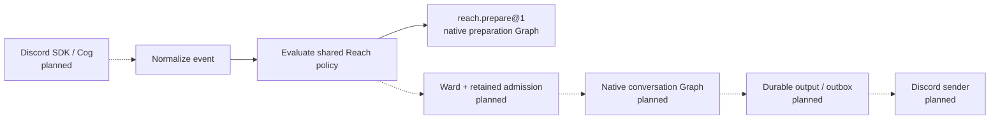

# Reach preparation architecture

A message from an external place should enter Reach through one bounded application request.
The platform adapter supplies attributed event data; Reach keeps the policy and workflow that
decide whether the request may proceed. This preparation foundation makes the boundary executable
before a live bot is connected.

The separate **`reach.prepare@1`** profile validates configuration, normalizes a synthetic event,
and evaluates its admission policy. It does not revise **`reach.discord@1`** or deliver the
conversation promised by **`reach.external_converse@1`**. The accepted [Habitat](habitat.md) and
[Turn](turn.md) keep their existing meaning; [State of Work](../../state-of-the-work.md#composition-portfolio-delivery)
owns the shared implementation evidence.

The later **[`reach.connect.prepare@1`](connected-work/preparation.md)** profile prepares bounded
provider requests for email, chat, forge and social targets. It keeps the same explicit native
Graph boundary while remaining separate from ingress normalization and connected delivery.

The [operator development profile](operator.md) now implements a separate explicit edge and
native documents worker. Its generation-local memory, source excerpts and local administration
do not supply the public contract's durable conversation, Ward or deployment acceptance.

## Keep Reach independent of the platform

Reach's core vocabulary is **platform, account, space, conversation, subject, groups**, and
the triggers **mention** or **command**. Identifiers remain namespaced by platform and account;
matching strings or display names across services establish no shared identity or authority.
The Discord configuration can retain familiar application, guild, channel, user and role names;
its adapter compiles them into the shared policy before evaluation.

| Reach concept | Discord binding |
| --- | --- |
| Platform | Discord provider identity. |
| Account | The configured application ID. |
| Agent subject | The bot user's stable ID. |
| Space | Guild. |
| Conversation | The allowed channel in this preparation profile. |
| Subject | The triggering user's stable ID. |
| Groups | The triggering member's role IDs. |
| Trigger | Direct mention becomes `mention`; a slash command becomes `command`. |

Discord snowflake validation belongs at that provider boundary. A future Telegram or WhatsApp
adapter will bring its own identifiers, audience semantics and provider constraints. The generic
vocabulary supplies no live adapter, account access or eligibility for either service. It avoids
making their eventual implementation depend on a Discord SDK or renaming all conversations as
channels.

Shared identifiers are bounded opaque strings. A missing enclosing space means exactly no
space, never a wildcard. The same preparation Graph is exercised with two platforms' synthetic
identifier shapes, without importing either provider's SDK.

## Keep transport at the edge

The planned Discord adapter uses an outbound Gateway for message events, direct mentions and
slash-command interactions. This road needs no public callback, Interactions Endpoint URL, or
new listening port. A future HTTP interactions profile would need its own verified ingress and
would not replace Gateway reception of ordinary message events.
[Discord interaction delivery](https://docs.discord.com/developers/interactions/receiving-and-responding)

Solid edges describe the offline preparation path. Dashed edges require later integration and
acceptance. Tests supply synthetic wire observations to the normalizers; the CLI fixture is
already normalized. Neither supplies Discord-authenticated identity. The preparation Graph
produces an eligibility result, not an answer or a delivery.

A Cog groups Discord listeners and command callbacks. An extension installs those handlers.
Handlers normalize SDK values into Reach-owned data, acknowledge interactions,
invoke the application boundary and format an admitted result for delivery. Reach keeps policy,
context selection and application judgment outside Cogs. Ward retains identity and grants;
native Graph and Run machinery retain execution. The future credential owner sends only the
exact committed output. [Cogs](https://discordpy.readthedocs.io/en/stable/ext/commands/cogs.html)
and [extensions](https://discordpy.readthedocs.io/en/stable/ext/commands/extensions.html)
provide the transport organization.

## Admit an explicit policy

The strict TOML-backed Discord configuration uses schema version `1`. It binds one application,
bot user and guild; an allowed channel set; mention/slash triggers; ordered rules; question and
event-age limits; and explicit context bounds. It compiles into the platform-neutral preparation
policy. Discord identifiers are decimal unsigned 64-bit strings. Display names, tags and rule
labels confer no authority. Unknown configuration or unsupported actions refuse rather than
silently becoming a broader default.

Each Discord rule has a label, user IDs, role IDs and allowed actions. A rule matches a user ID
**or** one of the event's role IDs. The first matching rule owns the decision: if its actions
omit the requested action, admission is denied without looking for a more permissive later rule.
The action names `answer_docs` and `summarize_context` describe requested work; preparation
executes neither action.

The shared evaluator checks platform, account, agent subject, space, allowed conversation,
trigger, event freshness and question length. A rule cannot waive those checks. Passing them
admits only this preparation request. A supplied group is platform evidence for a later authenticated adapter, not a Principal,
Sigil, private-record entitlement, or consent.

Pure ingress normalizers and policy evaluation run before creating any Intent. The explicit
factory
`lychd.compositions.reach.workflow.reach_preparation_workflow(policy, *, clock, record_result)`
builds the native preparation Graph. It revalidates and pins the policy and event at that boundary;
its guest execution receives empty scopes. `record_result` is a supplied result sink, not a
durable application ledger. The profile has no default registry or startup installation.

The [preparation tutorial](preparation.md) exercises this contract through
`scripts/reach_prepare.py`, `examples/reach/policy.toml` and `examples/reach/event.json`.
The helper validates and previews without authentication, Gateway connection, command
registration, cognition or sending. It does not log the question. No bot credential, Ward mapping,
retrieval service, history fetch, retained application turn, outbox or delivery enters this slice.

## Choose the later Discord transport

Use **discord.py 2.7.1** as the provisional live-edge choice, with `app_commands` and thin
Cogs/extensions. This choice follows the immediate mention/command requirement and the concrete
later voice path. The comparison was checked against primary sources on **2026-10-27**.
The offline preparation foundation contains first-party payload normalization and imports no
SDK. The separate operator edge pins this SDK in its own environment; development checks also
install it to exercise the transport contract. Normal Vessel assembly does not start the edge.

| Candidate | Strongest case | Cost and fit |
| --- | --- | --- |
| [discord.py 2.7.1](https://pypi.org/project/discord.py/), released 2026-03-03; `Python >=3.8` | Events, built-in application commands and Cogs/extensions cover the immediate adapter in one library; version 2.7 adds DAVE voice connections. | Provisional default for a small listener/command edge. Keep its objects, caches and callbacks outside Reach policy and Graph state. Python 3.15 remains unqualified. |
| [Hikari 2.6.0](https://pypi.org/project/hikari/) + [Lightbulb 3.2.6](https://pypi.org/project/hikari-lightbulb/), both released 2026-08-19; both `Python >=3.10.0,<3.15` | Typed REST/Gateway transport with separate command handling, loaders, hooks and dependency injection. Python 3.14 is explicitly supported. | A valid option when those mechanisms simplify the actual edge. It introduces a separate command framework; its Python upper bound does not disqualify an isolated 3.14 adapter. |
| First-party HTTP + Gateway client | Exact control over received payloads, retention and request formation, without an SDK object model. | LychD must implement and maintain the provider lifecycle and rate limiter. The current raw-payload normalizers do not supply that live client. Prefer an SDK unless a concrete unmet transport requirement justifies this work. |

Hikari's [GatewayBot](https://docs.hikari-py.dev/en/stable/reference/hikari/impl/gateway_bot/)
exposes explicit startup/close and session-limit controls; its default startup update check must
be disabled when the adapter's egress contract does not admit a PyPI request.
Lightbulb's [dependency injection](https://hikari-lightbulb.readthedocs.io/en/latest/by-examples/050_dependencies.html)
can supply a narrow Reach port to handlers. Those are useful adapter mechanisms, without making
Lightbulb the owner of application state or authority.

An independent Discord edge may run its own qualified **Python 3.14** environment and lockfile.
It passes typed, serializable Reach requests across the admitted deployment boundary; bot
credentials and SDK objects stay with the edge. Core need not downgrade its interpreter or import
the SDK. This process separation still requires explicit route, identity, custody and lifecycle
acceptance under the selected deployment profile. No such live edge ships with preparation.

Both SDK choices require dependency resolution and focused startup, event, command and shutdown
tests on the selected interpreter. Package metadata without an upper bound does not qualify
Python 3.15. Prefer Hikari if a bounded adapter comparison demonstrates a simpler correct boundary
or a verified capability requirement changes the fit; release recency alone establishes neither.

### What a raw client would own

A raw Gateway client owns Hello/heartbeat scheduling, jitter and ACK failure, sequence/session/
resume-URL state, close-code decisions, invalid sessions and Identify quotas. Resume can fail;
reconnection must expose gaps. These transport duties apply independently of Reach's durable
event admission. [Gateway lifecycle](https://docs.discord.com/developers/events/gateway)

Its HTTP layer must respect dynamic route buckets, major-resource partitions, global limits and
`Retry-After`; fixed guessed limits are insufficient.
[Discord rate limits](https://docs.discord.com/developers/topics/rate-limits)
Interactions require an initial response or deferral within **three seconds**; follow-up tokens
last **15 minutes**. A handler must acknowledge before waiting on cognition or durable execution.
[Interaction responses](https://docs.discord.com/developers/interactions/receiving-and-responding)

An SDK reduces this provider-protocol work. Neither SDK supplies LychD's durable admission,
application deduplication, Ward decisions, outbox or unknown-effect reconciliation. The integration
must also inspect SDK retries and timeouts so an ambiguous send cannot silently become a new
application effect.

## Expand context and media through separate gates

`context_message_limit = 0` disables surrounding history. Positive limits are configuration bounds
for later work, not evidence of a fetcher. Enabling history requires explicit operator policy,
bounded count and age, channel access, `Read Message History`, and the privileged Message Content
intent for surrounding guild content. The current preparation requests none of that access.
Checking a triggering member's roles does not by itself require privileged member-list or
presence intents. [Message Content intent](https://docs.discord.com/developers/events/gateway#message-content-intent)
and [member-cache behavior](https://discordpy.readthedocs.io/en/stable/intents.html#member-cache)
remain provider constraints.

Voice and video remain separate future capabilities. discord.py's
[2.7 changelog](https://discordpy.readthedocs.io/en/stable/whats_new.html#v2-7-0)
records DAVE support for voice connections. That does not qualify audio reception, transcription,
video, native dependency availability, or LychD's custody and privacy policy. Media should enter
through typed, bounded capabilities without moving cognition into a Cog.

## Acceptance before deployment

The next live slice must prove the complete path, including refusal and interrupted effects:

- Gateway authentication, reconnect/resume and explicit gaps; durable event identity and deduplication.
- Retained admission, Ward mapping, current grants and revocation; guest/public restrictions.
- An admitted corpus, bounded retrieval, source-backed answers and validated citations.
- Current payload-bound egress admission before any remote model or specialist call.
- Durable application turns and an outbox that binds exact targets and bytes; reconciliation of
  unknown sends without blind replay.
- Explicit startup, shutdown and cancellation ownership across the transport and native workflow.

Only that integrated evidence can qualify a live deployment. The [deployment profiles](deployments/index.md)
retain placement, credential custody and recovery; installing an application in a guild does not
establish those guarantees.

[Prepare Reachy](preparation.md) · [Reach](index.md)
