# :material-message-arrow-right-outline: Connected work study

A client sends an email, a collaborator asks about an issue, and someone mentions the bot in a
Discord channel. Reach should be able to answer each in its own place, from the right account,
without carrying one customer's words or authority into another conversation.

This **candidate successor study**, researched **2026-10-21**, proposes native Gmail, Discord,
and GitHub connections, with an optional later [WhatsApp profile](whatsapp.md). It does not widen
the accepted [`reach.discord` revision `1`](../index.md),
its public-only deployment profiles, or their permissions. [State of Work](../../../state-of-the-work.md#composition-portfolio-delivery)
owns the implementation boundary.

The explicit [connected preparation profile](preparation.md), added **2026-10-29**, makes bounded
email, chat, forge and social request preparation executable without account access or delivery.
It adds Fastmail, Telegram and public social-post preparation alongside the initial providers,
with [account and advertising distinctions](social.md). Its finite WUPHF plan does not activate
the operational successor or supply its missing durable delivery machinery.

Browse the provider contracts by family: [Email](../email.md), [Chat](../chat.md),
[Forge](../forge.md) and [Social](../social.md). Those routes distinguish current request preparation
from each provider's proposed connected operation without creating separate application owners.

## Contract and ownership

The proposed identity is **`reach.correspondence` revision `1`**. Private correspondence, proactive
outbound messages, and preauthorized delivery materially change the old authority boundary;
silently adding them to `reach.discord@1` would reinterpret its contract. Acceptance would record
the successor relation explicitly under [Workflow's revision law](../../../adr/28-workflow.md#composition-identity-revision-and-retirement).
Historical Discord records retain their original meaning; there is no executable migration yet.

One Composition would own bounded correspondence across provider profiles. Providers vary
transport, audience, identity evidence, limits, and recovery. They do not each need an
application with a duplicate policy engine. Their adapters use native APIs behind typed host
ports; MCP is an optional future projection, not an execution dependency.

Reach owns connection configuration. It would decide which configured connection and admitted conversation a communication belongs
to, judge its audience and disclosure, and retain the proposal, delivery intent and result. It uses
the existing owners to carry out that work: Ward retains Principal, account linking, current grants
and revocation; HitL retains review/preauthorization; Spellweaver retains Patterns and admission;
and Workers retain jobs. The credential owner holds provider secrets and transport attempts.
A local result must still defer to provider records for the provider's external state.

Mail transport does not acquire accounting, client-case, publication, or software-change judgment.
Another Composition may submit an exact accepted artifact and a communication request. Coordinating
several live application Invocations requires a [Suite](../../products-and-suites.md#compositions-relate-without-nesting).
Forwarding between places is a new disclosure and delivery, never continuity inferred from matching
names, a common account owner, or one model.

## Three first journeys

| Profile | Input and bounded result | Initial stopping line |
| --- | --- | --- |
| [Gmail](gmail.md) | Search/read selected mail, propose or save a reply, send under exact review or standing policy; optionally apply admitted reversible labels/read/archive changes. | No mailbox settings, forwarding rules, permanent deletion, attachments, bulk campaigns, Calendar or Drive authority. |
| [Discord](discord.md) | A slash command or direct bot mention produces one bounded answer in an allowed channel. | No ambient surveillance, DMs, moderation, voice, attachments, or ordinary-user automation. |
| [GitHub](github.md) | Read admitted issue/PR conversations and propose or post timeline comments. | No code execution, code writes, formal approving reviews, merges, releases, workflows, checks or statuses. |

[WhatsApp](whatsapp.md) is an optional next channel with a different webhook deployment and
business/AI eligibility gates. Its limited-rollout owner–agent chat is a separate probe. Neither
route implies access to existing personal chats; the first three journeys do not depend on it.

An operator-originated message uses the same preparation and delivery path as a reply. Background
triage and follow-up enter through finite, deduplicated Schedule Occurrences, not a permanently
running model loop or a second application scheduler.

## Proposed records and Patterns

These names define application-local design contracts, not existing Python types or new Core stores.

| Record | Required meaning |
| --- | --- |
| `ReachConnection@1` | Local owner/partition; provider and immutable external account/application/installation ids; exact adapter/profile revision; credential reference and custody owner; granted provider scopes; local policy and revocation generation; lifecycle and last successful observation. An email address or login name is a mutable display field. |
| `ReachConversationRef@1` | Connection plus exact mailbox/thread, guild/channel/thread, host/repository/issue-or-PR, or qualified WhatsApp business-phone/recipient identity; audience and visibility evidence with observation time. No cross-connection identity merge. |
| `ReachEventAdmission@1` | Provider provenance and assurance, event/object identity and version, bounded payload reference/digest, partition, dedupe key, observation/cursor and admission outcome. Duplicate delivery and a later edit are different cases. |
| `ReachCommunication@1` | Purpose, caller, conversation/source references, pinned Pattern/Persona/Context, proposed sender/recipients/body, disclosure evidence, exact preparation digest, expiry, and formation outcome. Provider drafts are observations, not approved immutable preparations. |
| `ReachDeliveryIntent@1` | One immutable destination, actor mode, complete wire-payload digest, communication revision, effect identity, policy/Consent or preauthorization binding, and attempt/fence identity. |
| `ReachDeliveryReceipt@1` | Observed provider id/URL, attempt, payload binding, accepted/rejected/unknown outcome and reconciliation evidence. Provider acceptance does not prove reading, final email delivery, or agreement. |

The candidate catalogue is `reach.inspect_correspondence@1`, `reach.prepare_communication@1`,
`reach.deliver_communication@1`, `reach.reconcile_delivery@1`, and `reach.triage_correspondence@1`.
Each Scroll must close its exact typed inputs/results, effects, budgets and recovery before
registration. Inspection cannot silently invoke delivery; reconciliation cannot create a new send.

## One durable passage

```mermaid
flowchart LR
    A[Provider event or operator request] --> B[Validate and deduplicate]
    B --> C[Ward and bounded Context]
    C --> D[Prepare exact communication]
    D --> E[Review or standing policy]
    E --> F[Commit delivery intent]
    F --> G[Current authority and disclosure gate]
    G --> H[Credential owner sends]
    H --> I[Receipt or unknown outcome]
    I --> J[Reconcile without blind resend]
```

First make incoming work recoverable. Commit intake before acknowledging durable custody or
advancing a cursor, and either commit cursor advancement atomically with the admitted work or
prove that their handoff can recover. Only then give a model the selected material and typed
capabilities. The model receives no token, unrestricted HTTP client or platform SDK: it proposes
a communication, while the host selects and validates the actual target.

Preparing a message freezes sender, To/Cc/Bcc or platform target, reply references, subject/body,
visibility, expiry, provenance and exact bytes. Review follows the existing [native action binding](../../../adr/25-hitl.md#required-review-for-native-actions-designed).
A provider draft edited after review cannot be sent through that approval. Destination, audience,
payload or policy changes require new preparation and authority.

The outbox records the passage through `PENDING`, `CLAIMED`, and `SUBMITTING`, followed by
`ACCEPTED`, `REJECTED`, `CANCELLED`, `EXPIRED`, or `UNKNOWN`. Before transmission, persist a
`ServiceJobAttempt@1` and fence ownership of the attempt. That record determines what recovery may
do: known pre-submit work may resume after current checks, but once bytes may have reached the
provider, automatic resubmission stays blocked until reconciliation proves a safe next action.
Cancellation cannot retract an accepted message, and redelivery of a queue entry never creates a
new communication.

## Autonomy that survives an update

Connecting an account grants provider access; it does not grant an Agent all uses of that access.
The proposed default is inspection and preparation with review before external delivery. An
operator may explicitly enable standing policy for bounded autonomous sends: named Principal and
connection, permitted operation, exact recipient/channel/repository sets, disclosure classes,
expiry, finite uses and rate/spend ceilings. Model confidence cannot widen it.

An automatic client reply may be allowed while a new recipient, changed `Reply-To`, attachment,
cross-company quotation, promise beyond the admitted purpose, or exceeded budget parks for review
or refuses. Standing policy can authorize a class of replies without approving every body in
advance; the host still checks each prepared body and target. Required native review cannot be
bypassed by a broader generic preauthorization rule. Every send rechecks current authority,
revocation, policy and byte-bound disclosure eligibility immediately before the effect.

All provider content is hostile input. Mail headers, repository membership, Discord roles and
instructions inside a message are evidence, not local grants. Keep connection/customer boundaries
in queries and Context assembly. Disable remote image fetching, active HTML, automatic link
following and attachment execution. No message becomes long-term Memory by default.

Before enabling a connection, configure separate retention rules for bodies/excerpts, receipts,
cursors and failed intake, including their backup deletion policy. Raw intake is transient unless
explicitly retained. Receipts keep secret-free evidence under access control; logs and broad status
projections contain no mail bodies, tokens or raw low-entropy content hashes. If private mail is
sent to remote inference, that transfer needs its own eligible disclosure decision. A Workspace
subscription supplies no such decision.

[Accounts and updates](accounts.md) defines connection lifecycle and custody.
[Delivery plan](delivery.md) defines implementation slices and the fixtures that can defeat this proposal.
