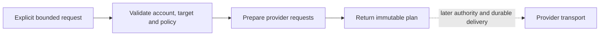

# Connected preparation

Prepare a client reply from Gmail or Fastmail, a Telegram message, or a GitHub issue comment
through the same Reach boundary. The result records the selected account, exact target, application
payload, policy and expiry. It can be inspected without connecting an account or contacting a
provider.

**`reach.connect.prepare@1`** is an explicit offline profile. It does not activate or widen
`reach.discord@1`, and does not qualify the operational `reach.correspondence@1` successor proposed
in the [connected-work study](index.md). [State of Work](../../../state-of-the-work.md#composition-portfolio-delivery)
owns its evidence and the remaining deployment boundary.

## One intent, several concrete channels

| Family | Concrete preparation | Why the distinction survives |
| --- | --- | --- |
| [Email](../email.md) | Gmail MIME/REST; Fastmail JMAP | Mailbox, sender, recipients, reply headers and thread remain explicit. Fastmail submission identity is separate from its account. |
| [Chat](../chat.md) | Discord bot, Telegram bot, WhatsApp business text | A server/channel, bot chat and business phone/recipient have different identities and eligibility. No personal-session impersonation is selected. |
| [Forge](../forge.md) | GitHub issue or pull-request timeline comment | A repository and numbered conversation are required. Radicle needs a future provider profile and may need its own target schema; no compatibility is inferred. |
| [Social](../social.md) | Facebook Page, LinkedIn member/organization and X original text post | The external author and public audience are pinned. Advertising, direct messages and automatic AI replies are separate capabilities. |

The shared request is semantic: read bounded correspondence or prepare text for one selected
target. Provider builders translate it into their own protocol subset. They do not turn every
service into an email server or expose an arbitrary API URL, method or shell command. A provider
that cannot perform the requested operation refuses it.

The read subset is explicit: Gmail lists bounded message IDs, Fastmail queries a bounded
header/preview projection, and Discord/GitHub list bounded conversation messages/comments.
These plans do not implement arbitrary mailbox search or full Gmail message-body retrieval.
Thread-scoped email reads, Telegram chat-history reads, WhatsApp history and social reads refuse.
Telegram's bot-wide `getUpdates` would also acknowledge offset advancement; it cannot stand in for
a target-scoped read. A Discord reply fails if its exact referenced message no longer exists.

A preparation policy defines one partition, exact connection snapshots, exact targets, operations,
bounds and lifetime. Its connection IDs are local references; the provider account and actor IDs
are external observations and do not become Ward Principals. Allowing preparation therefore grants
no send authority. Nor can matching display names or email addresses link two accounts.

## Call the native Graph

The explicit factory builds an ordinary serial score. It validates the admitted request, prepares
the provider payloads, and projects the resulting plan. The state binds the canonical Run, session,
policy and exact request; live handles remain dependencies. A caller must assemble this profile
explicitly, because normal application boot installs no connected profile.

The corrected payload generator uses implementation `py.2` under the same Pattern revision `1`.
Runs pinned to `py.1` refuse execution against it; prepare a fresh offline Run instead of resuming
with different request bytes. This changes no live delivery or replay authority.



Inspect the plan as a prepared application request. It contains application bytes and a provider
route selector, with no bearer token, credential URL or SDK session. Later transport still needs
its own setup: the Telegram credential owner must insert a token, and Fastmail requires an
authenticated JMAP Session and admitted API endpoint. The plan's digest binds only the prepared
application request, not transport headers or the provider's eventual response.

There is no effect executor in this profile. Saving a provider draft would already disclose data
and is therefore a later admitted write. Read plans also require current authority and disclosure
checks before a future transport fetches private data. No model receives any correspondence here.

Preview the synthetic release announcement without credentials:

```bash
uv run --locked python scripts/reach_connect_prepare.py \
  --policy examples/reach/connected/policy.json \
  --requests examples/reach/connected/wuphf.json
```

Use `founder-policy.json` and `founder-launch.json` in the same directory for Fastmail plus
Facebook Page, LinkedIn member and X launch-copy preparation. Both fixtures use invented accounts.
The default output reports only preparation status and count. `--include-payload` explicitly
prints the private application requests for inspection; protect that output like correspondence.

For native execution, assemble
`lychd.compositions.reach.connected.workflow.connected_preparation_workflow(policy, clock=clock, record_result=sink)`
in an explicit registry and submit the Intent from
`make_connected_intent(policy, requests, session_id=session.id, now=clock())` through the ordinary
RunEngine. The registry, session and result sink belong to that caller; no startup selector or
durable correspondence ledger is implied.

## WUPHF as finite preparation

“Announce this accepted release in these three places” selects a finite tuple of explicit targets.
Reach validates every item before returning the batch. Duplicate request identities and duplicate
operation/target pairs refuse; a forbidden destination does not disappear from an apparently
successful result. Each provider payload and the complete batch have separate bindings.

This is preparation inside a serial Graph station. It uses no Graph broadcast/map/join primitive,
background sender or parallel executor. A future sender must settle each target independently:
one accepted email cannot prove that a chat message or post was accepted. An unknown result must
remain visible and cannot trigger a blind replay of the whole batch.

Reach owns correspondence and destination policy. [Broadcast](../../broadcast/release.md) owns
editorial acceptance and publication judgment. An already accepted announcement can enter Reach
as settled input. Commissioning and waiting for several live Composition Invocations would instead
need a [Suite](../../products-and-suites.md#compositions-relate-without-nesting).

## Journeys and refusal cases

| User story | Observable result | Refusal that matters |
| --- | --- | --- |
| As a founder, answer one client from the selected Gmail mailbox. | Frozen MIME and recipients, including separately bound Cc/Bcc. | A changed recipient, sender, thread, body or connection changes the preparation. Header injection refuses. |
| Use Fastmail for another company with the same application flow. | JMAP mail operations and explicit submission identity. | Gmail thread IDs and send payloads cannot be reused as JMAP identities. Another partition cannot share the policy. |
| Send a reviewed notice to an admitted Telegram chat. | A bot `sendMessage` payload with link previews disabled and no markup parser selected. | No bot credential or personal Telegram session is accepted as request data. |
| Answer a WhatsApp customer. | A business free-form text request candidate. | Preparation supplies no opt-in, current service window, AI-market eligibility, escalation or spend proof; transport qualification still requires all of them. |
| Ask Reach to answer an issue or PR discussion on GitHub. | An issue-comment request for the exact repository and timeline. | No diff review, approval, merge, release, code execution or workflow run follows. |
| Prepare AI-service promotional copy for Facebook and LinkedIn. | Separate public post candidates as the configured Page/member/organization. | A personal Facebook profile, private audience or paid advertisement cannot inherit this capability. |
| Say WUPHF for an accepted release. | One bounded, fully preflighted plan across explicit provider targets. | One bad target rejects preparation; restart is not permission to send any item twice. |

The [account lifecycle](accounts.md) and [social assessment](social.md) distinguish provider access,
organic publication and advertising. The [acceptance plan](delivery.md) retains the durable outbox,
credential, current-authority, revocation and live-provider work needed before actual delivery.

[Reach architecture](../architecture.md) · [Accounts](accounts.md)
