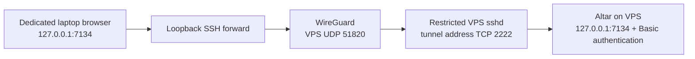

# Candidate access for one operator's VPS

This optional infrastructure profile gives one trusted operator a private SSH road to their own
VPS and a restricted forward to its local Altar. It is candidate tooling, not native Tether,
Veil, general remote IAM, shared multiuser isolation, or a qualified remote browser deployment.
The existing Basic credential still grants the full local Magus authority. Never share it.
Installed two-machine, hostile-browser, reboot, and revocation acceptance remains pending.

## Boundaries

The administrator owns WireGuard through host `wg-quick` and systemd. The application receives
no networking capability or tunnel keys. A separate sshd binds only the tunnel address on TCP
2222; it permits one destination, `127.0.0.1:7134`, and denies sessions and other forwarding.
The existing administrator sshd and its ingress are preserved. The Altar remains loopback-only.
Both transport units bind their lifetime to firewalld; losing the firewall stops the private road.
That is a declared systemd dependency, still requiring the real firewall-loss acceptance below.



The candidate admits one IPv4 /32 peer, no default/LAN routes, no DNS changes, no NAT, and no
IP forwarding. It does not manage arbitrary pre-existing networking. Installation is fresh-only;
an exactly matching completed installation is verified without writes. Changed intent, partial
installation, foreign files, enabled forwarding, or ambiguous firewall ownership refuses.
Revocation is an explicit, durable administrator operation; updates and key rotation require a
separately reviewed replacement. A revoked installation is never re-enabled by apply.

## Optional fresh-pilot preparation

For the standard fresh pilot, `lychd_access_prepare: true` and a separate
`lychd_access_prepare_target: HOST` opt into prerequisite automation. Both are disabled by default;
the ordinary `lychd_access_enabled` and `lychd_access_target` gates still apply. Run the same
playbook with `--check` first and review its package/policy/reload plan. Existing NetworkManager
and firewalld must already be running, SELinux must already enforce, and the actual external
zone must already include the standard SSH service permanently. Keep a tested provider console.

Preparation installs only missing named distribution package capabilities using existing
repositories without refresh or distribution upgrade. It reserves only `lychd-wg` through a new
NetworkManager device section, adds absent exact SELinux SSH port/file mappings, and creates the
empty DROP zone. Conflicting custom mappings, foreign interfaces/accounts/configuration, and
partial preparation refuse. The check plan does not qualify later package-dependent policy
checks: apply observes those before adding policy. This is a bootstrap for the standard pilot,
not an automatic repair of arbitrary existing host networking.

**This opt-in may reload NetworkManager configuration and firewalld.** A firewalld reload activates
all pending permanent settings and discards runtime-only changes; a NetworkManager configuration
reload can activate other pending changes. Review that state before authorizing the exact prepare
target. This is the explicit exception to the no-reload manual-preparation path below. Existing
completed access enters read-only verification instead. A failure leaves the root-owned
`/etc/lychd-access-prepare.json` incomplete marker and requires administrator recovery; re-running
does not silently continue partial preparation. Custom hosts can keep `lychd_access_prepare=false`
and use the explicit manual prerequisites.

## Prepare the host and public inputs manually

Use the existing administrator and retain a tested provider-console recovery path. Install the
distribution's `wireguard-tools`, OpenSSH, firewalld, and Python 3 first. Keep host IP forwarding
disabled. The candidate requires a running firewalld with no source-bound zones or direct rules.
Its only admitted policy is the unchanged vendor `allow-host-ipv6` ICMPv6 bootstrap policy, checked
in runtime and permanent configuration. Other policies refuse even when currently inactive:
binding the private interface can activate them before zone rules. Do not disable the vendor
IPv6 policy to make this profile pass. This narrow prerequisite may exclude a custom workstation.
When NetworkManager runs, reserve `lychd-wg` as unmanaged in the administrator's network policy
before installation, so it does not adopt the interface created by `wg-quick`. The candidate
refuses a NetworkManager connection naming that interface and does not reload NetworkManager.

Prepare an empty `lychd-access` firewalld zone with target `DROP` in both runtime and permanent
configuration. Creating a zone requires a reload, which may activate unrelated permanent changes;
review and perform that administrative step separately. For a new zone, the commands are
`firewall-cmd --permanent --new-zone=lychd-access`,
`firewall-cmd --permanent --zone=lychd-access --set-target=DROP`, and a separately approved
`firewall-cmd --reload`. Do not use these to replace an existing zone. With prerequisite automation
disabled, the playbook does not reload firewalld and adds only its declared interface and exact rules.

Copy `deployments/ansible/access.example.yml` to private working material outside the checkout.
Supply the laptop's WireGuard **public** key and a dedicated ed25519 SSH **public** key. Generate
and retain laptop private keys locally; never put them in inventory or send them to the VPS.
Choose unused, non-overlapping tunnel addresses and the actual external interface/zone.

For the example address pair, the laptop's private WireGuard configuration has this shape:

```ini
[Interface]
Address = 10.203.71.2/32
PrivateKey = REPLACE_WITH_LAPTOP_PRIVATE_KEY_LOCALLY

[Peer]
PublicKey = REPLACE_WITH_VPS_PUBLIC_KEY
Endpoint = REPLACE_WITH_VPS_PUBLIC_ADDRESS:51820
AllowedIPs = 10.203.71.1/32
```

Keep that file mode 0600 outside the checkout. Do not add a default route or DNS field. Add
`PersistentKeepalive = 25` only when the laptop's NAT requires it. Use one laptop interface owner
(NetworkManager or `wg-quick`), and verify its only route is the selected VPS address. Keep the
dedicated SSH private key passphrase protected; the foreground wrapper lets SSH prompt for that
passphrase and does not use an ambient SSH agent.

This candidate requires **SELinux Enforcing**, with `getenforce`, `semanage`, `matchpathcon`, and
`restorecon` installed. Prepare the exact SSH port and file-context mappings before running the
playbook. Inspect `semanage port -l`, `semanage fcontext -l -C`, and the installed SSH policy first.
When the port and paths are unclaimed, the administrator's explicit additions are:

```bash
semanage port -a -t ssh_port_t -p tcp 2222
semanage fcontext -a -t sshd_key_t '/etc/lychd-access/ssh_host_ed25519_key(\.pub)?'
semanage fcontext -a -t ssh_home_t '/etc/lychd-access/authorized_keys'
```

If a mapping already exists, inspect it; do not replace another service's policy with `-m` to make
this profile pass. `matchpathcon -n` on the three declared key paths must report the expected types
even before files exist. The role refuses an unadmitted port, missing mappings, or permissive SSH
domains before creating its directory. It applies `restorecon` only to its newly owned files and
checks labels again on verification. The dedicated sshd uses `PidFile none` to avoid an undeclared
runtime PID-file label. Activation never disables enforcement, changes policy, or generates broad
`audit2allow` rules; optional preparation adds only the declared absent mappings. Confined SSH
forwarding to port 7134 and the installed service's actual process
domain still require a successful two-device acceptance and AVC-log inspection under Enforcing.
These commands follow [SUSE's port and file-context procedure](https://documentation.suse.com/sles/16.1/html/SLES-SELinux/index.html);
the installed Tumbleweed policy remains the compatibility authority.

From `deployments/ansible`, first run `ansible-playbook -i PRIVATE_INVENTORY playbooks/access.yml
--limit HOST -e @PRIVATE_ACCESS_VARS --check`. The default is disabled. Activation additionally
requires `lychd_access_enabled=true` and `lychd_access_target=HOST`. It changes only the named
host, creates host keys once, and refuses partial state instead of guessing recovery.

For a fresh pilot, edit the private copy with the actual public keys and network information:

```yaml
lychd_access_enabled: true
lychd_access_target: pilot
lychd_access_prepare: true
lychd_access_prepare_target: pilot
```

Use the controller from the [Server guide](index.md#prepare-the-controller-and-private-inventory).
Keep its shell's `LYCHD_DEPLOY_WORK` set to that private directory. Preview, apply and observe:

```bash
cd deployments/ansible
"$LYCHD_DEPLOY_WORK/controller/bin/ansible-playbook" -i "$LYCHD_DEPLOY_WORK/inventory.yml" \
  playbooks/access.yml -e "@$LYCHD_DEPLOY_WORK/access.yml" --limit pilot -K --check
# After reviewing the preparation/reload plan, repeat without --check.
"$LYCHD_DEPLOY_WORK/controller/bin/ansible-playbook" -i "$LYCHD_DEPLOY_WORK/inventory.yml" \
  playbooks/access-verify.yml -e "@$LYCHD_DEPLOY_WORK/access.yml" --limit pilot -K
```

An unchanged second apply verifies without regenerating keys, reloading configuration or
restarting services. `access-verify.yml` never provisions. Its result proves the configured
host boundary; a successful two-device connection is a separate observation. Verification and
revocation fail when their enable/target inputs are missing, rather than returning a skipped success.

The result exposes only the WireGuard public key and dedicated SSH host public key. Verify those
over the existing trusted administrator connection, then prepare the laptop's WireGuard peer and
a dedicated `known_hosts` file. Its host entry is `[VPS_TUNNEL_ADDRESS]:2222`. Do not use
`StrictHostKeyChecking=no` or treat an unauthenticated `ssh-keyscan` result as trust evidence.
Laptop WireGuard configuration uses its own /32 address, the VPS public key and public UDP
endpoint, and only `VPS_TUNNEL_ADDRESS/32` in AllowedIPs. NAT keepalive is optional and explicit.

## Open the single-operator browser road

The client preparation tool renders a private WireGuard configuration, pinned SSH known-host
entry and connection profile from explicit public server material and locally retained keys.
It never imports a connection, changes routes, opens a browser or starts a service. Existing
different output refuses; unchanged output is observed without rewriting it. Private input
and output must stay outside checkouts. Forwarding requires an explicitly named, up WireGuard
interface and an actual route through that interface; a LAN or default-route fallback refuses.

Install `wireguard-tools` and OpenSSH clients on the laptop through its trusted distribution
repositories. Create a private workspace outside every checkout, and generate **device-specific**
keys once. These commands refuse to overwrite the WireGuard files; retain existing keys on repeat:

```bash
LYCHD_ACCESS_WORK="$HOME/.local/state/lychd-access/pilot"
mkdir -p "$LYCHD_ACCESS_WORK"
chmod 700 "$LYCHD_ACCESS_WORK"
(umask 077; set -o noclobber; wg genkey > "$LYCHD_ACCESS_WORK/wireguard.key")
(umask 077; set -o noclobber; wg pubkey < "$LYCHD_ACCESS_WORK/wireguard.key" > "$LYCHD_ACCESS_WORK/wireguard.pub")
ssh-keygen -t ed25519 -f "$LYCHD_ACCESS_WORK/forward_ed25519" -C lychd-forward
```

Protect the SSH key with a passphrase. Put only `wireguard.pub` and the first two fields of
`forward_ed25519.pub` into the private server inventory; the host input deliberately accepts no
SSH key options or comment. Neither private key leaves the laptop.

Copy [`client.example.json`](https://github.com/hexanomicon/lychd/blob/main/deployments/access/client.example.json)
to `$LYCHD_ACCESS_WORK/client.json`, mode 0600. Fill the matching addresses, unique interface name,
public UDP endpoint, local private-key paths and the two server public keys obtained through the
trusted administrator connection. Do not trust an unauthenticated network key scan.
Use distinct interface names and non-overlapping address pairs for multiple VPS connections.
The browser forward still occupies one fixed local port, so open one instance's forward at a time.

```bash
python3 deployments/access/client.py --config "$LYCHD_ACCESS_WORK/client.json" \
  --output-directory "$LYCHD_ACCESS_WORK/generated" --check
python3 deployments/access/client.py --config "$LYCHD_ACCESS_WORK/client.json" \
  --output-directory "$LYCHD_ACCESS_WORK/generated"
```

The output contains `lychd-vps.conf`, exact `known_hosts` and `connection.json`. The directory is
0700, files are 0600, and a second identical render changes nothing. A different or partial output
refuses. The WireGuard configuration contains a private key: never attach it to an issue or put
it in a source/archive build. No interface, route or service has been changed by rendering.

On the KDE laptop, choose NetworkManager as the interface owner. Confirm that the selected
connection/interface name is unused before importing; stop on a collision. For the example name:

```bash
sudo nmcli connection import type wireguard file "$LYCHD_ACCESS_WORK/generated/lychd-vps.conf"
sudo nmcli connection modify lychd-vps connection.interface-name lychd-vps \
  connection.autoconnect no ipv4.never-default yes ipv6.method disabled
sudo nmcli connection up lychd-vps
```

Only this new tunnel has IPv6 disabled; the laptop's ordinary IPv6 configuration is unchanged.
Do not also start `wg-quick` for the same interface. Automatic connection at login/boot is an
explicit later choice after the first acceptance. The generated peer route is only the VPS /32.

After the laptop WireGuard connection is established, use the rendered connection profile.
First check local files, the up WireGuard device, route and free port:

```bash
python3 deployments/access/forward.py --profile "$LYCHD_ACCESS_WORK/generated/connection.json" --check
python3 deployments/access/forward.py --profile "$LYCHD_ACCESS_WORK/generated/connection.json"
```

The check starts no SSH session and proves no remote handshake, application or browser result.
Explicit connection options remain available with `--peer`, `--identity`, `--known-hosts` and
`--interface`; omitting the interface refuses. The tool uses a fixed `127.0.0.1:7134` local bind and refuses an
occupied port. Verify the actual listener with `ss -ltn` before opening the browser; the SSH
server cannot enforce the client-side bind address. End the foreground process to close it.
SSH accepts only the pinned server key and the selected device key, permits a local key-passphrase
prompt, and offers no password/keyboard-interactive fallback. Its connection timeout is bounded.

Use a dedicated browser profile **per VPS instance**, without untrusted extensions. Do not reuse
the same profile across servers behind the same localhost origin: HTTP Basic credentials may be
cached and sent to the next server. Retrieve this instance's local credential through the trusted
administrator/runtime path and enter it only at `http://127.0.0.1:7134`. Host, Origin, CORS, CSRF,
and Basic checks remain intact; there is no header rewriting or public listener. An occupied
local port also prevents accidental collision with a laptop-local LychD.
Create and launch a separate Firefox profile for the instance through `about:profiles`; a normal
new tab or private window is not a replacement for that separation. Machine-wide Dark Reader
policy can also install the extension into this profile; disable it here unless deliberately
trusted for Altar content. No browser profile or login state is copied by the deployment tools.

Close the forward before changing/disabling the VPN. On unexpected loss, SSH keepalives terminate
the failed connection; the tool selects no alternate endpoint or public Altar URL. Route preflight
is an observation before SSH starts, not a continuously enforced client firewall.

| Observation | Interpretation and next check |
| --- | --- |
| No recent server `wg show lychd-wg latest-handshakes` after a laptop connection attempt | Check UDP endpoint/port, provider firewall, public keys and NAT; inspect only public handshake output. |
| Handshake succeeds, TCP 2222 fails | Check the tunnel route, exact firewalld policy and dedicated sshd/SELinux AVCs. |
| SSH refuses a host key | Stop and compare against the trusted administrator's host public key; never bypass checking. |
| Local 7134 is occupied | Close the existing forward/local instance. Do not use an arbitrary substitute port or browser profile. |
| Altar returns 401 | Transport reached authentication; enter this instance's private local credential in its dedicated browser. |
| `access-verify.yml` returns `revoked` | Transport is deliberately closed. Apply does not recover or re-enroll it. |

## Revoke, recover, and qualify

Use the independent administrator connection for explicit revocation. The same private intent
and exact target remain required; no application credential or runtime account is needed:

```bash
cd deployments/ansible
"$LYCHD_DEPLOY_WORK/controller/bin/ansible-playbook" -i "$LYCHD_DEPLOY_WORK/inventory.yml" \
  playbooks/access-revoke.yml -e "@$LYCHD_DEPLOY_WORK/access.yml" --limit pilot -K --check
# Repeat without --check to revoke; use access-verify.yml for readback.
```

Revocation persists and fsyncs `/etc/lychd-access/revoked.json` **before** disabling/stopping
`lychd-access-sshd.service` and `wg-quick@lychd-wg.service`. Both boot paths check that marker,
including the receipt-owned WireGuard instance drop-in. An interrupted revocation can be repeated
to finish; a completed repeat changes nothing. Apply refuses revoked intent. The SSH service uses
control-group termination so established forwarded sessions are stopped with it. Verify both units inactive,
the interface absent, and a previously established browser connection unable to reach Altar.
Disablement must be preserved when restoring backups. Removing an authorized key alone does not
close existing connections. Preserve a separate revocation record outside old host snapshots;
never re-enable from a stale receipt without reviewing it. The host marker cannot survive a restore
that omits it: reconcile the independent revocation record before booting a restored host. Keep
the old device's access closed and use fresh keys for a separately admitted replacement; deleting
the marker or editing the receipt is not rotation.

Partial setup preserves evidence and requires manual inspection of `/etc/lychd-access`,
`/etc/wireguard/lychd-wg.conf`, the two named units, the owned
`wg-quick@lychd-wg.service.d/10-lychd-access.conf` drop-in, `lychd-forward`, and the declared firewall
rules. Do not blindly delete these paths or reuse another installation's keys. LychD's active
stop/restart and credential-rotation recovery remain separate unfinished contracts. A compromised
laptop can require quarantining/rebuilding its instance after transport revocation.

Before calling this supported, retain evidence for two-machine startup/reboot/reconnect, a
no-change second apply, exact IPv4/IPv6 ingress, forbidden destinations and shell/subsystem/socket
forwarding, Basic/Host/Origin/CSRF refusals, hostile framing and DNS rebinding, SSE, lost-tunnel
failure, and revocation of an already established connection. Include a controlled firewalld-loss
test proving both transports stop and no unfiltered private path remains; retain the provider
console during that test. Repository tests and syntax checks alone prove none of these
installed-host results.
