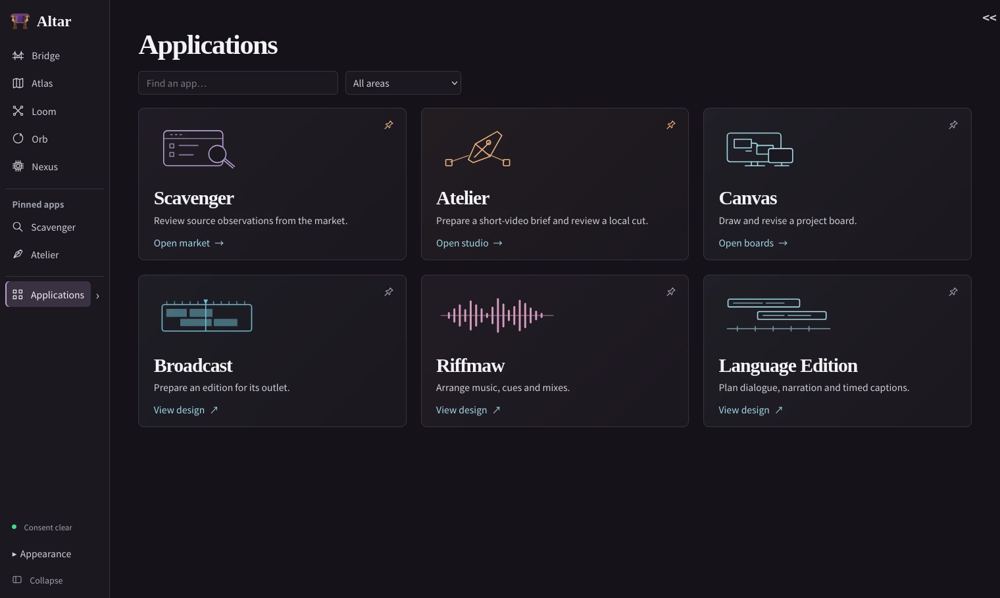
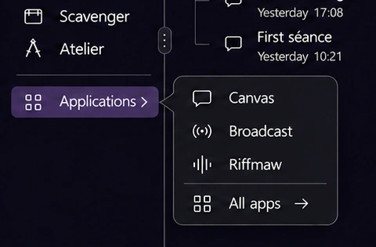
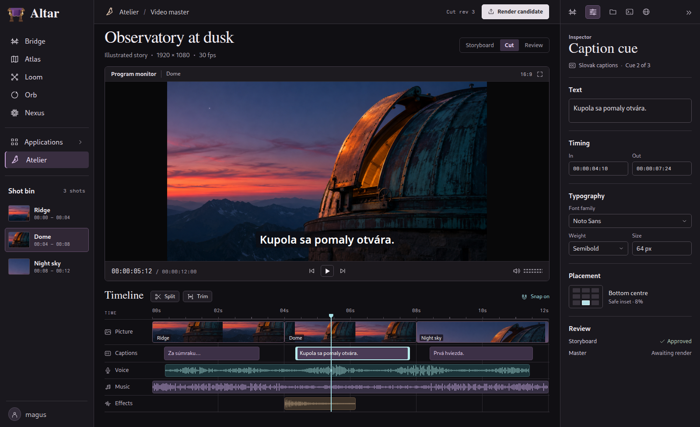

# Applications

The **Applications** label on the left rail opens a dashboard where you
can browse applications and pin the ones you use often. The **›** beside the label opens a
short list over your current screen. For example, while reading a conversation in Bridge, you
can check which apps are available and dismiss the list to keep reading.

## Browse the dashboard

Click or tap the **Applications** label, or focus it and press Enter. Search the dashboard by
application name or filter by the kind of work you want to do using **Area**. The groups
come from the [Composition portfolio](../../compositions/index.md#areas).

Each card names its destination. **Open market** takes you to
[Scavenger’s market](../../compositions/scavenger/market.md). **Open boards** takes you to
[board authoring](../../compositions/canvas/index.md). **View design** opens the guide for
[Broadcast](../../compositions/broadcast/index.md),
[Riffmaw](../../compositions/riffmaw/index.md) or [Language Edition](../../compositions/language-edition/index.md).
**Open studio** opens the [Atelier short-video studio](atelier.md). Pin a card to put a shortcut to that same destination on the rail. In the example,
**Scavenger** and **Atelier** are pinned. Starting a Run requires a separate action.

## Open the quick list

Right-click the **Applications** row, or click or tap its separate **›** button. With a
keyboard, focus **›** and press Enter or Space. The popup opens beside the rail on the current
screen. Hovering over the closed row or moving focus onto it keeps the popup closed.

[{ width="400" loading="lazy" }](../../assets/altar-design/applications-quick-list.webp)

The popup stays open as you move the pointer into it or tab to an entry. In the example, **Canvas**, **Broadcast**
and **Riffmaw** are available here as unpinned shortcuts. Choose an entry to open its
destination, or choose **All apps** for the full dashboard. To stay where you are, click
outside the popup or press Escape. Escape returns focus to the control that opened it.

## Cut a video in Atelier

In this proposed workspace, **Observatory at dusk** is a 12-second illustrated story at 30 fps.
Its storyboard has passed review. The left Altar sidebar holds the pinned **Atelier** shortcut
and the shot bin, with **Dome** selected. The centre monitor shows **Cut rev 3** at
`00:00:05:12`, five seconds and twelve frames into the cut. Below the playback controls,
the playhead crosses the **Picture**, **Captions**, **Voice**, **Music** and **Effects** tracks.

[{ loading="lazy" }](../../assets/altar-design/atelier-cut.webp)

To time the caption to the opening dome, select “Kupola sa pomaly otvára.” on **Captions**.
In the right inspector, set its in point to `00:00:04:10` and its out point to `00:00:07:24`.
The example uses **Noto Sans Semibold** at 64 px, centred 8% above the bottom edge of the
1080p frame. Play across both ends of the cue to check when the words appear and clear.

To cut to **Night sky** as the caption clears, select the shared picture edit at `00:00:08:00`
and choose **Trim**. Roll the edit six frames earlier to `00:00:07:24`. The inspector shows
both source trim points so you can check that Night sky has six earlier frames available.
The cut still runs twelve seconds. The voice and music keep their positions. Audition the
transition, then select the voice clip to adjust gain or lower the music under the line.

The cut design proposes a candidate export for review against its exact bytes.
In the current [Atelier studio](atelier.md) you can exchange a short-video brief, time its
lines and play an existing local video. The multitrack cut above is an early design study.

## Availability

Submitting a Scavenger market observation requires the
[finite feed observation profile](../../compositions/scavenger/market.md#finite-feed-observation).
The [portfolio delivery record](../../state-of-the-work.md#composition-portfolio-delivery)
tracks the work each Composition can perform.
