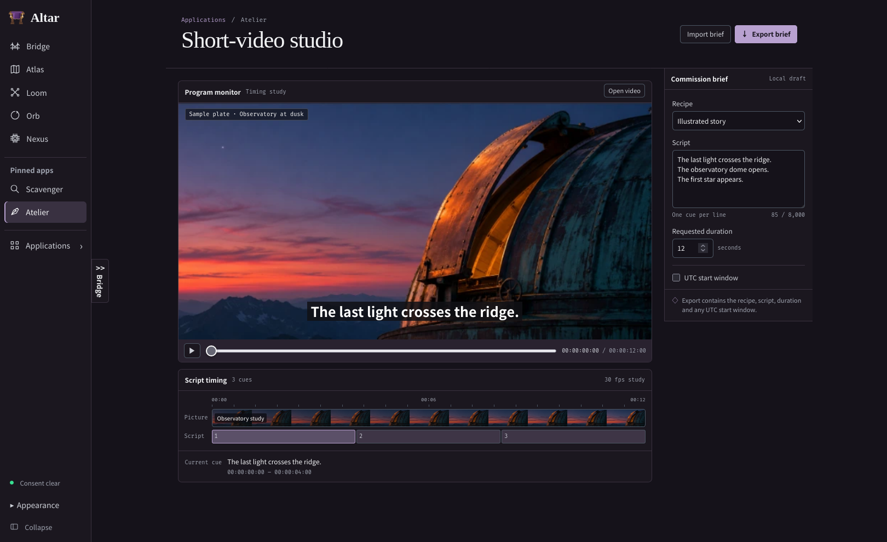

# Atelier studio

Open **Atelier** in Applications to write a short-video commission and review the timing of
its script. The brief stays in the current page until you export it. The initial observatory
study uses an illustrative still from the [Atelier cut design](applications.md#cut-a-video-in-atelier).

Open **Commission brief** in the right panel. Choose **Illustrated story**, **Animated lesson** or **Captioned excerpt**. Write the script
and enter a whole duration from 1 to 180 seconds. The monitor divides the requested time
equally between nonblank script lines to start. **Workflow** opens that recipe's blueprint
in Loom. The registered execution workflows remain available from the Loom library.

**Storyboard** lays out the shots for inspection. Select a shot there, in the left **Shot bin**
or on the picture track to inspect its caption in **Cut**. The right panel exposes its text,
in and out points, font, weight, size and placement. Drag the panel border for more room.
Times use 30 frames per second. Changing an interior cut moves the adjoining boundary.
Move the playhead inside a shot and choose **Split** to create two cues at that frame.

The **Voice**, **Music** and **Effects** lanes accept local audio references for individual
audition. A waveform appears when the browser decodes its samples. **Review** lists the
selected source and caption count. **Export captions (.vtt)** saves the cue text and timing.
**Export brief** saves the commissioning fields. The editor keeps local media and styling in
the current page. A finished audiovisual master still passes through the composition's render
and review process.

To review a finished local cut, choose **Open video**. Play or scrub the selected file with
the browser's media controls. The source and its observed duration stay separate from the
commission's requested duration. The browser reads the file locally.

Enable **UTC start window** when the operator may begin only within a particular interval.
Supply both bounds, including seconds and the UTC suffix. The opening instant is eligible,
and the closing instant is exclusive. **Export brief** downloads the validated JSON.
**Import brief** restores a valid file, preserving the current draft if the file fails
validation. Each wire brief is limited to 8,192 UTF-8 bytes and 8,000 script characters.

The [Atelier composition](../../compositions/atelier/index.md) owns the production brief and
review of the finished work. Its [short-video example](../../compositions/atelier/short-video.md)
shows how to hand off a public brief through Intercom and render a single captioned clip locally.
The browser edits and exports the brief. The Intercom operator session submits it separately.
