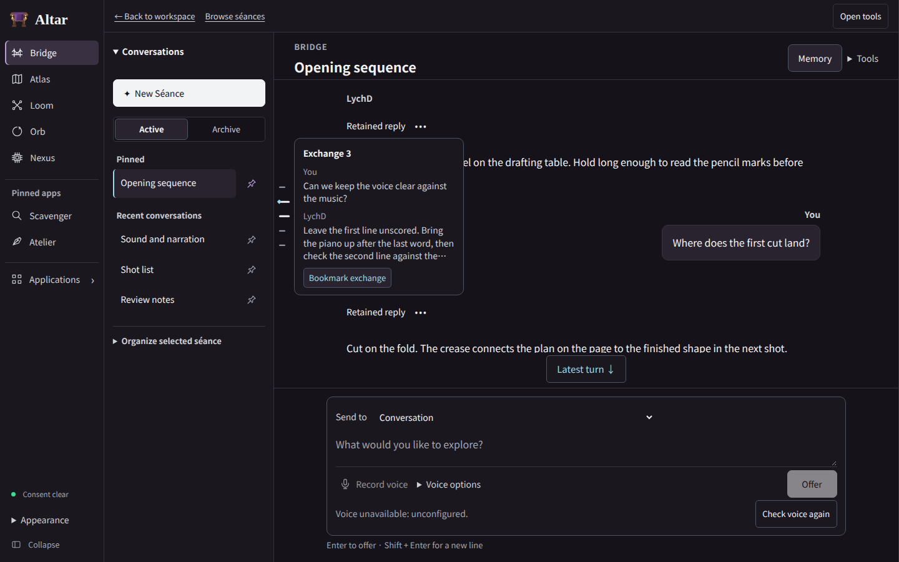
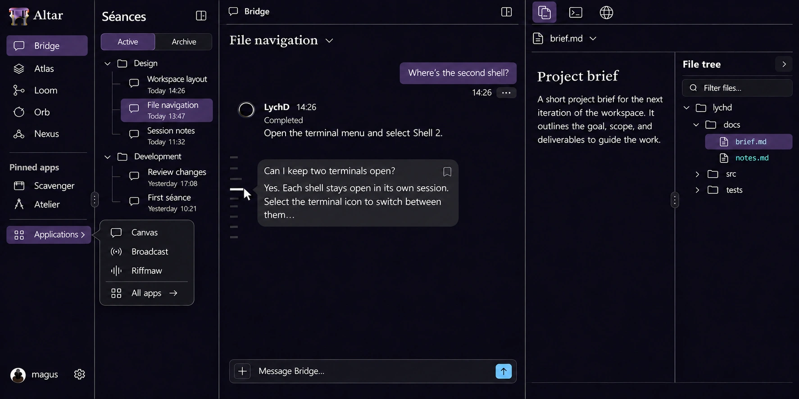

# :material-bridge: Bridge

Bridge is where you speak with [Primus](../../lexicon/inner-tongue.md#primus), the Lich's
continuing personal identity. Keep one conversation, or *séance*, for as many turns as you
need. Each message the Vessel accepts opens a [Circle](circle.md) and has its own Run.
You can leave halfway through writing your next question, inspect the work behind an answer,
and come back to the same draft. To start in the installed Altar, [open a conversation](#open-a-conversation-today).

## Current Bridge



Hover or focus a mark on the left edge of the chat to read an exchange. Click it to jump to that turn. Active, Archive, named groups and bookmarks are filing choices in this browser. Consent stays with its request.

## The Bridge workspace

**Design preview.** Suppose you have a file open and want to find the turn where you agreed
to change it. The conversation and the file sit side by side. You can go back to that
exchange, check what happened, and keep your place in both.



**Find the conversation.** On the far left, the sidebar holds the instruments and pinned
applications. Clicking **Applications** opens the dashboard. Right-clicking it or activating
its separate chevron opens the quick picker in place. Next to the sidebar, the **Séances**
panel has **Active** and **Archive** tabs. Expand the named groups inside either tab, follow
their nested groups and select a conversation. Drag the panel divider to widen the list for
long titles, or collapse it once you have found yours. [Applications](applications.md)

**Find the turn.** Short horizontal marks form a vertical strip halfway down the chat's left
edge, one mark per exchange. Hover over a mark or focus it with the keyboard to highlight it
and preview the question and reply. Select it to jump there. Bookmark a turn you want to revisit
so you can pick it out on the strip. Previewing leaves your place in the conversation intact.

**Inspect the answer.** Each turn shows its own status beside the message. Choose **… → View
run in Orb** on that turn to follow its exact Run into Orb. The action needs a known Run
identity. If admission is uncertain, the original offering and its recovery action stay visible.
If the Run asks for consent, its request and decision controls appear inline. To trace an
idea across *several* turns, choose **Open map in Atlas** from the séance title menu. Follow
a citation back to its passage with your draft intact. [Orb](orb.md) ·
[Atlas séance map](atlas.md#the-shared-memory-map)

**Work beside the chat.** The right panel has a horizontal row of three icon-only buttons at
the top, with accessible names **Files**, **Terminal** and **Web**. Selecting Files opens
the file tree alongside the open file. Drag the tree's divider to zero or click its chevron
to collapse it. Select Files again to reopen it. Each tool lists its open items, so you can
switch to a second shell or return to a particular page. Bridge already occupies the main pane. On
other instruments the same tools share the panel with the **walking Bridge**, which brings
this conversation alongside the work.

Drag the main divider to resize either pane, all the way to zero, or focus it and use the
arrow keys. Collapse and reopen controls give the same choice without dragging. Reopening
restores the work you had in view. Resizing a
panel, opening a file or following a citation gives a model no extra Context or authority.
File access, shell execution and web access each need an admitted host capability.
[Moving between screens](workspace-design.md)

## Open a conversation today

After [local setup](index.md#bring-one-intent), open `http://127.0.0.1:7134/bridge` in the
dedicated same-host browser profile. **Bridge** on the left rail returns to the last
conversation you explicitly selected in this document. Choose **New Séance**, pick a pinned or
recent conversation under **Conversations**, or **Load more conversations** to reach older
entries. Browser pins remember session identities. An older pin can show just its identity
until its metadata loads.

**Browse séances** opens the retained catalogue. Inspecting an entry leaves the live conversation
where it was. **Continue in Bridge** selects the conversation you inspected. When you visit
another instrument, the current Bridge dock can carry the live conversation with you.
**Open Séance** opens its supplied transcript. **Back to workspace** returns to the work you
were viewing. Layout preferences contain no messages or request bodies.
[Séances](seances.md) · [Keep Bridge beside the work](index.md#keep-bridge-beside-the-work)

A link to a particular session, Run or consent request opens that focus. Coming from Atlas
preserves a project return link even if you start a new séance. To associate a conversation
with that project, choose **Link this conversation to…** and save the prefilled Atlas form.
Visiting either instrument alone supplies no project material to the model.

### First meeting and naming ceremony { #naming-ceremony }

Open **Naming ceremony** from the welcome or **Tools**. You can keep **Magus** and **Primus**,
choose your own names, or name yourself and invite Primus to answer with a name of its own.
A true name can be one you recognize as yours. You can offer as much or as little of its
story as you wish. Other Agents and Personas can contribute while this relation continues.

Type a name or browse local two-part suggestions such as **Zenith Runeweaver**. Both work
before a model is ready. To ask for help, start an ordinary Bridge exchange. This can be the
first turn that starts and warms the selected model. Read the reply and copy the name you
want into the ceremony. Closing it leaves you free to converse or try again later.

Review both forms of address and choose **Save names**. The Vessel stores your choice for
the authenticated operator. Later admissions receive the new names. An admitted Run keeps its
original names through resume. Your login, Principal and Sigil retain their own identities
and authority. [Mirror and Persona lineage](../../sepulcher/aspects/mirror.md)

## Offer one Intent {#follow-a-turn-to-settlement}

Write a message and choose **Offer** once. You can write the next question while you wait.
Each séance admits one unsettled Run at a time. Bridge keeps a later draft editable until
you choose to send it.

| What you see | What to do |
| --- | --- |
| Admission is uncertain | Use **Retry original offering** to resend the exact original text and request identity. The same request returns the canonical Run. A subsequent refusal alone cannot settle the earlier uncertainty. |
| The offering was definitely refused | Restore or dismiss the refused text. Bridge keeps any newer draft separately. |
| The session read failed | Choose **Retry read**. This reloads the current focus and preserves the draft and unresolved offering. |
| The Run is waiting for a decision | Read the target, scope and consequences on the inline consent card, then choose one of its supported decisions. The decision covers that exact pending request. |
| The activity stream slows or stays open | Read the durable Run status. A spinner or open stream can outlast the work. A new offering becomes available when the ledger records a terminal state. |
| The session refresh fails after cancellation | The former consent actions and count stay cleared until the session can be read authoritatively. |

**Conversations awaiting consent** in the shell lists sessions with pending requests. Choose
a marked conversation to inspect its cards. The chooser reports any requests for which it
cannot supply a conversation. **Tools** beside the title also opens **Séance details**,
**Public sources** and **Project links**.

The status beside each reply identifies the state the Vessel supplied. Open **…** for
**View run in Orb**, the exact Run identity, and its declared score in Loom when available.
Older turns identify missing metadata. A recorded physical transition can take you to
Nexus. [Circle controls](circle.md) · [Loom](loom.md) · [Nexus](nexus.md)

A failed or cancelled Run may leave only your admitted message. If a failed Run still
projects text, Bridge marks it incomplete. The live display can include a retained failure
message. When a retained agent turn arrives, it takes the place of that projection. After
reload you may see **Retained reply** with fewer badges. Orb has the exact Run's canonical
status. Incoming text preserves your place while you read older turns. **Latest turn**
returns to the end and releases a linked Run focus without disturbing your draft.

Session drafts and immutable pending offerings survive detours in this open document. Reloading
or closing warns before losing transient work. Admission has a durable delivery outbox.
Token streams and their reconstruction live in the serving process.
[Bridge delivery and recovery](../../state-of-the-work.md#bridge-surface)

### What enters the next turn

Bridge revisions 1 and 2 use the newest whole, settled exchanges that fit the configured
turn and character limits. A message can be visible before its reply settles and makes the
exchange eligible. A consent return stays paired with the tool call that asked for it.
On resume, the current call chain survives and earlier history must fit the current grant.
A policy stop retains completed tool results and records the known refused request as denied.
A new Invocation rebuilds its Stable Floor for its own grant.

Only a settled agent turn appends a complete typed history unit. Validated interface fragments
survive terminal refresh. Older unsupported fragments stay inert. An identical settled outcome
replays harmlessly. Conflicting content for the same Run and role is refused, and an older
snapshot cannot overwrite a newer generation or cursor. The public-source profiles below
answer each question independently.

## Dictate and review {#dictate-and-review}

With a configured local transcriber, choose a declared language in **Voice options**. Press
**Record voice** to request microphone access, speak for up to 30 seconds, then **Stop** or
**Cancel**. The compact dock and full workspace share one microphone. The browser converts
the recording to mono 16 kHz signed 16-bit PCM WAV. The server checks the size and format.
Cancelling releases local capture and waiting. A contacted transcriber may still be running.

Compare **Original transcript** with the editable draft. If you typed during recording, review
the suggestion before inserting it. Sending is manual by default. Opting into **Automatically
send after 2 seconds** gives you a visible countdown you can cancel. Editing, navigation,
cancellation or unresolved admission prevents automatic sending.

**Voice history** shows 25 attempts at a time, including unknown outcomes and attempts without
saved corrections, up to the 1,000-attempt catalogue limit. **Inspect attempt** or **Check
outcome** reads the exact retained result and leaves the draft alone. For an unknown outcome
the protected recovery read is `GET /api/v1/bridge/dictation/attempts/{attempt_id}`. A fresh
recording starts a new attempt. **Delete attempt** removes the retained record and correction.
If the response is uncertain, refresh history before another deletion.

**Remember corrections when sending** opts into private retention of both the original
transcript and the *entire* sent draft, including anything you typed. Vocabulary changes need
separate language-specific approval. You review whether to use a suggested replacement.
These records stay out of public notes, localStorage and generic logs. Deleting them removes
the retained records within the service's control. Backups and WAL have separate lifetimes.

For an instrument command, speak one of its displayed English commands. Canvas creates a preview
that needs explicit acceptance. Loom supports `inspect STATION`, `focus STATION`, `show pattern`
and `show stations`. Orb supports `zoom in`, `zoom out`, `fit graph`, `pause`, `go live` and
`go back/forward N seconds`. Seeking outside this tab's retained observations refuses. Moving
around either view leaves its underlying work untouched.
[Canvas command journey](../../compositions/canvas/index.md#give-a-bounded-command-through-bridge)

??? info "Configure the transcriber"

    Text conversation works with `server.web.dictation` omitted. To enable recording, supply
    an already-running CPU whisper.cpp small binding on a literal loopback endpoint. The
    version 1 profile pins runtime, dialect, revision, backend, device, and the model identity,
    family, digest, languages and license. Discovery starts and downloads nothing. This binding
    has no cloud, GPU or browser fallback.

    Transport timeout defaults to 10 seconds (maximum 30), total to 30 (maximum 60).
    Transport must fit inside the total. Responses are bounded to 65,536 bytes and 8,192 text
    characters. Retention defaults to seven days (maximum 30) and 100 attempts per owner
    (maximum 1,000). Raw WAV retention defaults to 300 seconds (maximum 3,600). Set
    `raw_audio_retention_seconds` to zero to prevent persistent WAV storage. Temporary
    in-memory invocation bytes remain possible. PostgreSQL owns durable private retention.
    The in-memory fixture loses its records on restart.
    [Profile schema](https://github.com/hexanomicon/lychd/blob/main/src/lychd/domain/dictation.py) ·
    [Audio delivery and live evidence](../../state-of-the-work.md#audio-admission)

## Investigate public source

Under **Tools → Public sources**, choose **Investigate public source**. Give the form one
software question, the repository and base revision, the tree or patch digest, literal named
public sources, criteria, omissions and non-goals. Review the UTF-8 byte limits and confirm
that everything you supply is public. The fixed investigation reads what you give it. It has
no tools for fetching a repository, editing files, executing work or promoting a change.
[Creation investigation](../../compositions/creation/index.md)

Submit once. For **Admission unconfirmed**, **Check this case** reads the original case UUID.
A 404 can arrive while submission is still in flight. **Replay identical request** lets you
resend the frozen body while it remains in this document. Reconnects and timeouts do not
repeat the submission. **Start different request** lets you keep the current draft or
confirm discarding it and its replay body. Earlier uncertain UUIDs remain visible. Selecting a
valid case within this view preserves the transient state. Invalid or ambiguous selection
retains the departure warning.

The URL keeps only the UUID. Reload can recover a case by explicit Check, but loses the source
draft and identical replay body. **Return to conversation** restores the ordinary session,
with its own draft, consent and offering recovery.

Compare the question and source with the candidate findings, their citations and the separate
verifier verdict. Open the exact Run in Orb for execution evidence. **Refresh retained case**
reads the latest detail and may expire an overdue case. **Load feedback** reads separate
historical judgments without expiring it. Read the native verdict, external assessment,
annotation coverage and owner's disposition individually. A newer assessment needs owner
review. **Reload feedback** checks for changes. Refusal clears protected feedback. A missing
report, an unassessed report, an unavailable read and an unconfirmed admission call for
different follow-up. Viewing authorizes no feedback, successor or continuation.

## Public-note answers {#public-note-answers}

For “What closing time did the observatory publish?”, you can give Bridge a public note,
promote it and ask about *observatory*. With Bridge revision 3 the search uses PostgreSQL
`simple` word matching. It takes up to five whole notes within 8,000 characters, from a
question of at most 2,000 characters and notes of at most 16,000 each. The receipt explains
whole notes omitted for space. A database failure produces a refusal. A successful search
can find nothing.

Each question stands on its own. The tool-free answer receives attributed text from the
selected revisions and can quote it in the conversation. Read its source keys and revisions
against what you supplied. Correction or revocation can prevent future resolution, even
before settlement, while previously generated output can persist.
[Public-note delivery and operator observations](../../state-of-the-work.md#karma-semantic-memory)

??? info "Configure lexical answers"

    Set up same-host loopback Altar access, the PostgreSQL binding and migrations, and an
    exact local chat capability. In this example replace the capability placeholder with the
    exact key observed in Nexus. Choose stable namespace and owner identities for a new
    collection. Changing a retained namespace's owner or policy requires a migration.

    ```toml
    [weaver.bridge]
    revision = "3"
    capability_key = "replace-with-the-exact-local-chat-capability"

    [weaver.bridge.archive]
    profile = "local-public-notes@1"
    namespace_id = "9d340d97-7a12-47ed-af2b-c4742ed690f6"
    policy_revision = "local-notes-policy@1"

    [weaver.bridge.archive.owner_subject]
    identity = "local-notes-owner"
    ```

    The host binds the authenticated caller to the configured owner. New defaults apply to new
    admissions. A Run retains its admitted profile and capability, subject to current authority
    when it continues. [Summoning](../../summoning.md) ·
    [Weaver configuration lifecycle](../../sepulcher/aspects/weaver/index.md#choose-a-bridge-capability)

### Manage public notes

Open **Memory → Public notes** in Bridge or Séances, or choose **Tools → Public sources →
Manage public notes**. **Configured profile** identifies the collection. **Current Bridge
default** says whether the current default uses that exact collection. Neither read starts a
model or establishes storage readiness. Closing Memory preserves the manager for this open
document. [Memory](memory.md)

1. **Add a candidate.** Choose **New public note**. Give the source key, revision, producer,
   observation time with timezone and complete text. Explicitly declare the material public.
   **Prepare public intake** freezes the UUID, exact UTF-8 digest, timestamp and body for
   inspection. **Submit candidate once** retains it. **Promote this candidate** separately
   makes it eligible for recall.
2. **Find a revision.** **Manage notes** lists bounded metadata for all lifecycles. Use the
   exact source-key filter and **Load more metadata**, or open an exact record link and
   choose **Check exact record**. Metadata inspection returns no source text. The number of
   loaded entries covers only those pages.
3. **Correct it.** Choose **Stage correction** and provide the complete replacement text
   and a different revision label for the same source key. Submit and review the new revision.
   Only separately promoting it supersedes the former promoted revision. Labels imply no ordering.
4. **Revoke it.** **Review revoke** identifies the namespace, source, revision, record, digest
   and expected lifecycle version. **Confirm exact revoke** removes controlled text and keeps
   a tombstone to prevent reingestion. Earlier answers and backups have separate lifetimes.

If an intake response is lost, **Replay identical intake** deliberately resends the frozen
body. A metadata read cannot establish which occurrence committed. For a lifecycle command
such as promotion or revocation, check the exact record and make a fresh decision at the
current version. No read or later refusal proves rollback, and a later version does not
identify the writer. Navigation never repeats a write.

Reload warns before discarding draft and replay bodies. Keep the uncertain request, source
or record identity for a later metadata read. Current refusal clears protected content,
and late responses cannot replace a new focus. Returning to conversation restores its own
draft, offering and consent state.

??? info "Use the authenticated Archive API"

    The GET paths below return metadata without note text, search vectors or embeddings.
    Writes use the same local access and CSRF protection as other Altar mutations.

    | Request under `/api/v1/archive` | Operation |
    | --- | --- |
    | `GET /profile` or `GET /bridge-default` | Read the configured management profile, or check its complete match with the actual Bridge default. |
    | `GET /notes` | List lifecycle metadata. Supply `limit` from 1 to 50 and an optional exact `source_key`. Continue with the opaque `next_cursor` and the same filter. Absence returns an empty page. Binding and storage failures refuse. |
    | `GET /notes/{record_id}` | Read the current exact record and version. |
    | `POST /notes` | Submit the public proposal below. Keep the returned `reference.record_id` and `reference.lifecycle_version`. |
    | `POST /notes/{record_id}/promote`, `/archive` or `/revoke` | Append the chosen action to the record path and supply its current `expected_version`. Promotion archives the prior promoted revision. Archiving excludes the note from recall but retains text. Revocation clears controlled text. |
    | `POST /recalls` | Supply the namespace ID, fresh request UUID and query. Read the receipt's selected source references, scores and omissions. |
    | `POST /recalls/{receipt_id}/resolve` | Supply the returned `receipt_digest` to load those exact sources under current authority and lifecycle. |

    This example digest binds the text exactly, including punctuation. Use a fresh UUID for
    new material and reuse the original UUID for an identical replay.

    ```json
    {
      "namespace_id": "9d340d97-7a12-47ed-af2b-c4742ed690f6",
      "request_id": "fe6444d6-4267-44e6-afca-c592f3340f31",
      "source_key": "observatory-hours",
      "source_revision": "1",
      "source_digest": "5ed3a3ecd485ad5b2d58439f0d3ca781979499c5e5d230fa6cd4cd5c7997179f",
      "text": "Example note: the test observatory closes at 21:00 UTC.",
      "producer": "operator-public-note",
      "observed_at": "2026-10-11T00:00:00Z",
      "classification": "public"
    }
    ```

### Prepare a promoted note for semantic recall

Open the exact promoted record from **Manage public notes**. The configured generation and
exact local embedding runtime must be available. Warm the runtime through its owner before
asking for derivation. Preparation keeps the source text on the server.
[Orchestrator](../../adr/23-orchestrator.md) · [Archive derivation](../../adr/27-memory.md#explicit-local-derivation)

1. **Check preparation** reads metadata for this source and generation without embedding.
   Read the row state and server times. An unavailable read differs from a missing generation
   or derivation, an expired or failed attempt, or a completed row.
2. If needed, **Register configured generation** records the reviewed shared generation.
   An exact repeat can observe active or retired state. Registration never revives a retired
   generation or embeds a note.
3. Confirm namespace, generation, key, revision and full reference, then choose **Prepare
   this promoted revision**. This may take an embedding lease and compute that exact revision.
   Oversize or changed material refuses. Intake, promotion, model activation, Run admission
   and recall each have their own controls.

A derivation UUID identifies the durable row. Its row and attempt versions describe the
latest state. A successful Check after a lost response cannot identify which HTTP call ran
or how much compute it consumed. Keep the frozen generation and exact source reference.
Reload cannot reconstruct a prior lifecycle version, and a newer reference may no longer
locate the historical row. Seeing expiry or leaving the panel cannot establish that
earlier work stopped.

A new explicit preparation can repeat compute on a prepared, failed or database-expired row.
Only the server can establish an eligible completed replay. **Complete** applies to this
derivation alone. Open **Recall** separately to find out which sources a query selects.

### Recall semantic sources

Open **Memory → Recall**, **Tools → Public sources → Recall public sources**, or
`/bridge?notes=recall`. Opening reads the authorized profile and generation. The query needs
a registered generation, eligible prepared sources for a match, and the exact warm model.
No model starts and no source is prepared by opening this view.

1. Enter a public query and minimum cosine similarity from −1 to 1. Review the result and
   character limits. **Query and load exact sources once** freezes these settings, the exact
   query, namespace, generation and a new request UUID. It requests a selection, then resolves
   its receipt digest under current authority.
2. Read each source's key, revision, record, lifecycle version and similarity. Compare the
   selection time with the later resolution time. Check coverage and whole sources omitted
   for space. Similarity ranks matches. Partial coverage limits what an empty selection tells
   you, and refused service or model access leaves the search unresolved.
3. After a lost response use **Check exact request metadata only**. It performs no new embedding
   or text load. An in-flight request may have no receipt yet. From a recovered receipt use
   **Load exact current sources**. Correction, revocation or a change of authority may prevent
   resolution.

Query drafts, frozen bodies and source text stay in the open document. Leaving warns before
discarding them. Current refusal clears the protected display. A later deliberate submission
gets a new request identity and may incur fresh work. Source text supplies no instructions
or permission. To ask for a generated answer from these kinds of sources, the operator must
configure the appropriate Bridge revision. [Semantic recall contract](../../adr/27-memory.md#explicit-exact-semantic-recall)

### Answer from a semantic generation

Revision 5 answers an ordinary Bridge offering from the configured semantic generation.
The composer identifies the current default. Already admitted Runs keep their own revisions,
and opening Recall cannot change the routing of a message. In Loom you can see the declared
recall, answer and settlement stages. Open the exact Run in Orb for what occurred.

??? info "Configure semantic answers"

    Supply PostgreSQL, local access, exact chat and embedding bindings, and independent
    `archive.profile`, `archive.derivation` and `archive.semantic = true` settings. When
    migrating revision 3, move the *same* retained namespace, owner and policy from the
    legacy `weaver.bridge.archive` to `archive.profile`. Revision 5 rejects the legacy field.
    Choose the threshold for the intended retrieval. Generation registration and source
    preparation remain separate explicit operations.

    ```toml
    [weaver.bridge]
    revision = "5"
    capability_key = "replace-with-the-exact-local-chat-capability"

    [weaver.bridge.semantic]
    min_cosine = 0.5
    max_results = 5
    char_budget = 8000
    ```

    Follow the [Weaver configuration lifecycle](../../sepulcher/aspects/weaver/index.md#choose-a-bridge-capability).
    The [delivery record](../../state-of-the-work.md#karma-semantic-memory) distinguishes
    component, PostgreSQL and actual model evidence.

Read the answer beside its cited source keys, revisions, conflicts and uncertainty.
Missing generation, revoked sources or a service failure fail the Run. A managed dedicated
model can enter bounded hardware waiting. If recall succeeds with no notes selected, Bridge
returns the receipt's coverage and the specific reason. There may be no searchable notes,
none meeting the threshold, or no retrieved note fitting the character budget. The query
embedding still consumes its admitted work. This path skips answer inference and adds no
SDK message history.

If generation reaches its output limit, the Run fails with `answer_output_limit`. Streamed
text remains provisional. Check its evidence in Orb and review the generation budget before
offering a new request. An identical admission replay starts no new inference. Neither retry
nor budget increase is automatic.

The answer workflow uses no model tools or earlier conversation history. It resolves the
same receipt again before model work and settlement. The escaped source envelope has its
own 16,000-character ceiling. An oversized projection refuses. Revocation blocks later use,
while an answer already generated or streamed may quote the source. The revision-3 Archive
inspector supplies its historical selection evidence. A generated answer alone cannot
establish what was transmitted to a provider.
[Native semantic source answers](../../adr/27-memory.md#native-semantic-source-answer-consumer)

## Public-page answers

With the Scout profile as the current default, the composer shows a two-line example.
Enter one exact public HTTPS URL, press **Shift + Enter**, then enter the question.

```text
/read-public https://example.com/page
What does this page claim?
```

Before approving, read the complete URL, resolver disclosure, limits and local answer
capability on the consent card. A refused or expired review grants no contact. The workflow
reads a single page, can quote it in the retained answer, and uses no model tools or earlier
chat history. It performs no URL search, redirect following or retry of a lost acquisition.
Current composer guidance applies even in an older conversation. Look to Loom for the exact
`bridge_chat@4` score and Orb for this Run's outcome.
[Scout public-page answers](../../sepulcher/aspects/scout.md#public-page-answers)

## Proposals under design

A planned **consent history** would let you follow a proposal through denial, a revised
proposal, a fresh decision and the executor's receipt. Review would show the exact file diff
and base revision or the page destination and limits as appropriate. Until a receipt arrives,
the execution result is unknown. Withdrawing approval cannot reverse an effect already carried
out. Today the consent card covers one exact request. [Consent history and proposal branches](../../adr/25-hitl.md#consent-history-and-proposal-branches) ·
[Delivery](../../state-of-the-work.md#graph-stasis-consent)

**Pin and Ask** would let you review a typed reference, its included or redacted material
and its permission before offering a fresh Intent. The Vessel would reauthorize the request.
**Propose in Loom** would use selected passages as attributed input to an inert charcoal
Scroll candidate against an exact Pattern revision. A Spellweaver draft contract would have
to validate and publish a new revision before execution. [Loom](loom.md) ·
[Bridge delivery](../../state-of-the-work.md#bridge-surface)
