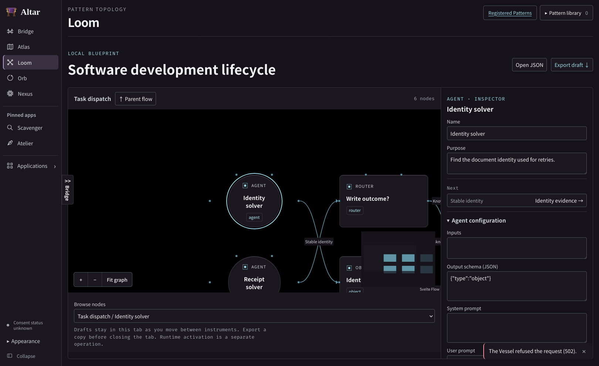

# Design a workflow

Open **Loom → Design workflow** to edit the software development blueprint. The editor opens
with a synthetic document-import retry example. Its overview connects Intent, semantic
decomposition, the conditional task plan, parallel orchestration, evidence review,
implementation and the decision ledger.

This is a first authoring layout. The sample and its editable nodes are local to the browser.

Select a node on the graph or in **Browse nodes**. Follow **Previous** or **Next** to inspect
the document or guard on a connection. **Explore subflow** and **Explore router** open their
declared members. In Parallel Intent Task Orchestration, open Task dispatch and follow the
unknown write outcome to Recovery solver. Its lookup routes distinguish a file read receipt
from unresolved evidence. **Parent flow** returns to the enclosing node.

Edit a node's purpose, inputs and JSON output schema in its inspector. Agents also declare
system and user prompts, model, temperature, fallback and tools. **Add connected node**
creates a typed successor. **Add inside** creates a member of the selected router or subflow.
Use **Edit outgoing connections** to change the relationship, guard label or target.

**Export draft** downloads the current blueprint. **Open JSON** validates and replaces the
working document. Instrument navigation preserves the working draft in this tab. Export before reloading or closing the tab. The blueprint
remains local, and tool declarations and prompts are inert. Registered Pattern revisions
and Run evidence keep their existing [Loom](loom.md) and [Orb](orb.md) owners.
