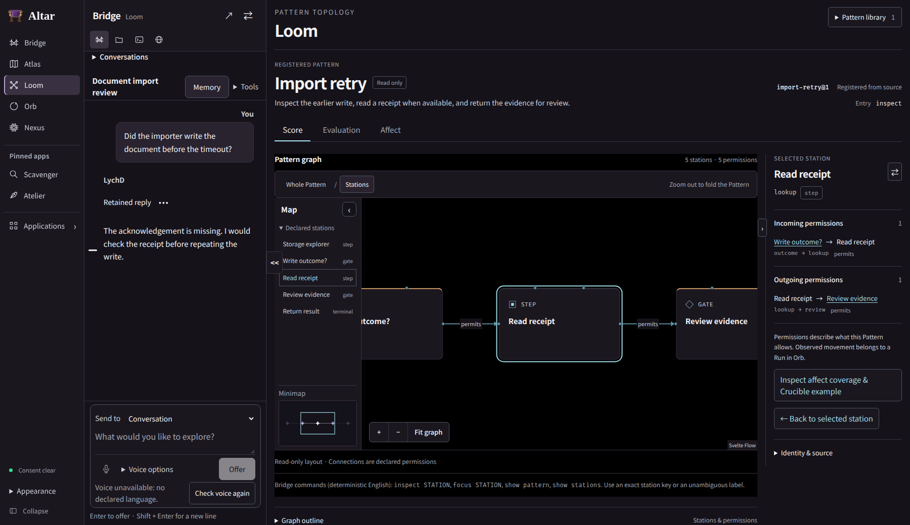
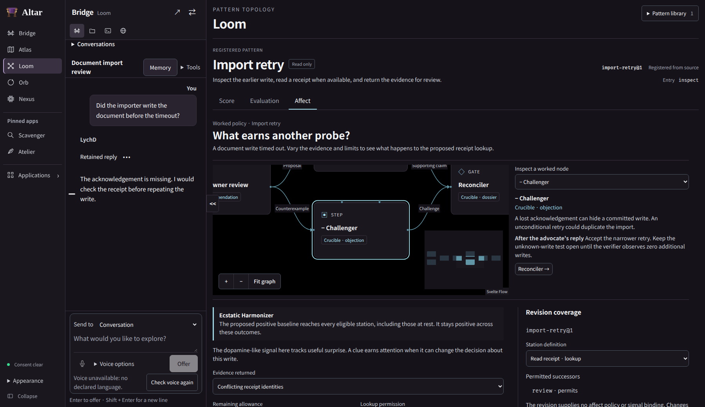
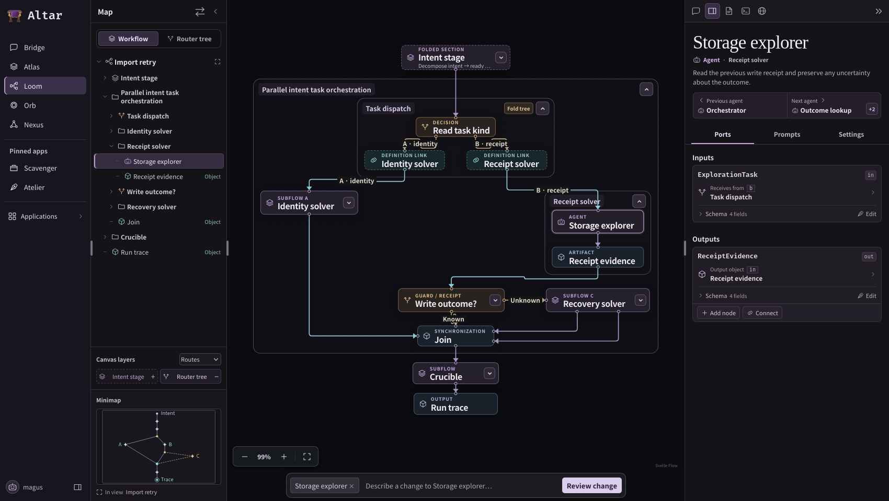
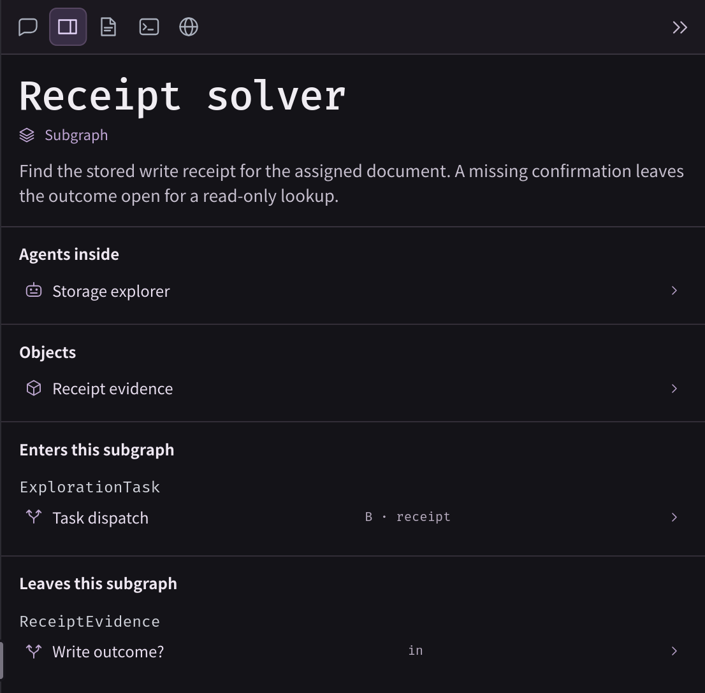
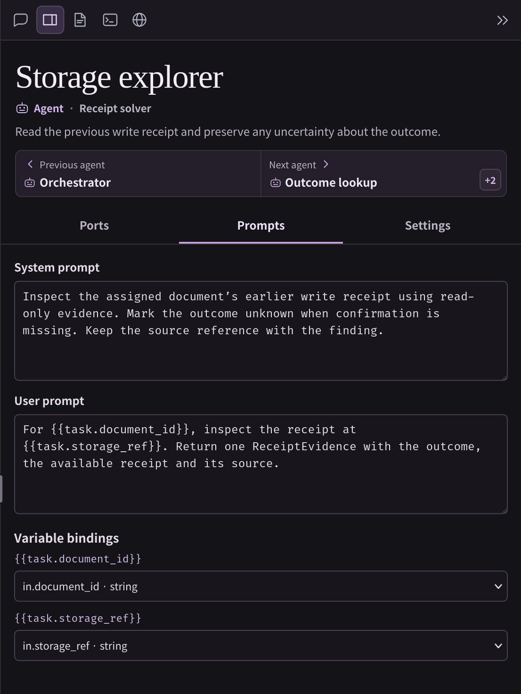
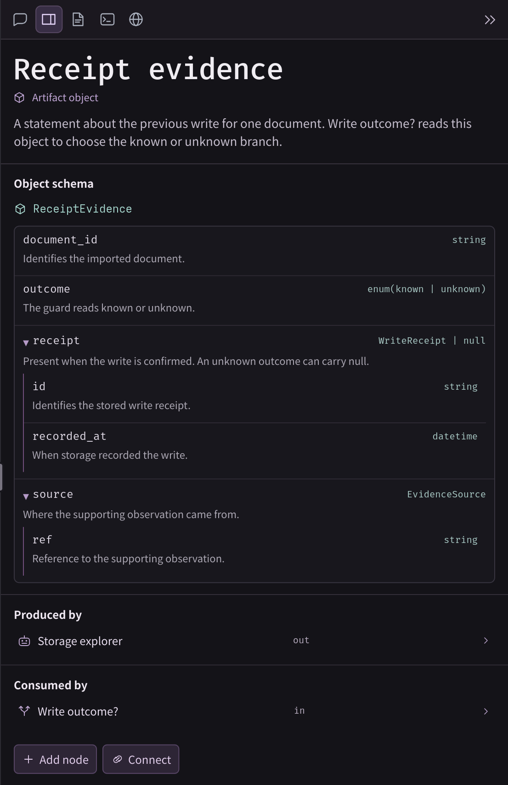
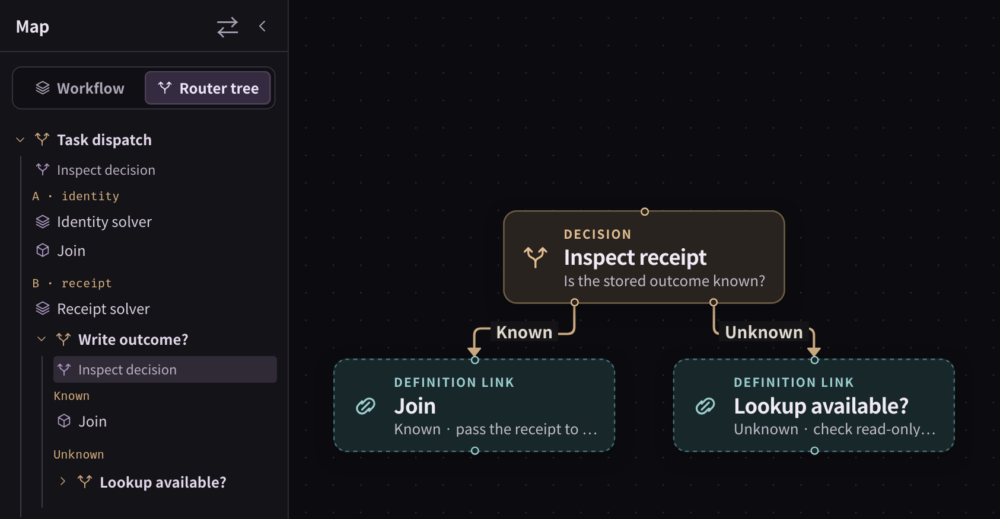
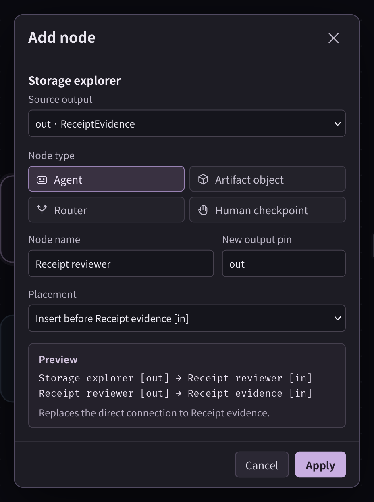

# :material-vector-polyline: Loom

A document import timed out. The write might have succeeded before the importer lost its
connection. Before designing a retry, you want to know who checks for a receipt and what
happens if nobody can find one. **Loom** lets you follow those decisions through a workflow.
For the evidence recorded on a particular attempt, open its Run in [Orb](orb.md).

Choose **Design workflow** to edit the software development blueprint, connect an agent to a
typed object and examine conditional routes. [Design a workflow](loom-studio.md).

## Walk the blueprint {#reading-direction}

The screenshots follow **Import retry** in an early design prototype. Its layout and controls will be refined through use. You can inspect
the nodes and try an edit in your open page. The installed Altar lets you read the workflow
at an exact revision. [Open the interactive canvas](../../assets/altar-design/loom-canvas.html)
or [open a revision in the installed Loom](#find-the-exact-score).

Start at the selected **Storage explorer**. The frame around it is the subgraph that owns
the work. The smaller **Receipt evidence** node below it is the object it produces.
Selecting any of the three opens a different definition in the right panel.

### Open the Receipt solver subgraph

Select **Receipt solver** in the Map or click the frame title. The canvas brings the group
into view. Its inspector explains the job, lists the agents and objects inside, and shows
each wire crossing the boundary. Here **Task dispatch** sends an `ExplorationTask` on its
**B · receipt** exit. The solver sends `ReceiptEvidence` out to **Write outcome?**.

[{ width="553" loading="lazy" }](../../assets/altar-design/loom-receipt-subgraph.webp)

Use **Workflow** in the left Map to browse the ownership tree. A tree chevron exposes children
while you keep reading the current node. Drag or zoom the canvas to explore it. The minimap
at the foot of the Map keeps the outer branches in place. Its marker shrinks as you zoom
into a branch.
**Up one level** frames the parent. **Fit full graph** (`F`) brings the whole blueprint back.
The Orb design reuses these navigation gestures for the branches observed by a particular
moment in a Run. [Navigate the Orb capture](orb.md#navigate-with-the-minimap).

### Inspect the agent

Choose **Storage explorer** under **Agents inside**. In **Ports**, follow the incoming
`in` pin back to Task dispatch or the outgoing `out` pin to its receipt object.
**Previous agent** and **Next agent** traverse the objects and decisions in between.
The previous agent here is **Orchestrator**. Open the choices beside **Next agent** to
find **Outcome lookup** on the recovery route or **Advocate** and **Challenger** in review.

Open **Prompts**. The system prompt tells the agent to read the earlier write and preserve an
unknown outcome when confirmation is missing. The user prompt supplies the document and
storage reference for this task. **Variable bindings** shows how the placeholders resolve.
For example, `{{task.storage_ref}}` reads the string at `in.storage_ref`.

[{ width="553" loading="lazy" }](../../assets/altar-design/loom-storage-prompts.webp)

In **Settings**, inspect the model profile, temperature, output limit, allowed tools and
primary and fallback Animators. Storage explorer has a read-only
`read_receipt(document_id, storage_ref)` tool. A fallback can take over if the primary is
unavailable before submission. An uncertain submission needs reconciliation before another
attempt. [Execution-road planning](../../adr/28-workflow.md#execution-road-planning).

??? info "Compare the other explorer"

    On branch **A · identity**, **Repository explorer** takes the assigned question and
    revision at `in.task`. Its system prompt requires file and line references. The user
    template binds `task.revision` and `task.question`. Its `out.evidence` pin produces
    an `EvidencePacket` with a finding, source references and outstanding questions.

    Its sample Gemma profile uses temperature 0.2, top p 0.9 and up to 1,200 output tokens.
    `search_repo(query)` returns source references. `read_file(path, start_line, end_line)`
    reads an inclusive line range and returns the path, revision, range and text. For the
    actual Animator, rendered request or tool result, follow the Run to Orb and inspect
    what the attempt retained. [Animator readiness in Nexus](nexus.md).

### Open the receipt object

Return to **Ports** and select **Receipt evidence** under **Outputs**. Expand `receipt` in
the object schema. When a stored receipt is present, `id` identifies it and `recorded_at`
gives the time storage recorded the write. The field may also be null. Expand `source` to
find `ref`, the reference supporting the observation.

[{ width="553" loading="lazy" }](../../assets/altar-design/loom-receipt-schema.webp)

**Produced by** takes you back to `Storage explorer.out`. **Consumed by** opens the
`in` pin’s owner, **Write outcome?**. Those two endpoints identify this particular binding
even if another station produces the same schema. To read the receipt for a specific
import, inspect the object retained by that Run in Orb.

### Follow the router tree

Switch the left Map to **Router tree**. Open **Task dispatch**, follow **B · receipt**
and expand **Write outcome?**. **Known** leads to **Join**. **Unknown** leads to
**Lookup available?**. With read-only access the workflow can ask **Outcome lookup** for
evidence. Without access it records **Unresolved**. Both outcomes can go forward to review.

[{ width="843" loading="lazy" }](../../assets/altar-design/loom-routing.webp)

The identity and receipt checks can start together. **Join** waits for the identity evidence
and one receipt result. **Crucible** then tests the evidence for a retry. Changing an
unknown result into permission to repeat the write would require an explicit change to the
workflow.

Under **Canvas layers**, fold **Router tree** to work on a solver with its boundary wires
still visible. **Intent stage** folds independently. Click a folded section’s body to
inspect what it contains or its chevron to open it. **Routes** and **All stations** switch
the overall level of detail. During execution the backend assigns workers and evaluates
the declared conditions. Orb records the route taken.

??? info "Trace the work back to the Intent"

    Expand **Intent stage**. The target-state and current-state analysts describe the desired
    behavior and the importer as it exists. **Reconcile analyses** records the gap and
    acceptance criteria in **Difference**. **Task decomposition** emits an atomic task or
    splits a composite task and calls the same definition for each child. A recursive call
    appears in the tree as a reference to that definition.

    The conditional task plan tells the Orchestrator which work can start. The queue uses
    priority to choose among waiting Runs. An explicit Intent priority overrides the routing
    rule on a 0–100 scale. Work already running keeps its claim. Follow the
    [software-change blueprint](loom-sdlc.md) through exploration, the human checkpoint,
    implementation and the separate Eval workflow. [Worker admission](../../adr/14-workers.md#publication-and-exact-hop-claims).

## The planned editor {#where-charcoal-must-wait}

To put a reviewer between the storage agent and its output object, start at
**Storage explorer → Ports → Outputs → Add node**. Pick **Agent**, name it
**Receipt reviewer** and choose **Insert before Receipt evidence [in]** under
**Placement**. Read the two replacement connections in **Preview** before choosing **Apply**.

[{ width="464" loading="lazy" }](../../assets/altar-design/loom-add-node.webp)

Choose **Add a branch** if both the original and new destinations should receive the output.
Use **Connect** for an existing node and select its compatible input pin. You can also drag
between handles or enter `Insert Reviewer before Task dispatch` in the composer and
choose **Review change**. **Cancel** dismisses a proposal and **Undo** reverses an applied
edit. Prototype edits stay in the open page. Each running workflow stays pinned to its
admitted revision. [Editor design and admission](../../adr/15-frontend.md#loom-workload-and-editing-gate).

??? info "From a draft to a published workflow"

    In the planned editor, Charcoal drafts and grey Spell placements produce inert candidates
    and redacted resolution reports. A candidate stays `castable=false` until every exact
    placement passes Scroll admission. A human checkpoint may pause a route for an authorized
    decision. Its policy defines where approval, refusal and expiry lead.
    [Scroll admission](../../adr/28-workflow.md#spells-scrolls-and-casting) and
    [Spellweaver](../../sepulcher/aspects/weaver/index.md).

The tool icons along the top of the right panel let you return to **Walking Bridge**, your
files, terminal or browser. Selecting a graph node opens its inspector. Switching back to
Walking Bridge restores the séance and its unsent draft. Both side panels can be resized,
folded or swapped. [Shared panel design](workspace-design.md#keep-the-conversation-on-loom).

## Find the exact score

In the installed Altar, open `http://127.0.0.1:7134/loom`. Loom opens the configured
default and puts the **Pattern** and its **revision** in the address. The unconfigured
Bridge score opens at `/loom/bridge_chat/1`. Copy that full address to share the same
workflow definition. Its **Scroll** declares the entry, stations and permitted connections.
[Altar setup](index.md#bring-one-intent).

| Label beside the revision | What it tells you |
| --- | --- |
| **Default** | Ordinary route for a new request. |
| **Route** and **Active route** | The routing rank and whether the entry is active. |
| **Retained** | This exact revision remains inspectable after routing changes. |

For a contributed score, **Inspection binding** identifies its source, Registrant, profile,
generation and publication meaning. **Observation only · not executable in this Vessel**
allows inspection. **Executable in this Vessel** identifies a separately executable native
entry. A deep link preserves the binding, and Loom reports changes or loss of access at that
address. [Connected sources](../../sepulcher/aspects/oculus.md#connected-components-and-activity)
and [route selection](../../sepulcher/aspects/weaver/pattern-lifecycle.md#identity-before-motion).

### Read identity, then possibility

In the installed read-only **Pattern graph**, choose **Whole Pattern** for the group or
**Stations** to reveal its contents. Zoom changes between the same two levels. Hover or
focus a node for a preview and press Escape to dismiss it.

| Control | What to inspect |
| --- | --- |
| **Graph outline** | Select a station by label or key. Its permitted successors, incoming and outgoing connections and declared self-loops remain readable if the graph fails to render. |
| **Selected station** | Inspect the endpoints and relation on each permission. **Back to selected station** returns keyboard focus to its row. |
| **Identity & source** | Read the checkpoint schema, entry, reviewed implementation revision, manifest digest, trigger and Mermaid source. The header identifies the revision and its registration source. |

**No outgoing permission declared** describes the manifest. Use a Run trace to establish
where execution ended. If the score fails to load, **Retry reading Pattern** retries the
same revision. [Scroll and Spell contracts](../../adr/28-workflow.md#spells-scrolls-and-casting).

The installed **Map** lists the revision's declared stations. Select a station to locate it on
the canvas and open its definition. The stars in the minimap represent actual graph nodes.
Drag the minimap viewport to pan. Use its chevron to fold the Map, or drag the separator to
give it more room. The station inspector has its own fold control and separator. **Swap Map
and station inspector** changes their sides while keeping the Bridge conversation open.

### Compare it with a Run

Follow a Run from Orb into Loom to inspect the exact revision it used. For **Return to Run
in Orb**, Loom checks the Run’s pinned manifest against the registered score and verifies
the displayed score’s digest. The return link restores the same attempt and its selected
event or delegated-job hint. Loom reports stale or mismatched bindings. Choosing another
Pattern clears the Run context. [Verified handoff and delivery status](../../state-of-the-work.md#loom-workflow-views).

### Explore an affect policy {#affect-policy}

Open **Affect** on an exact revision. **Revision coverage** lets you inspect a station and its
declared exits. The current score format supplies neither an affect policy nor a binding from
a signal to any of those exits. Alongside it, **Import retry** is a worked policy you can vary
in this tab. Its question is whether a read-only receipt lookup could resolve an uncertain write.

Change **Evidence returned**. A new receipt key makes one specific lookup worth considering.
Repeated observations leave the decision unchanged. A conflicting receipt calls for review.
Then change the remaining allowance or the lookup permission. Exhausting the allowance stops
further probes. A probe that needs permission goes to review. The proposed positive baseline
stays present in every case, including when work stops. It supplies orientation across eligible
stations, while the evidence-gain signal applies only to the question the observation could settle.
[The software-change example](loom-sdlc.md#affect-in-exploration) ·
[Ecstatic Harmonizer](../transcendence/illumination.md#ananda).

The worked graph marks the appraisal with **Curiosity**, **Frustration**, **Concern** or
**Satisfaction** as the evidence changes. Select a node in the graph or use **Inspect a worked
node**. **Read · receipts.log** shows the illustrative source line. **+ Advocate** and
**− Challenger** make independent claims about the repair. **Reconciler** retains the
lost-acknowledgement objection. **Edit · retry.py** opens the candidate diff and its open
verification finding. The proposed links show where the claims go. A recorded claim exchange
would need an admitted workflow and an actual attempt. [Crucible](../../sepulcher/aspects/weaver/crucible.md).

Follow **Inspect affect routing in Nexus** to inspect the scope and ownership of a proposed network default.
Each consuming station would need a declared input and an authorized route. That includes
separate authorization for sending anything to a peer. Changes in this example stay in the
open page. To inspect a Run, use [Orb's appraisal at the cursor](orb.md#appraise-a-record).

??? info "Source and context for this revision"

    The exact source endpoint is `/api/v1/loom/source/patterns/{pattern_id}/{revision}`.
    The current-revision shortcut is `/api/v1/loom/source/workflows/{workflow}`. A detail
    link requires a revision. Orb may supply `?run={run_id}` alongside it. The separate
    source namespace also permits an exact score such as `/loom/source/1`.

    A station definition can declare the context policy and evaluation criteria it uses.
    Archive governs eligibility. Context assembly determines which inputs reach an Invocation.
    [Archive](../../adr/27-memory.md), [Context assembly](../../adr/21-context.md#explicit-archive-projection)
    and [the shared station inspector](index.md#shared-workflow-station-inspector).

## Review a retained output

Open **Evaluation → Manual output review** on an exact revision to judge a historical answer.

1. Enter your reviewer name, goal, bounded scope and criteria. Freeze them before loading
   the output so the record shows which terms you set in advance.
2. Choose a Run whose full pinned manifest and inspection binding match the displayed score.
   Loom reads the retained agent turn from its exact Session. Start each verdict at
   `UNKNOWN`, record a reason for changing it and quote the supporting text or identify
   what evidence is missing. A claimed file write needs evidence of the write itself.
3. Finish to freeze the review. Regrading creates a new revision. Export JSON or Markdown
   before leaving the page. The review lives in the open browser document and records the
   self-declared reviewer, source, judgments and limitations. If access is refused, Loom
   clears protected captures and prevents a late response from restoring them.

To test a proposed workflow improvement on the same cases and criteria, open the
[worked Eval example](loom-sdlc.md#evaluate-the-workflow). [Drift](../../adr/34-drift.md)
owns the comparison and revision contracts.
