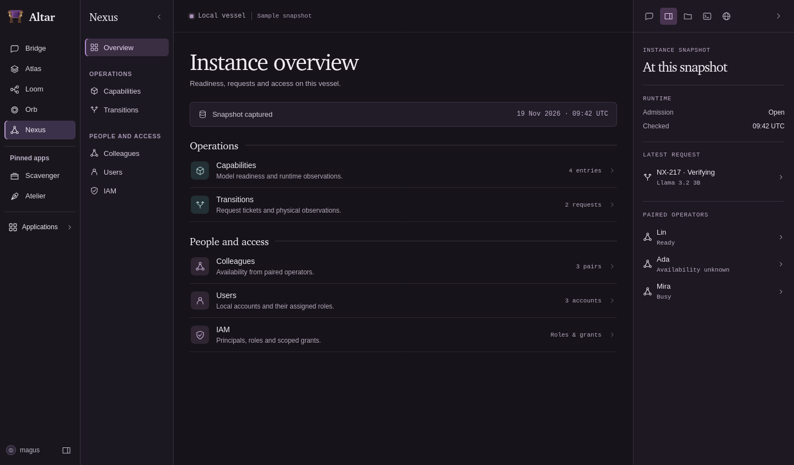
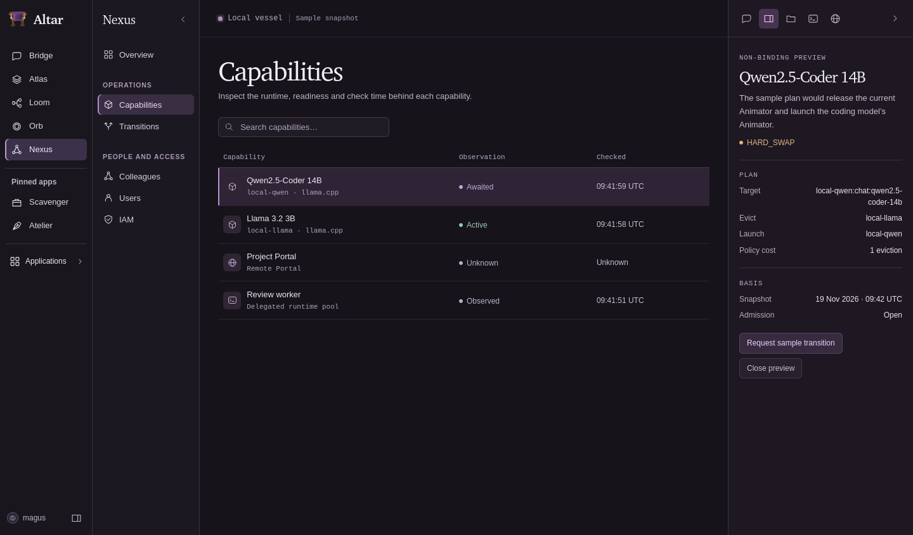
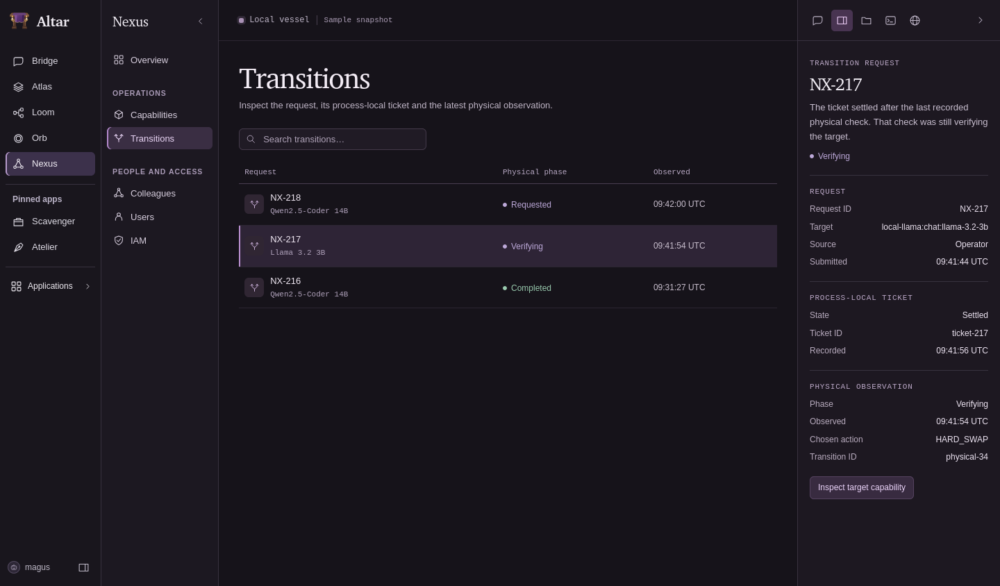
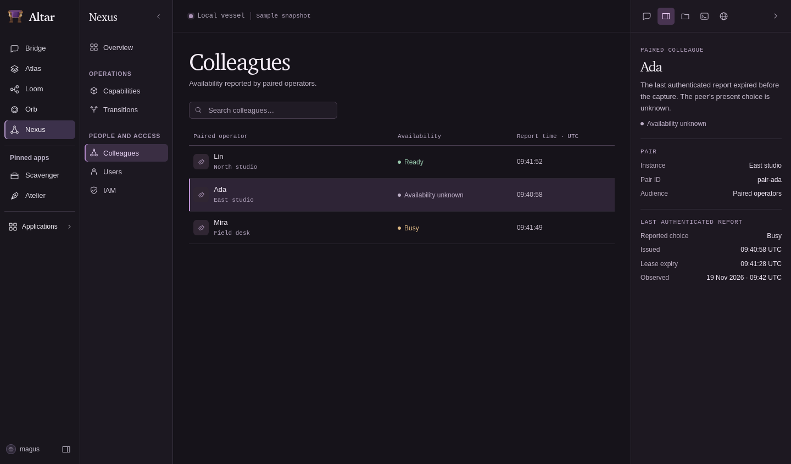
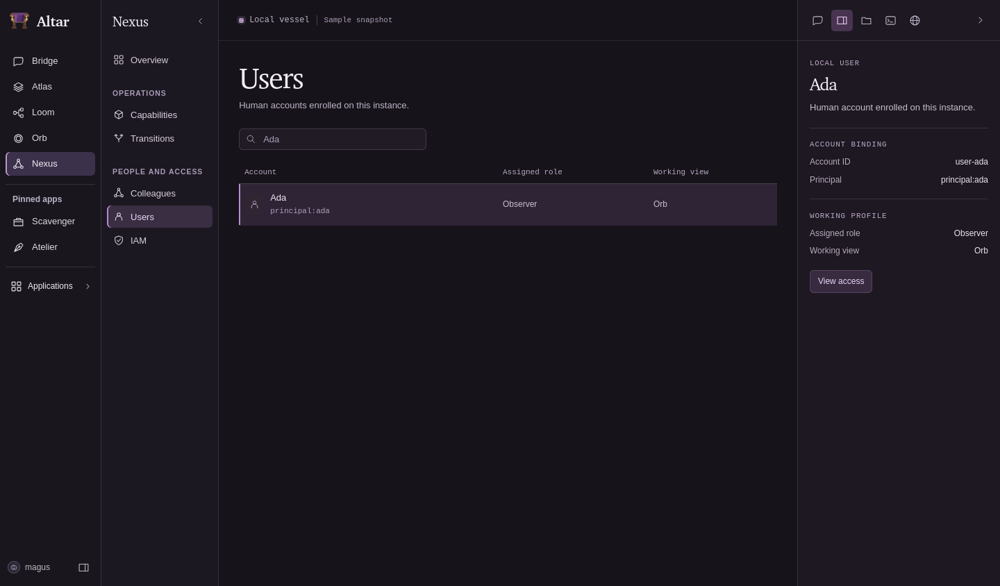
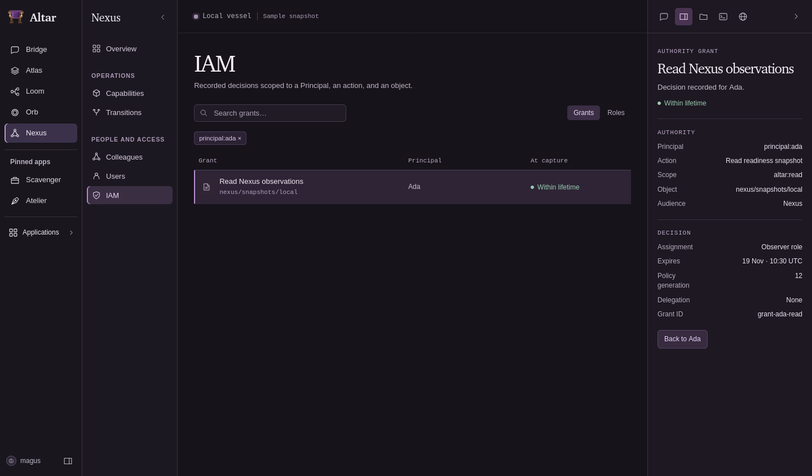

# Nexus design

An operator wants to load a local model. Ada needs to read the resulting readiness
observation. In Nexus the operator can preview the model change, follow its request and
inspect Ada’s access to this instance. This earlier standalone study uses fictional records. The installed [Nexus operations directory](nexus.md#choose-an-operation) uses the current Vessel snapshot.
Its controls and layout will be refined through use. Every figure shows the same screen.
[Open the interactive Nexus study](../../assets/altar-design/nexus-board.html).

## Overview

Start with the sample snapshot from **19 November 2026 at 09:42 UTC**. Under
**Operations**, choose **Capabilities** for a model or **Transitions** for a request.
Under **People and access**, choose **Colleagues** for a paired operator’s availability,
**Users** for a local account, or **IAM** for its scoped authority.

On the Altar rail, **Applications** opens the catalogue. Its chevron or a right-click
opens the quick list over Nexus. Closing either returns you to the selected record.
[Browse and pin applications](applications.md).

Selecting a row in Nexus opens its details on the right. The horizontal controls there also open
Walking Bridge, Files, Terminal and Web. On a narrow screen, closing the detail should return
you to the selected row. On refresh, the design should preserve its identity and show when
that record has become unavailable. [Moving between screens](workspace-design.md).

## Capabilities

Select **Qwen2.5-Coder 14B**. The **Awaited** chip corresponds to the raw observation
`activatable`, checked at **09:41:59 UTC**. Choose **Preview transition** to see what the
local instance would have to release to load that model.

[{ loading="lazy" }](../../assets/altar-design/nexus-capabilities.webp)

The sample plan would evict `local-llama` and launch `local-qwen`. Its policy cost of
one counts the planned eviction. The preview reserves nothing. Choose **Request sample
transition** to create the example **NX-218** and inspect it in Transitions. For comparison,
the active **Llama 3.2 3B** returns `NO_OP`. Portal rows offer observation details only.
[Preview a change in the installed Nexus](nexus.md#preview-the-change-you-intend).

## Transitions

Open **NX-217**. Its process-local ticket settled at **09:41:56 UTC**. The latest physical
observation for that request is **verifying** at **09:41:54 UTC**. The task returned.
The physical outcome is still open in this snapshot.

[{ loading="lazy" }](../../assets/altar-design/nexus-transitions.webp)

If you created **NX-218**, its ticket is **warming** and its recorded physical phase is
**requested**. Keep the request identity when comparing those records. In the installed
Altar, an Orb event can lead to the exact Nexus request when the Run supplies that
correlation. [Follow a ticket and its physical observation](nexus.md#follow-the-ticket-and-the-physical-observation).

## Colleagues

At the sample snapshot, Lin’s **Ready** report is current. Select the paired colleague
**Ada** to see why her row reads **Availability unknown**.

[{ loading="lazy" }](../../assets/altar-design/nexus-colleagues.webp)

Ada reported **Busy** at **09:40:58 UTC**. The authenticated report expired at
**09:41:28 UTC**. Her current preference is unknown. **Ready** means an operator welcomes a
request. Accepting a task requires its own authorization.
[Read colleague presence in the installed Nexus](nexus.md#see-which-colleagues-welcome-requests).

## Users

Search **Users** for **Ada**. This entry identifies an account on the local instance.
A matching name in Colleagues gives you a separate record for a paired operator.

[{ loading="lazy" }](../../assets/altar-design/nexus-users.webp)

Ada’s account binds to `principal:ada`, carries the **Observer** role and opens **Orb**
by default. Choose **View access** to carry her exact Principal into IAM.
[People, accounts and instances](../../adr/38-iam.md#people-accounts-and-instances).

## IAM

Open **Read Nexus observations** under **Grants**. Ada’s sample grant permits reading
the local readiness snapshot. The details identify the action, object and audience.

[{ loading="lazy" }](../../assets/altar-design/nexus-iam.webp)

The object is `nexus/snapshots/local`, the audience is **Nexus**, and the grant expires at
**10:30 UTC** under policy generation **12**. Open **Roles** to inspect the named assignment behind a grant.
**Back to Ada** restores the selected user. Requesting a transition would require a grant
for that operation.

Users and IAM are read-only design examples. The current Altar uses its trusted local
operator. Ward owns identity, grants and the requirements for multi-user administration.
[Identity and grants](../../adr/38-iam.md#decision) · [Delivery boundaries](../../adr/38-iam.md#thresholds-and-delivery).
