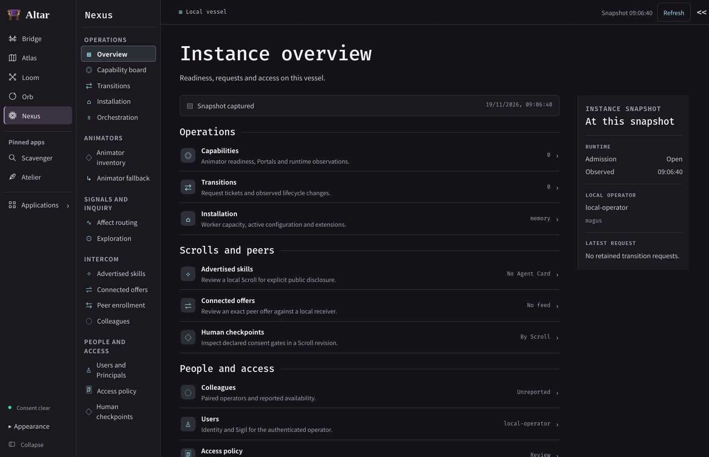
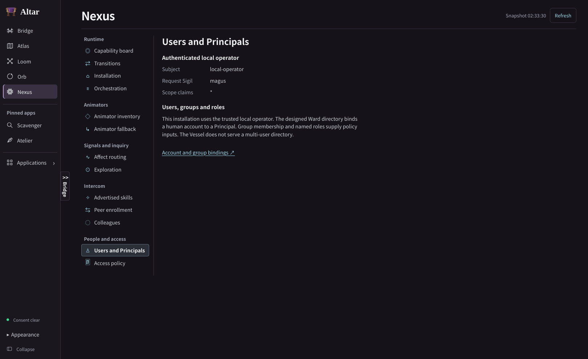
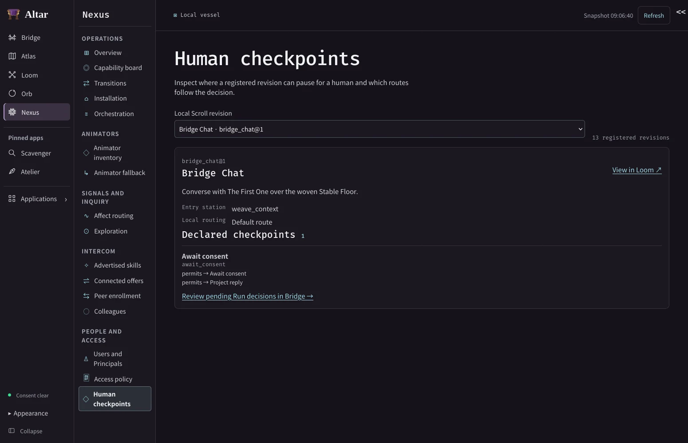
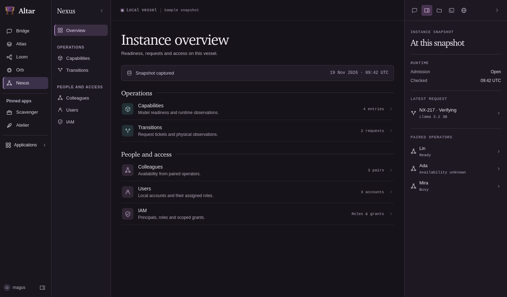

# :material-transit-connection-variant: Nexus

Use **Nexus** to understand the current readiness of the iron before changing it. Begin with its
observations, open **Preview** to calculate a nonbinding plan, then choose **Request transition**
only when you intend the real maximum-priority lifecycle mutation. Viewing the board alone
changes no lifecycle state.

Complete [Altar’s startup and local-access steps](index.md#bring-one-intent), then open
`http://127.0.0.1:7134/nexus` within the same-host browser boundary.





This first design opens on **Instance overview**. Its captured time, capability counts, latest transition and request identity come from the local snapshot. Select a row or use the operations directory to open its owner. Choose **Orchestration** to inspect the effective queues and priorities. The broader [operations design study](nexus-design.md) uses fictional people and access records.

## Choose an operation

Use the directory on the left to select an area. **Capability board** opens the ownership map,
list, transition preview and recent observations. **Installation** and **Orchestration** read the
effective configuration captured when this Vessel started. **Animator fallback** shows the Bridge
casting and lets you order a candidate list for review. **Animator inventory** groups the served
capabilities by owner, Coven membership, capability family or connector. Select a model row to see
its exact capability key, Animator, runtime, registration and declared groups. An icon choice
changes the glyph for that Animator in the current inventory view.

In **Orchestration**, read the source, queue and priority together. A Bridge default of 70 on the
runs queue says how an intent is admitted. It does not establish the current queue order.
**Installation** accepts proposed worker limits. Each exported file includes its operation and
the values you entered. The running startup generation remains authoritative.

In **Animator fallback**, enter the exact key or choose one of the observed managed capabilities.
Add candidates in preferred order, then move a row up or down. Review JSON to see the complete
sequence. Bridge revision 2 currently supports exactly two eligible local Chat declarations with
tool support. At admission, the highest-weight eligible route wins and the Run retains its exact
key. A rank in this worksheet cannot trigger an automatic retry or switch a running model.
[Bridge admission preference](../../sepulcher/aspects/weaver/index.md#prefer-a-ready-route-at-admission).

**Affect routing** prepares a design for a signal producer, receiver and local weighting.
**Exploration** prepares the question, evidence criterion, probe ceiling and stopping rule for a
proposed investigation. In **Affect routing**, choose a producer, receiver and influence, then
**Add signal route**. Re-select that pair to update its weight. The
[Ecstatic Harmonizer](../transcendence/illumination.md#ananda) proposes a positive baseline.
Its weight cannot establish a successful outcome. **Exploration** records the evidence that
would change a decision and stops on saturation or a finite probe ceiling. Edits stay in this page until exported or the page closes. Their JSON
files are review documents. The Vessel has no endpoint that applies these designs.

### Review Scrolls, offers and checkpoints

In **Advertised skills**, select a registered Scroll revision. The title, entry station, routing
state and **View in Loom** link refer to that exact local definition. This build serves zero
public Agent Cards. Prepare the skill, task schema and intended audience to review a disclosure.
The exported JSON keeps the private target and digest in the local review envelope. Only the
explicit public fields are candidates for the [advertised contract](../../adr/26-a2a.md#advertised-expertise-and-reusable-knowledge).

**Connected offers** shows the availability of peer-offer inventory. The installed web API
provides no discovery or connected-offer feed. To review an offer obtained separately, enter
its workload identity, exact contract revision and task schema, select the receiving Scroll and
choose how the receiver should handle an unknown Spell. An exported review creates no enrollment
or binding. **Peer enrollment** describes the operator-managed Intercom task binding.



**Human checkpoints** reads the selected revision’s immutable manifest. Each declared gate lists
its outgoing station and relation. A revision with no gates has an explicit empty state. **Review
pending Run decisions in Bridge** opens the operator’s live decision surface. A gate declaration
alone says nothing about whether an executing Run is waiting.

**Users and Principals** and **Access policy** show
the authenticated local subject and Sigil. A policy review can describe a proposed group, role and
time-limited elevation for an exact action and object. Applying that authority belongs to Ward.

## See which colleagues welcome requests

Open **Colleagues** in Nexus. **Ready** means the other operator welcomes a request. **Busy**
means they have asked colleagues to hold off. **Availability unknown** means there is no
current authenticated report. A stopped Vessel and a delayed replica can look the same.

For a disposable local walkthrough, run this from the checkout on a POSIX host:

```bash
uv run --locked python scripts/nexus_colleagues_demo.py
```

Two presence services exchange real encrypted reports in a temporary local folder. Alice shares
Ready, Bob shares Busy, and Alice withdraws. Bob then stops reporting and his last lease expires. The demo uses
generated keys and cleans up on exit. Two computers need a private, bidirectionally replicated folder that both operators control.

### Pair two installations

1. Give this pair its own local replica directory and a separate local directory for its key.
   On a default Linux installation the Vessel can already read and write its Lab. For example,
   run the following as the installation owner on each machine. Substitute your actual Lab path
   if you use a different data root. The profile requires private POSIX directories.

    ```bash
    install -d -m 700 ~/.local/share/lychd/lab/nexus/ada-lin ~/.local/share/lychd/lab/nexus/keys
    ```

2. Generate **one** dedicated secret for the pair. On the first machine, run the following
   once. Copy the resulting file to the second operator through an independently trusted
   private channel and set its mode to `0600` there. Keep both key copies outside all replicas.

    ```bash
    (umask 077; set -C; openssl rand -hex 32 > ~/.local/share/lychd/lab/nexus/keys/ada-lin.key)
    ```

3. Use your private file replication tool to synchronize the contents of **ada-lin** between
   the two machines. Only `a.lease` and `b.lease` need to travel. Use real local directories
   on both ends so the service can pin them across refreshes. Synchronize both clocks. A report more than three seconds ahead is refused. The key authenticates and encrypts the choice. Someone with
   access to the replica can still see when its files change.

4. Add this pair to `lychd.toml` on each installation. Use absolute paths visible to its Vessel.
   In Ada's configuration, `name` identifies Lin locally and `slot` is `a`. In Lin's
   configuration use the name `Ada`, slot `b`, and Lin's own absolute paths. Each additional
   colleague needs another pair, directory and key. Restart the Vessels to load the roster.

    ```toml
    [[server.web.presence.pairs]]
    name = "Lin"
    slot = "a"
    directory = "/home/ada/.local/share/lychd/lab/nexus/ada-lin"
    key_file = "/home/ada/.local/share/lychd/lab/nexus/keys/ada-lin.key"
    ```

5. In Nexus, check the listed audience and choose **Share ready** or **Share busy**. Sharing
   lasts one hour and continues with the browser closed. Lin should see Ada's choice and report
   time after replication and the next refresh. Change to Busy and check again. **Stop sharing**
   writes a withdrawal. If the process or replication stops abruptly, the previous report
   expires within 30 seconds of issue. Each startup begins hidden. A publication failure is
   shown for its pair. Remove the pair and restart to revoke local access.

To send actual work, ask the other operator for a separate Intercom invitation. The receiver
starts a private listener for one enrolled sender and one task schema. The operators can then
send a public request and review it using the Intercom commands. Keep the task ID from
your sender's `submit` command to poll and read the acknowledged task after reconnecting.
**Ready** in Nexus is a presence report. [Receive a public brief](../../sepulcher/intercom.md#receive-a-public-brief)

## Read the observation before planning

Choose **Map** to explore supplied capability ownership, or **List** for the equivalent grouped
observations. Wide windows start with Map and fresh narrow windows with List; the browser can
remember this view choice. Select an Animator, capability, Portal or delegated runtime to open
**Selected object**. Selection reads properties only; it does not compute a plan or change
configuration. Portals and delegated runtimes remain read-only. Missing objects stay explicitly
unavailable after refresh instead of selecting a different object.

Map edges connect a supplied Animator to its capabilities. Positions and Coven labels organize
the view; they do not assert a physical host, GPU placement, network link or full group membership.
Use Fit, zoom and pan to inspect the map; the List supplies the same objects without camera gestures.

The board loads a timestamped snapshot, refreshes every five seconds, and refreshes when a ticket
settles. Stop if **Runtime admission is contained** appears: runtime admission is fenced.

Managed capabilities are grouped under their Soulstone's first Coven, falling back to the
Animator. A row shows its capability key, normally `{animator}:{family}:{model_id}`, a state chip,
its `checked` time or **freshness unknown**, and **Preview**. Compare `checked` with the board's
snapshot time before treating a row as current.

| Displayed chip | Raw observation |
| --- | --- |
| `active` | `warm` |
| `warming` | `warming` |
| `awaited` | `activatable` on a dynamic capability |
| `fault` | `error` |
| `cold` | Everything else, including `cold`, `unknown`, and non-dynamic `activatable` |

Expand a capability's **Observation details** for the served `warm`, `health`, and `reason`,
Animator, runtime and model. The checked time remains on the row. An unknown value remains unknown even when its compact
chip reads `cold`. `/orchestrator/status` also exposes raw `phase` and process-wide
`mutation_containment`.

**Portals** remain read-only. **Delegated runtime pools** also remain read-only and show
display/delivery state, adapter and transport, owning extension, Coffin profiles, Provider Gate
posture, capacity posture, and declared limitations. These are cached observations, not probes or
reservations. A refresh does not reserve a capability for a later Run.

## Preview the change you intend

Choose **Preview** on the selected managed capability, or beside its List row. The target stays visible during
loading, and closing the preview prevents a late response from reopening it. Read the
**Non-binding preview** for `action` (`NO_OP`, `SOFT_SWAP`, or `HARD_SWAP`), `target`, Animator ids
selected for `evict` and `launch`, and `policy cost`.

That cost currently counts planned evictions. It supplies no estimate of VRAM, time, energy,
or topology.

`NO_OP` disables the action. Otherwise, **Request transition** submits the real request at maximum
operator priority. The server recalculates before acting, so the preview reserves nothing and
cannot promise the same eviction set.

Evictions are named by Animator while board rows are keyed by capability. A Coven cannot hold
two conflicting Animators, so an eviction lands on another card, not the previewed one. The
map marks exactly matched Animators and their managed capabilities as **Planned eviction** or
**Planned launch**. Those labels describe this nonbinding plan, not the observed state. The full
Animator lists remain visible even when an identity has no corresponding object in this snapshot.
Selecting another object or changing Map/List does not retarget an open plan or its prepared request.

## Keep one request identity through uncertainty

The browser allocates a request id before submission. If the response is uncertain, keep Nexus
open and choose **Request transition** again for the same target to reuse that id. Admission
reserves the first target before task launch. PostgreSQL preserves this fence across Vessel
restarts; the memory profile preserves it for one process. Reusing the id for a different target
is rejected.

A retry returns the live ticket if one is still available. When its ticket has expired or its
process has ended, the same request id is refused without relaunch: the remaining ticket state
cannot establish the physical outcome.

Nexus keeps that refused id while the page stays open. Leaving or reloading discards the prepared
retry, so cancel the navigation warning while the outcome remains unknown. PostgreSQL retains
the admission fence, not the browser's retry state. Keep the original identity until the physical
outcome is reconciled; losing the answer does not justify creating another physical request.

## Follow the ticket and the physical observation

An accepted request returns HTTP 202 with a process-local ticket:

| Ticket | What it establishes |
| --- | --- |
| `warming` | No terminal task result has been observed. |
| `settled` | The task returned; Nexus refreshes the board. |
| `failed` | The task raised or was cancelled. |

The **Request ticket** keeps its target, current transition phase, and full request id visible
even while you preview a different target. **Request outcomes** also retains full identities after
uncertain submission, including after you close the preview.

Terminal ticket truth remains for a 60-second reconnect window by default. If the bounded store
is full, it refuses new work before launch instead of evicting active or fresh-terminal tickets.
Tickets provide no cancellation, durable history, or restart recovery. Durable admission prevents
duplicate effects but cannot settle, fail, or resume a ticket that was lost.

**Latest transition observations** shows up to 24 newest retained requests from Run and operator
sources. Select one, or open `/nexus?transition={request_id}`, to inspect `request`, `source`,
`target`, `phase`, chosen `action`, Run `occurrence` when supplied, `physical` transition identity,
and compensation identity labeled `restoration`.

Its phases are `requested`, `arbitrating`, `draining`, `actuating`, `verifying`, `compensating`,
`completed`, `declined_no_effect`, `failed_restored`, `cancelled_restored`, `contained_uncertain`,
or `failed`. Ticket settlement and these physical observations answer different questions; read
both before judging what happened.

An Orb link may add `event={event_id}`. Nexus keeps it only while that request is selected and,
when Run correlation exists, offers the return to `/orb/{run_id}?event={event_id}`. Closing the
inspector or selecting another transition drops the event context.

## When the accounts disagree

If a chip, raw status and host disagree—or a lost ticket leaves the outcome unknown—follow the
[existing runtime-transition contract](../../sepulcher/extensions/animators/runtime-transitions.md#the-transition-contract)
and its [Host Reactor observations](../../sepulcher/extensions/animators/runtime-transitions.md#switching-settings).
Keep the original request identity while reconciling the physical outcome. A contained or
unresolved result needs operator recovery; another transition request cannot clear that uncertainty.
Reconcile a unit/probe mismatch before retrying.

The capability board offers an ownership map and grouped list, selected properties, preview, request
ticket, and latest-observation inspector. Narrow screens place details in the reading flow.
It shows no queue order, leases,
GPU/VRAM/topology/thermal pressure, durable history, configuration editing, provider accounts,
billing, or credentials.

Its map is a read-only lens over validated observations within the semantic board. The
[Frontend Covenant](../../adr/15-frontend.md#decision-lock-and-reopening-gate) owns that design and
its admission gates.

## Reading direction

In an earlier standalone study, follow a model from a nonbinding preview to its sample
transition, or follow a local account to its scoped grant. Six views of the same screen
show the separate observation times, record identities and return paths. The study uses
fictional data. [Open the interactive design](../../assets/altar-design/nexus-board.html)
or [walk through the illustrated Nexus guide](nexus-design.md).

[{ loading="lazy" }](../../assets/altar-design/nexus-overview.webp)

The current layout keeps snapshot time and containment first, then the ownership map or grouped
list, selected properties, one selected preview and its explicit request. Exact plan overlays and
aligned eviction/launch lists describe the same supplied Animator identities. Keep inspection
selection visually distinct from the preview target. Neither position nor a group label establishes
physical topology, and the capability and its Animator remain different objects.

Ticket outcome and physical observation stay separately identified by request, target and time.
A recently observed phase is not a complete progress rail, and the latest bounded list is not
full history. Unknown or stale states remain recognizable even when a compact chip merges
several raw values. New memory, temperature, duration, impact, or health graphics need actual
observations and their interpretation before they gain a place on the board.

Acceptance case: inspect a proposed target while an older request is observed as verifying,
then lose the response to the new request. Keep both identities clear, retain the original
request, and avoid treating a settled ticket as physical success or making a fresh request to
cover the unknown result. Check keyboard return from the inspector and a narrow layout with
long Animator ids. These [presentation targets](../../adr/15-frontend.md#reading-hierarchy-and-visual-direction)
do not deliver durable observation history, restart recovery, or a body map.
