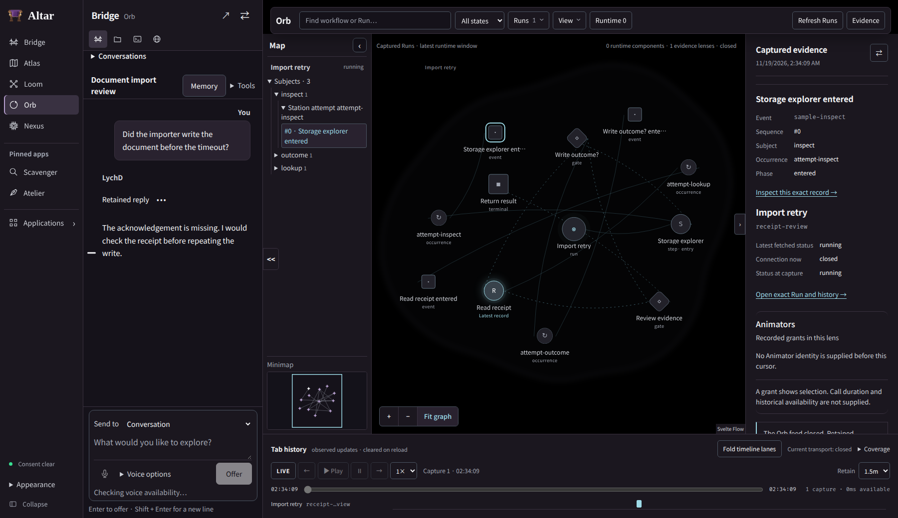
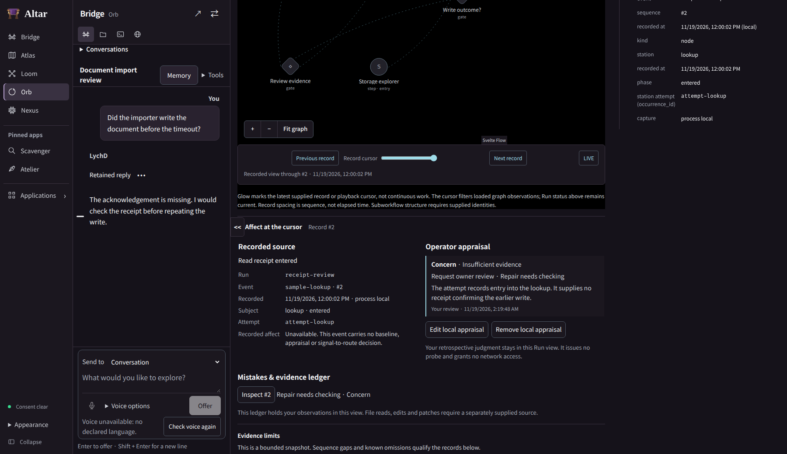
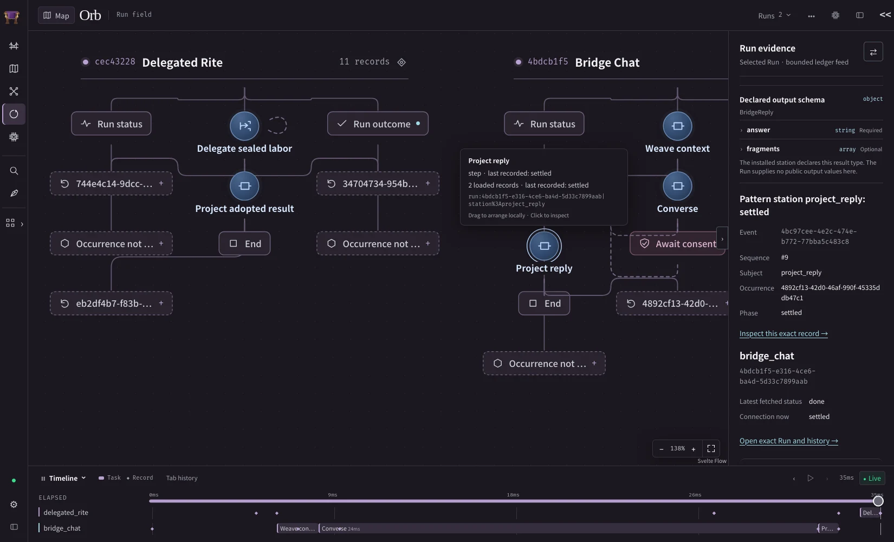
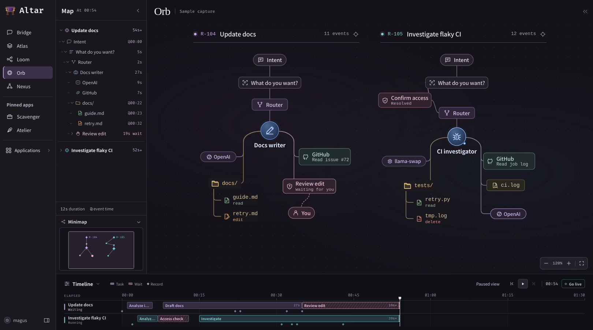
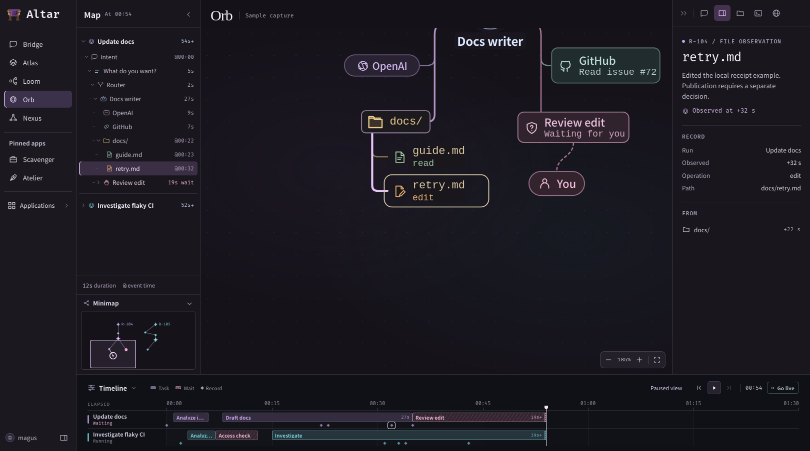
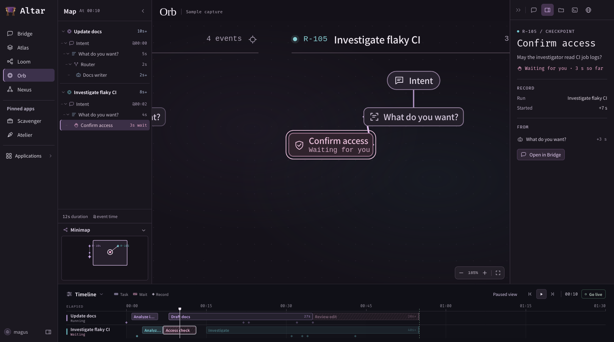
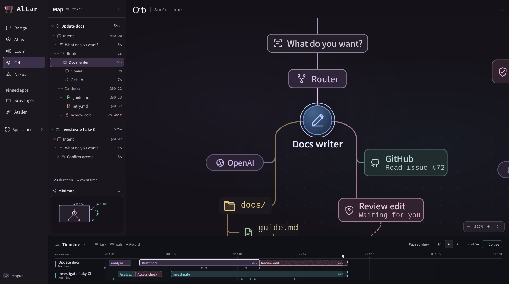
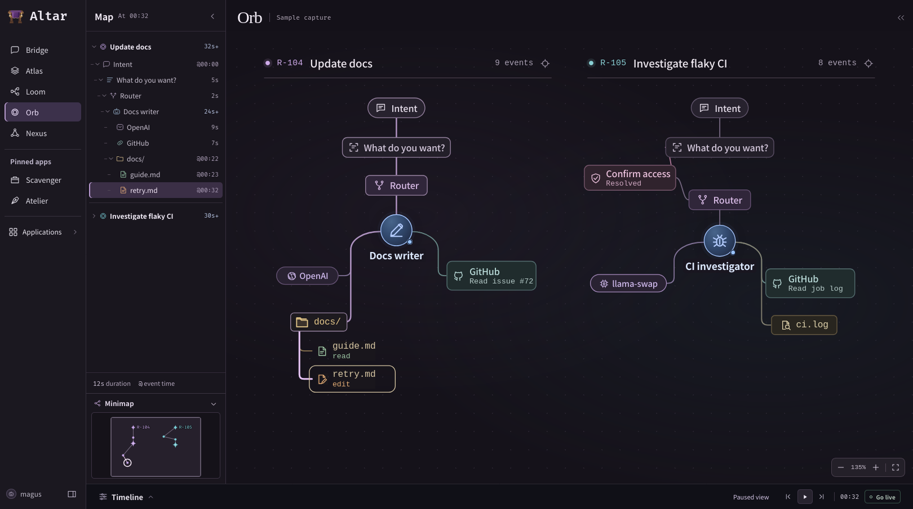

# :material-crystal-ball: Orb

A result raises two questions: which Run produced it, and how much of that Run can still be
examined? The **Orb** opens its ordered structural evidence and keeps gaps visible as you read.
This act of looking through the evidence is **scrying**.

Open `/orb` for the parallel Run field, or choose **… → View run in Orb** at a Bridge result to
inspect `/orb/{run_id}`. The shell’s **Orb** tab opens the parallel field; exact Run and event
links preserve the account being reviewed.

The installed Altar below shows two Runs completed by the local worker. **Bridge Chat** used
an offline model and **Delegated Rite** used the reference delegated runtime.

### Inspect a station result

Select an observed station on the field or in a Run's detail. **Declared output schema** shows
the installed definition for an exact registered station. Expand a field to read its type,
required status and nested object or array. A delegation station can separately report the
latest retained AgentJob’s output presence and artifact count. Rewinding by record hides
those latest counters. Raw response content is private. A schema or a completed station does
not establish which output values existed at an earlier moment.

## Proposed design

This is a rough, interactive design for Orb. The views below show one simulated
capture. The layout and controls will be refined as the design is tested with larger Runs.
[Open the interactive Orb mockup](../../assets/altar-design/orb-field.html).

### Find a step in the Map

At **00:54**, **Update docs** is waiting for permission to publish while **Investigate flaky CI**
continues. The left **Map** lists the work observed by that moment, grouped under the Run
and event it belongs to. The bottom timeline places both Runs on the same clock.

A step with a recorded start and finish shows **how long it took**. **Docs writer** took
27 s, including an OpenAI call and a GitHub request that overlapped. A parent’s duration
covers its own interval. Adding its children would count some of that time twice.
An open step shows elapsed time through the cursor. **Review edit** shows **19s wait**.
**CI investigator** shows **39s+** while its attempt is open. A single observation has a
**time on the capture clock**. The **@00:32** beside `docs/retry.md` marks the edit.
Its duration is unknown.

Open **Docs writer → docs/** with the chevrons, then select **retry.md**. The row and file
node highlight together, the timeline marks the edit, and the right panel identifies the
operation and path. The cursor stays at **00:54** while you look. Select the row’s time
to seek to the edit, or a step’s duration to seek to its recorded start.

[{ loading="lazy" }](../../assets/altar-design/orb-map-selection.webp)

On the graph, hover or focus an **Intent** to read the original request. Follow **What do
you want?** through its router to the assigned agent. A small inference mark reveals its
model. A larger Reach mark names its operation. Hover either GitHub call to highlight
the shared connection. The writer read an issue and the investigator read a job log.
File activity appears under its gold folder with a read, edit or delete label. The `ci.log`
search result stays beside the agent that found it.

### Rewind a checkpoint

Scrub the timeline to **00:10**, or use the arrow keys. **Confirm access** has been waiting
3 s for permission to read the CI logs. Its router and investigator appear only after
approval. The Map keeps the surviving branches in order as you scrub. Pausing holds the
Map and graph at the cursor while the timeline can continue receiving samples. During
playback a signal briefly lights the incoming connection as its record is reached.

[{ loading="lazy" }](../../assets/altar-design/orb-map-history.webp)

**Go live** returns to the newest sample. In the installed Altar, Bridge checks whether a
consent request is still pending and whether you can act on it. Orb’s separate **Runtime**
inspector covers background calls and observations received after a Run ends.
[Follow an exact consent request](#follow-a-relation-only-where-it-was-recorded) or
[read the installed field’s Tab history](#pause-and-revisit-the-observed-field).

### Navigate with the minimap

Zoom into a branch and look at the minimap at the foot of the left **Map**. The outer Run
landmarks stay in place while the frame shrinks to show how much of the graph you can see.
Select another location on the minimap to move the canvas at the same capture time. Hiding
the Map hides its minimap too. Zoom out to fold each Run into a named bubble, select a
bubble to open it, or choose **Fit both Runs** to recover the overview.

[{ loading="lazy" }](../../assets/altar-design/orb-minimap.webp)

### Make room for the selected evidence

With a historical event selected, fold the details panel using the control on its left edge,
where the panel meets the canvas. The control to reopen the details sits at the right edge
of the expanded canvas. Select **Timeline** to fold the task lanes and give the graph more
height. The compact bar keeps the clock, playback controls and **Go live**. Expand it at
**00:32** and the same `retry.md` edit is still selected. During playback the clock keeps
advancing even with the lanes folded.

[{ loading="lazy" }](../../assets/altar-design/orb-collapsed-panels.webp)

The design calls for Loom and Orb to reuse the Altar panels, expandable Map rows, selection
highlight, canvas focus and minimap viewport. Each instrument supplies the identities and
relationships those controls display. Loom can open a branch declared in a workflow revision
even when a Run never took it. Orb can open a recorded attempt once the cursor reaches it.
Both interactive design samples already use the same code to map the camera onto the
minimap and draw its stars and connections. The remaining shared controls are design targets.
[Walk the Loom blueprint](loom.md#reading-direction) or read the
[frontend folding contract](../../adr/15-frontend.md#folding-not-scale).

## Read the parallel field

Open **Orb** on the same Vessel where you submitted the Intent. A lane appears for each
Run in the loaded catalogue. When its exact Pattern is available, the lane uses the
Pattern's title. Two Runs of the same revision have separate lanes and Run IDs. Hover or
focus their headers to distinguish them. To see a workflow before it has a Run, open its
registered revision in [Loom](loom.md).

The installed **Map** lists Runs from the displayed capture. Expand a Run’s loaded subjects
and station attempts to reach an actual record. Selecting it opens its evidence alongside
the graph and keeps the capture clock in place. The **Runtime · latest window** branch uses
the current runtime observation window even while the Run field is paused. The stars in the
minimap mark projected nodes and the viewport follows the camera. Drag either panel’s divider
or use its arrow keys to resize. The Map and evidence panel each have an edge control to
collapse or reopen them. **Swap Map and evidence panels** places them on opposite sides
without changing the selected record or moving the Bridge dock.

The shared field also shows the admitted runtime body: components, declared connections and
actual observed call attempts. **Runtime** opens its inspector with **Sources & coverage**,
the **Semantic runtime list**, **Declared and observed connections**, and **Exact inspection
Patterns**. Known components remain visible when activity instrumentation is unavailable.
Presentation icons come from supplied safe local assets and have generic fallbacks.

Runtime reads refresh every three seconds while visible. **Refresh runtime** establishes a fresh
baseline; initial reads, reconnects, source restart and historical reload do not animate old
calls. A newly received attempt can highlight its source → call → target path. The inspector
keeps producer, source generation, operation identity, observed HTTP response and separately
reported effect result readable without motion. A response alone does not establish delivery.

This is a bounded latest runtime window, independent of the Run timeline below. Pausing Run
history does not create historical runtime playback. Background calls can have no Run, and final
delivery may be observed after Run completion. The source's capture, freshness, omissions and
coverage describe what can be inspected. [Oculus source selection](../../sepulcher/aspects/oculus.md#connected-components-and-activity)
explains how admitted profiles join this common view.

The field starts with a bounded page of Run identities. **Load more retained Runs** extends the
catalogue; the number shown is the loaded count. Its newest page refreshes every five seconds
while visible. **Refresh Runs** rereads it immediately, preserving already opened Run lenses.
Each lane starts with its Run. Read down the lane to follow the workflow, or across a branch
to inspect a connected subject. The dotted field continues beyond the visible area. Select
a mark to inspect its evidence, or open **Map** to navigate with the keyboard.
Drag the background to pan, scroll or use the viewport controls to zoom, and drag a mark to
rearrange it locally. This changes no Pattern or execution state. All loaded Run groups remain
available; at most three live evidence lenses are open. Close a lens before opening another.
**Runs** opens the keyboard-operable semantic list and its pagination control. Search by workflow
or Run identity; the state selector can show active work, supplied waiting states, or terminal work.

Zoom out to see whole Run groups. Zoom in to disclose **Stations**, supplied **Occurrences**, and
**Records**, or choose those same levels directly. **Zoom changes detail** controls this automatic
disclosure. Each lens retains at most 100 records, and its coverage notice distinguishes that
window from older retained history. Current manifests supply no nested subworkflow identities;
an occurrence or delegated job is not an invented child workflow.

Hover or focus a mark for its exact detail; select it to open **Evidence** beside the canvas.
Known groups unfold on selection. **View** contains explicit depth and following controls.
The workspace camera stays where you put it. **Follow selected Run** explicitly returns to the
latest field and follows that Run's projection; manual camera interaction pauses following.
**Latest fetched status** and **Connection now** remain separate from a historical capture.
**Open exact Run and history** enters the selected account below. Closing the inspector returns
to its opener without discarding the selected Run.

Each retained dispatch selection has a small Animator mark inside its Run, connected to
its recorded dispatch subject. Hover or focus the mark to read the served model and
capability family. Larger Reach operation marks show the observed operation. A supplied
Run identity connects a runtime operation to its visible live Run. Background operations
stay with their observation source. On rewind the runtime list continues to show its latest
window independently.

The Map and timeline show the total recorded time for completed attempts at each station
in the selected capture. Each duration pairs one entry with a later settlement or failure
for the same station and occurrence. Incomplete or ambiguous pairs contribute no time.
Unknown station types are not renamed as Agents or tools;
file trees and other resources require identities from their own source.

## Pause and revisit the observed field

The default **Timeline** aligns the loaded Runs by their recorded event times. A task bar
joins the entry and settlement of a single station attempt. Individual records appear as
diamonds. Overlapping attempts use separate tracks. Select a bar or diamond to inspect its
record. Use the slider or arrows to show the evidence through that moment. **Live** returns
to the latest field. Click **Timeline** to fold the tracks or reopen them.

Choose **Tab history** to replay the snapshots this browser received. In that mode,
**Fold timeline lanes** keeps the clock and seek bar available.

The bottom **Tab history** keeps up to 300 changed projections received in this open tab, within
the chosen 30-second, 90-second, five-minute or one-hour window. It starts when the field is read.
Local receipt times place captures; a first capture may already contain older producer evidence.
This is separate from the exact Run's sequence cursor below, and disappears on reload.

**Pause live field** holds the observed graph while current feeds continue. Seek with the slider,
choose a Run's update mark, step through captures or play at 1×, 2× or 4×. **LIVE** follows the
newest observed capture. Incoming updates do not move a paused graph. Slider bounds stay fixed
during a pointer drag. A pinned capture outside the seek window remains explicitly labelled;
widening the window does not restore discarded captures. **Coverage** explains the account, and
**View → Clear tab history** starts a fresh in-tab account.

The inspector identifies captured evidence separately from current connection and latest fetched
status. Closing a live lens stops its subscription while an already authorized capture remains
inspectable. Current-authority refusal clears the protected evidence, including pinned captures.
The timeline does not reconstruct work between receipts, infer execution duration, or provide
durable full-workspace replay.

## Establish the account you are reading

Confirm the **Run id**, **Latest fetched Run status**, and capture class in the header. The Run owns ledger
status. The Orb shows the bounded trace its sources can supply and cannot replace Run, consent,
grant, effect, or artifact truth.

**[Oculus](../../sepulcher/aspects/oculus.md)** names the body’s evidence service; **Orb** is
its Altar surface. Native durable Oculus storage is not delivered. Run evidence is available
through this running Vessel and is labeled `process local` or `durable best effort`.
`process local` evidence disappears when the Vessel process ends. With `durable best effort`,
PostgreSQL retains structural records, but failed writes and omitted token deltas can leave
sequence gaps.

Then read the coverage strip:

| Label | Boundary |
| --- | --- |
| **Read at** | Response assembly time. Run status, evidence and jobs are read separately; this is not an atomic historical state. |
| **retained through** | The retained ledger head. |
| **loaded through** | How far this page has loaded. |
| **live updates** | `ledger poll`: updates come from retained evidence, subject to its capture limits. |

**Refresh** requests a new bounded snapshot. The first page contains up to 100 evidence records;
**Load more retained evidence** requests another page while more remain. If that read fails,
the evidence already loaded stays visible; use **Retry loading retained evidence** to retry the
same page read.

The live feed collects newly retained structural records and metadata in bounded batches. On
reconnect it resumes from the delivered cursor; if the account resets, a fresh snapshot replaces
it. The feed settles once the ledger reports terminal status and the currently retained account
has drained. This tells you the available account has caught up, without promising a complete trace.

The live window holds the latest 100 received records. Older retained evidence remains separately
pageable. Token text, prompts, output bodies, and private errors are absent. Refreshing or opening
a transport connection leaves Run status unchanged.

## Appraise a record at the cursor {#appraise-a-record}

Open an exact Run and expand **Affect at the cursor** below the field's playback controls.
The source is the cursor event, or the event you select within that window, with its Run, sequence, event ID, time, capture
class and station attempt when supplied. Step backward to inspect an earlier record.
An empty interval or missing attempt gives you no basis for attributing it to a different
station. A station completion alone says nothing about its pleasure, uncertainty or motivation.
The current event contract supplies no historical affect report or signal-to-route decision.

Choose **Appraise this record** to hold that position and review its value yourself. Name
your response (for example, concern), select what the observation contributed, suggest a bounded probe, stop or owner review, and explain
which decision the evidence could change. Save the appraisal in this Run view. Stepping away
and back restores it on its exact record. The source and your later, self-attributed judgment
have separate timestamps. Leaving the Run view clears these local appraisals. Nothing is
sent to Nexus, to an agent or to a peer. To study how a declared policy could use evidence
before execution, open [Loom's worked policy](loom.md#affect-policy).

Your chosen emotion appears on the matching graph node with its sequence. From a selected
event still within the cursor, **Inspect affect &amp; evidence ledger** opens the same review.
**Mistakes &amp; evidence ledger** lists your suspected mistakes and repair observations
with their supporting events through that moment. **Inspect #** returns to the source without
moving playback. A later note disappears when you rewind before its source. The ledger holds
up to 24 reviews in the open Run view. [The shell's local file history](workspace-design.md#local-files)
records the changes you make in its Files tool.

## Locate the event

Use **Browse loaded evidence** to choose a **Recorded subject**. **Station observations** contain
NODE records; **Capability dispatches** contain DISPATCH records. A station and a capability with
the same name remain separate. Counts describe loaded records, not complete subject membership.
**Show all loaded evidence** restores the account. Filtering leaves reported gaps visible;
sequence jumps between filtered rows do not imply missing evidence.

For a station, choose a **Station attempt** to read records with that exact supplied correlation.
**No recorded attempt** keeps unassigned records visible. The raw `occurrence_id` field means
station-attempt correlation here, not a scheduled trigger Occurrence. Repeated attempts remain
separate, and an ID recorded under multiple station subjects is flagged without merging them.

Select a row to open **Selected historical evidence**. Its stable review URL is
`/orb/{run_id}?event={event_id}`. The inspector shows recorded sequence, producer timestamp, kind,
subject, phase, station-attempt correlation, and capture class. Its historical observation leaves
the header's latest fetched canonical Run status unchanged.

**Previous loaded record** and **Next loaded record** follow Run sequence across all loaded
records, including when timestamps repeat or move backward. Stepping outside a subject or attempt
filter restores the full account. The controls stop at the loaded boundaries; load another page
explicitly to continue. Sequence and timestamps establish neither elapsed work nor causality.

The subject and attempt selectors and record buttons use native keyboard controls. Opening a
record focuses the inspector; **Close** returns to its row when available, or to **Ordered
evidence** if filtering removed the opener. Changing a filter retains the selected record and
labels it when outside that filter. Refresh preserves the selected identity without moving the
reader's focus; if the record cannot be found at that read, the requested identity stays in the URL.

Load more pages when a linked event lies beyond the current page. If you exhaust the retained
pages without finding it, Orb reports that absence at this read. To investigate a wait, examine
its recorded status, phase, subject, station attempt, and transition correlation. The cause may
still be unknown; Orb supplies no **Why waiting?** analysis.

Follow [Stasis and return](../../sepulcher/aspects/weaver/stasis-and-return.md) for the recorded
wait's owner and return boundary. If the Vessel has died, continue through
[Reanimation](../../sepulcher/phylactery/reanimation.md#reanimation-a-new-vessel-judges-durable-truth).

When delegated work exists, open **Delegated jobs** below the evidence and selected-record detail.
The disclosure shows at most the newest 32 summaries, each with
its `AgentJob` identity, runtime, Coffin profile, station, status, bounded-result presence,
artifact-reference count, and up to the latest 64 lifecycle events. Older omitted jobs and
truncation are explicit. A linked job absent from this bounded snapshot remains visibly unverified;
Orb does not choose another job in its place. Prompts, output text, and private errors are not exposed.

## Follow a relation only where it was recorded

**Bridge** returns to the owning conversation and focuses the exact Run’s turn when available.
An unavailable turn is reported. **Exact Pattern** opens [Loom](loom.md) only when the Run's pinned
manifest validates and equals the entire registered revision. The graph uses that same exact
declared score when available. Its Run and selected-event query preserves the return destination; neither
changes Pattern identity.

The fixed trusted source-browser [journey](../../state-of-the-work.md#current-evidence-envelope)
checks this exact Run→Pattern→Run relation and retained failed/useful history across a normal
reload. It does not establish complete trace capture, every evidence interaction or general
browser/accessibility acceptance.

A selected consent record with a retained reference offers **Open exact consent in Bridge**.
The reference records the historical wait; it does not establish that the request is still pending
or that you may judge it. Bridge focuses only the exact request for that Run in its current
conversation snapshot. A missing, settled, or unavailable request stays explicit; another request
is never substituted. **Return to Orb event** returns to the same Run and selected record.

A selected event with exact transition correlation offers **Open transition in Nexus** and
carries the selected event id. The link supplies a relation worth inspecting; viewing it requests
no mutation. [Nexus](nexus.md) keeps any lifecycle decision separate.

Selection, folding, and pagination leave Run state unchanged. Open `/orb` to compare another Run,
or follow it from Bridge. The current Orb offers no annotation, retry, cancellation, approval,
publication or transition action.

## Revisit a recorded moment

In an exact Run, **Record cursor**, **Previous record**, and **Next record** move through loaded
structural evidence. The graph shows observations through that sequence; future observations and
Animator selections disappear. Entering playback freezes that loaded lens, so incoming events and
live-window eviction cannot rewrite the moment being inspected. **LIVE** or **Follow latest**
returns to the latest loaded account. Refresh reads a fresh account and leaves playback.

The **Animators** rail names only identities supplied by retained dispatch records. Its stable
colours match dispatch nodes, and a glow marks a grant at the viewed cursor. A grant proves which
Animator was selected, not how long it was running or whether it remained available. Older records
without this identity remain unknown; current Nexus observations never fill in historical detail.
The parallel field shows these same supplied identities for its selected live Run.

Hover or keyboard focus previews a graph node's meaning without changing selection. Escape closes
the preview. Glow marks the latest record or playback cursor, not continuous execution. The Run
status above the graph remains current. Record spacing represents sequence, not elapsed time;
gaps, missing records, unretained tokens, and unloaded pages still limit the account. This is a
record cursor, not full-workspace wall-clock replay or a configurable retention service.

## Inspect a matching Archive selection

In an exact Run's **Archive selection** inspector, choose **Read Archive selection**. Nothing is
fetched until that gesture. **Refresh Archive selection** reads again; a failed read clears its
protected result and offers **Retry Archive selection**. Run navigation aborts and fences old
results independently of graph updates or playback. Read time and receipt creation time remain
separate. Long identities and digests open through native disclosures.

The separate same-host API read is
`GET /api/v1/archive/runs/{run_id}/recall`. Use the authenticated local API under the configured
Archive management authority; permission to view a Run alone does not disclose its source metadata.
The retained Run must identify the supported exact Bridge Archive Pattern and its admitted profile.

The response distinguishes `not_applicable`, `not_recorded` and `recorded`. A recorded receipt may
have zero selected notes; that successful empty selection differs from a failed or denied read.
It retains ordered source keys/revisions, exact record/lifecycle identities, scores, character and
result bounds and `omitted_for_budget`. These describe that selection: its character bound covers
selected note text, not the complete model Context or provider token accounting.

The capture class is `matching_retained_request`: the retained receipt matches the request's
identities. Because Recall accepts caller-supplied identities, that match can exist before the
workflow reaches recall. It therefore establishes a selection account, without proving consumption
or provider transmission. The read neither reconstructs the released Context cache nor exposes
the prompt, source body, answer, or provider payload. Source names and digests remain protected
local metadata.

A later correction, archival or revocation does not rewrite the old receipt. Current source
eligibility requires a separate authorized check; inspecting history neither resolves former
content nor makes that revision eligible again. Storage and binding failures remain errors rather
than an empty selection. [Memory](../../adr/27-memory.md) owns receipt authority and
[Observability](../../adr/29-observability.md#exact-run-archive-selection-explanation) owns the
capture boundary.

## Witness without possession

A richer view can reveal more of the retained account. It cannot fill the missing part of a
history. [Frontend's folding law](../../adr/15-frontend.md#folding-not-scale) keeps groups,
expansion, and sequence faithful to what their sources supplied.

## Reading direction

Place the selected account's qualifications where the reader judges it: Run identity, canonical
status, capture class, snapshot time, retained and loaded boundaries, and omissions stay beside
the graph and records. Summaries show the supplied subject; selection opens exact identity and
fields. Run-record timestamps include a date and use local time. A verified linked job opens its
disclosure and receives focus after the evidence and selected record, where a long job collection
cannot bury the account's limits.

The proposed [shared workflow station inspector](index.md#shared-workflow-station-inspector)
opens on the selected attempt in Orb and gives access to the verified station definition.

The diagram must distinguish declared permission from supplied record membership and observed
traversal. Sequence and equal spacing establish order, not elapsed time or causality. Unknown
subjects and gaps stay visible; job events keep their own sequence unless the server supplies
a Run correlation. Fold counts describe loaded membership. Deeper expansion needs supplied
identities under the [folding contract](../../adr/15-frontend.md#folding-not-scale).

A future [cross-instrument map](atlas.md#the-shared-memory-map) may lead to Orb with an explicit
Run scope. Orb follows the observed account and its capture limits. Loom retains the declared
workflow, and Nexus retains readiness and physical transitions.

Acceptance case: open an event beyond the first page, distinguish not-yet-loaded evidence from
an unretained interval or failed read, inspect the exact score or correlated physical transition,
and return to the same selected event using only the keyboard. A narrow display should start
with a readable list. Efficient direct event seeking needs a separate retrieval contract; the
current path remains loading subsequent pages. The shared renderer's cross-engine lifecycle
qualification and wider accessibility acceptance remain recorded separately in
[State of Work](../../state-of-the-work.md#orb-instrument). A graph and live feed establish
neither complete capture nor execution control.
