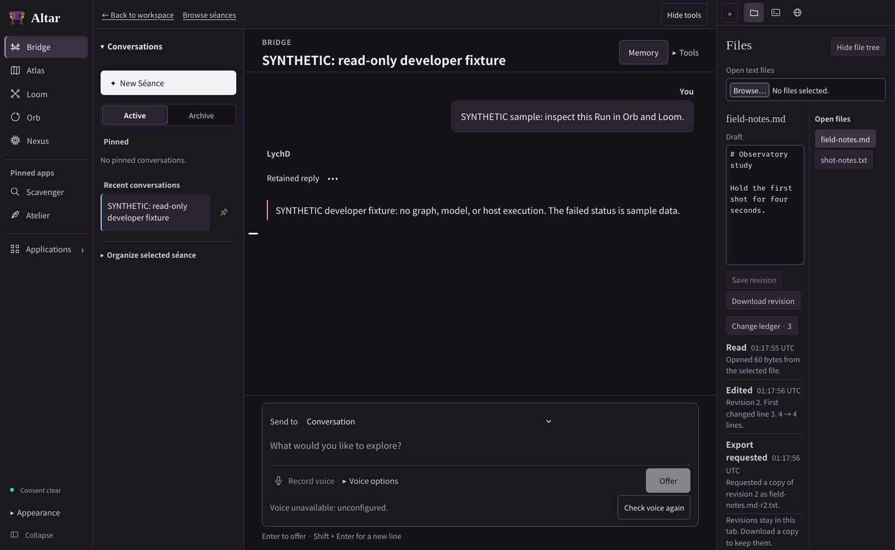
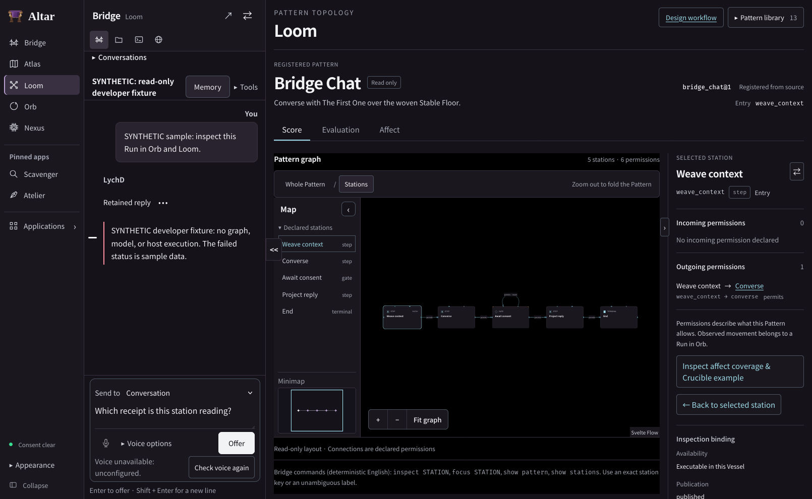
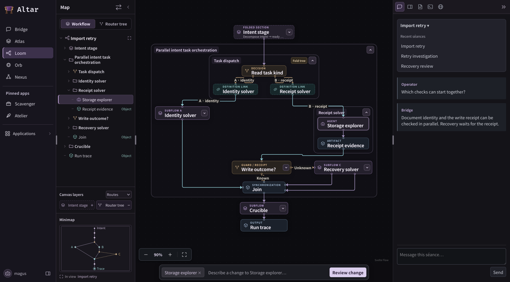

# Moving between screens

Suppose a shell is open beside a conversation and you want to inspect the workflow that produced a reply. In the proposed Altar, you can open its score in Loom, read a station, then bring the same shell or conversation alongside it. This page describes the screen design. The [installed conversation dock](index.md#keep-bridge-beside-the-work) and [workbench delivery record](../../state-of-the-work.md#altar-workbench) describe what you can use today.

## Local files

Open **Files** in the side panel and choose one or more UTF-8 text files of up to 1 MiB each.
The file tree opens beside the draft. Select a filename, drag its divider or use **Hide file tree**.
**Save revision** adds an entry to the file's **Change ledger**. Entries distinguish a read,
a changed revision, a refused oversized edit and a requested export. Download a revision to
keep its text. Returning to Files within the open Altar preserves the draft. Each downloaded filename includes its revision and ends in `.txt`. Saving a draft enables its download.

**Web** opens the entered HTTP or HTTPS address in the system browser and keeps a short list
in this document. **Terminal** displays the current connection state. This build has no host
shell transport.

To discuss a station while reading it, open Walking Bridge and use **⇄** to move the conversation
across the work area. Selecting the station in Loom opens its definition alongside the conversation.
The dock divider accepts dragging and arrow keys. Collapse it to recover canvas space.

## Choose what sits beside the work

The main navigation chooses the screen. In Loom, the graph sits between the **Map** on the left and the tools panel on the right. Tool icons run in a single row inside the top of the panel. Each has an accessible name and a tooltip. Fold the panel with the double chevron at its outer edge. A single chevron reopens it on its last tool.

| Screen | Icons from left to right |
| --- | --- |
| [Bridge](bridge.md) | Files, Terminal, Web. The conversation already occupies the main pane. |
| [Loom](loom.md) | Walking Bridge, Inspector, Files, Terminal, Web. Selecting a node on the canvas or its name in the Map opens Inspector. |
| [Orb](orb.md#find-a-step-in-the-map) | Walking Bridge, selected event, Files, Terminal, Web. Choosing a recorded event opens its details at the current capture time. |
| [Nexus](nexus-design.md) | Walking Bridge, selection details, Files, Terminal, Web. Selecting a row opens that capability, transition or person. **View access** carries a local Principal from Users into IAM. |
| Other screens | Bridge first, then tools specific to the screen, followed by Files, Terminal and Web. |

**Files** opens the selected document and its file tree. Drag the divider to size the tree or fold it against the outer edge. The chevron collapses it in one action. Select Files again to bring it back. Multiple documents, shells and web pages each stay grouped under their own icon. Use its item list to return to an open file, the second shell or a particular page. Switching screens keeps those items available within the same authorized context. A host would need to expose the corresponding file, shell or browser capability before the client could perform an operation.

In both design studies, selecting a Map entry locates it on the canvas. The minimap shows where the current view sits in the graph. In Loom you navigate the workflow revision.
In Orb the [observed Map](orb.md#find-a-step-in-the-map) follows the timeline cursor.
Hide either Map when you need more canvas space.

The rail can also take you to the [Applications dashboard](applications.md). Its separate chevron opens a short list over the current screen.

## Make room

Drag the dividers to adjust the width of the Altar rail, Map or tools panel. In Loom, swap the two panels to keep your preferred tool on either side of the graph. In Bridge, you can also resize the list of séances. A focused divider supports arrow keys. A pane can fold down to its reopen control. Expand either side of the main split to use the work area, then restore its previous widths. A folded pane retains its selected item and any conversation draft. On a narrow screen a single foreground pane has a named return control.

## Keep the conversation on Loom

[{ loading="lazy" }](../../assets/altar-design/loom-session-tools.webp)

Open **Walking Bridge**. Its first control is the current séance name. Use it to choose a
recent conversation or **Browse séances** to open the catalogue. Start a draft, then select
**Repository explorer** on the canvas or by name in the Map. The graph zooms to the agent.
Inspector opens with **Repository explorer** as its heading and the agent's inputs and outputs
under **Ports**. Its system and user templates live under **Prompts**. Select the attached
object or its enclosing subgraph to inspect that subject. Select Walking Bridge again to
pick up your draft in the same séance.

To look around while composing, expand a tree chevron, pan or zoom. Walking Bridge stays
in view. Each séance keeps its own draft, and Files remembers its current document. To edit
the specimen's workflow, use the [Loom composer](loom.md#where-charcoal-must-wait).

## Follow a question to its source

| Question | Where to go |
| --- | --- |
| What happened to this message? | On the [Bridge turn](bridge.md), **… → View run in Orb** opens the exact Run when its identity is available. Pending consent stays actionable beside the original request. |
| How did the idea develop over this séance? | **Open map in Atlas** in the séance title menu scopes the [Atlas map](atlas.md#the-shared-memory-map) to the conversation. A relationship cites its source turns. **Return to turn** reopens the passage and restores the draft. Unavailable citations retain their access or availability state. |
| What other route could this workflow have taken? | Open the exact revision in [Loom](loom.md). Its blueprint includes routes the Run never took. [Orb](orb.md) holds the observations for the particular attempt. |

Reading a map, retaining a quotation and attaching material to an Invocation are separate actions. [Memory](memory.md) describes the steps that retain a source for later work.

## Choose the Altar name and favicon

The default rail label is **Altar**, beside the purple-clothed table. Open that mark to edit
**Display name** and **Icon and favicon**. The name and a PNG, JPEG or WebP icon up to 64 KiB
are saved in this browser. **Restore Altar identity** returns to the original name and mark.
The source and build version remain accessible in the same panel.
