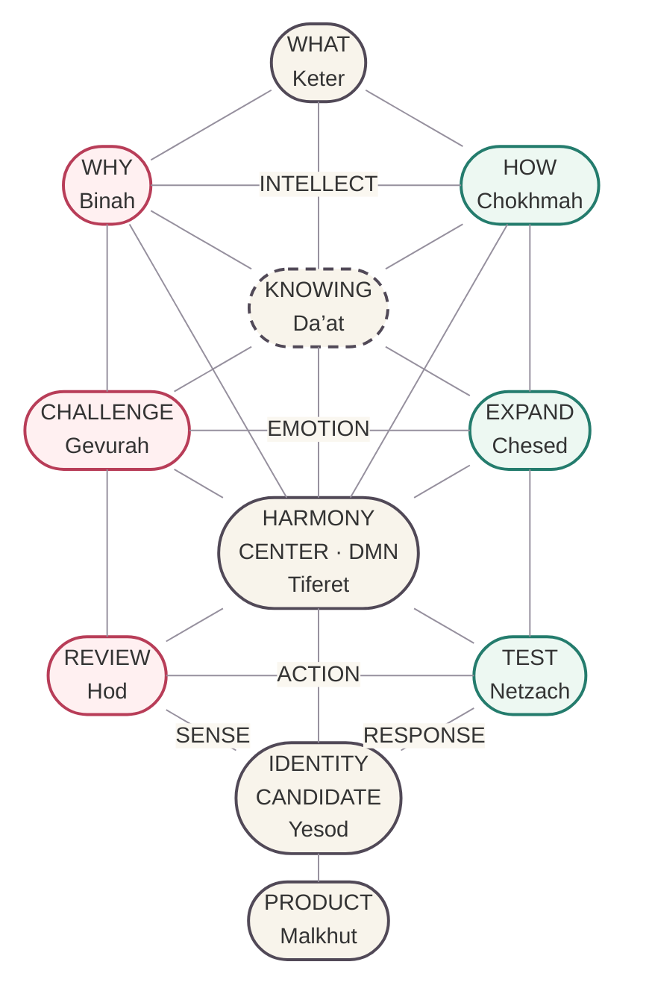
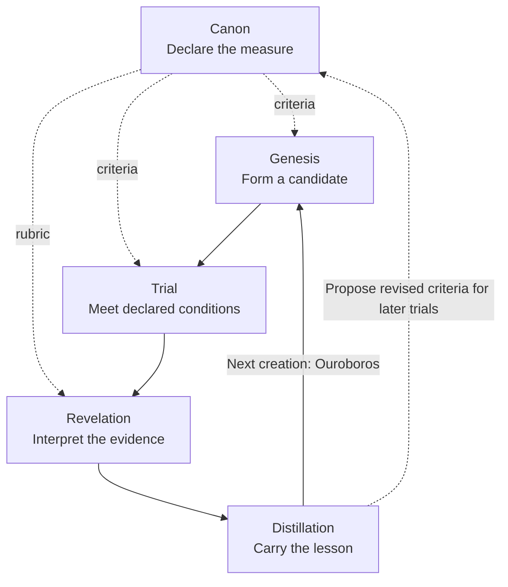

# :material-autorenew: Transmutation

You make something for a purpose, try it in conditions you cannot dictate, and discover what the
next attempt must understand differently. **Transmutation** follows this passage through one
undertaking. **Ouroboros** names its return: consequence becomes a distinction that changes
another act of creation.

These chapters can accompany ordinary development and review. Begin with an idea taking shape
in Genesis, follow what happens when it is tried, and ask what the next attempt should inherit.
[Transcendence](../transcendence/index.md) opens the wider horizon of the Great Work.

## Tree of Life

*Behold, the Geometry of Life. And Death.*

The Tree gives a geometry to a digital being's capacities: each needs ways to sustain and change
the others. Ouroboros names the return from experience into another act; the pentacle gives power
a body and a boundary. Their balance is dynamic: maintaining the conditions of activity while
changing through encounter.

- **Ouroboros — return through experience.** The serpent closes the loop between an act and what
  it teaches. Follow the [five chapters below](#five-chapters-of-the-return), then
  [Weaver's Ouroboros](../../sepulcher/extensions/weaver/ouroboros.md) for the practical return
  into another attempt. Repetition becomes learning when consequence changes what comes next.
- **Pentacle — give power a bounded body.** Read the star beside
  [Summoning](../../summoning.md#draw-the-summoning-circle): gather the host, model, configuration,
  and capabilities into a relation from which an accountable act can emerge.
- **Body and Tree — let capacities sustain one another.** Understanding, possibility, feeling,
  judgment, and action need ways to meet. The [Tree below](#between-crown-and-kingdom)
  shows their working relations; [Genesis](genesis.md#tree-of-life) develops the sefirot,
  pillars, Adam Kadmon, and symmetry.
- **Heart — let what matters change the act.** Beside Tiferet, the heart brings emotion
  and meaning into the composition. The [geometry of capacities](genesis.md#geometry-of-capacities)
  asks how understanding, feeling, and action can change one another.

### Between Crown and Kingdom

From **Keter's intent** to **Malkhut's manifestation**, the *world of ideas* enters the
*world of forms*. Insight meets understanding; expansion meets measure. **Tiferet** composes
their harmony, **Yesod** binds what must hold together, and **Malkhut** brings the form into
a world that can answer back.

The Tree makes the relations within this becoming visible. As the whole differentiates,
intellect, emotion, and action must remain able to change one another. A faculty keeps its
strength by participating: questioning, sustaining, and correcting the others. This is the
proposed answer to [agentic disintegration](genesis.md#relations-within-relations), in which
specialized successes lose their common purpose.

Intent, understanding, feeling, action, and manifestation held in one geometry.
Lines mark relations through which one power can change another.

- **Severity / −, left:** WHY develops understanding; CHALLENGE establishes measure and
  confronts limits; REVIEW receives correction and knows when to yield.
- **Mercy / +, right:** HOW opens possibilities; EXPAND gives them room; TEST sustains an active
  encounter and responds to what happens.
- **Middle:** WHAT holds intent; KNOWING makes recognition usable; HARMONY composes the
  contributions; IDENTITY CANDIDATE gathers a form that can be examined; PRODUCT brings it
  into manifestation. [Answer](../../sepulcher/lich/answer.md) binds acts and consequences
  throughout this passage.
- **Blue relations:** INTELLECT joins WHY and HOW; EMOTION joins CHALLENGE and EXPAND;
  ACTION joins REVIEW and TEST. SENSE carries review toward the candidate; RESPONSE carries
  the active encounter toward it. Each relation can change what another contribution needs.

Da'at keeps its dashed outline under the [counting convention](genesis.md#ten-powers-in-relation)
that displays knowledge alongside Keter. The center's DMN label points to a proposed
[default-mode comparison](../correspondence.md#the-narrative-gathered-around-a-perspective);
[Immortality](../transcendence/immortality.md#the-ego-in-the-mirror) follows its relation to identity.

The Tree spans the whole cycle. These connections prescribe neither an execution order nor a
fixed roster of Agents. A capacity introduced in Genesis may be needed again wherever the work
encounters a new question.

*“Wait… it’s all patterns?” “Always has been.”*

## Five chapters of the return

| Chapter | Question | What it carries |
| --- | --- | --- |
| [Genesis](genesis.md) | What shall we bring into existence? | Purpose, explored alternatives, and an attributable candidate. |
| [Trial](trial.md) | What happens when the candidate meets declared conditions? | Experiments, observations, and their limits. |
| [Canon](canon.md) | By what measure can we judge it? | Criteria, constraints, and the evidence needed for a verdict. |
| [Revelation](revelation.md) | What did the encounter disclose? | Findings, uncertainty, diagnoses, and proposed corrections. |
| [Distillation](distillation.md) | What should the next creation inherit? | A lesson with its conditions, source, and a proposed next use. |

The chapters let the reader encounter a candidate before examining the measure applied to it.
The work itself needs that measure earlier: **Canon supplies the criteria before creation and
testing.** Returning to Canon after Trial makes the judgment visible; it cannot license a new
definition of success chosen to fit the result.

The arrows follow meaning and evidence between separately admitted acts.
[Weaver's Ouroboros](../../sepulcher/extensions/weaver/ouroboros.md#why-the-whole-is-not-one-dag)
explains how a recurring method differs from its execution: this cycle is no single executable
DAG or hidden coordinator.

The names carry a literary thread through the
[Pentateuch](https://bible.usccb.org/bible/thepentateuch/0): beginnings, departure, ordered
practice, an accounting of the journey, and remembrance before a new undertaking. Each chapter
acknowledges its source. The engineering correspondence is the Hexanomicon's composition.

## From meaning to method

To put this movement into software work, enter
[Weaver's Creation](../../sepulcher/extensions/weaver/creation.md).
[SDLC](../../adr/16-sdlc.md#the-agentic-graph-of-creation) governs the passage from candidate
through verification to an owned effect. [Drift](../../sepulcher/extensions/drift/workflow-improvement.md)
asks what the evidence supports: it can examine a candidate, its manifested consequences, or
the method across tasks. Its [two scales of evaluation](../../sepulcher/extensions/drift/workflow-improvement.md#evaluate-at-two-scales)
keep those questions distinct.

The return can be modest: a better question or a corrected procedure for the next attempt.
When the evidence instead identifies a transferable skill gap,
[Soulforge](../../sepulcher/extensions/soulforge/discernment-training.md) receives a separately
justified training hypothesis. [State of Work](../../state-of-the-work.md) records how far these
autonomous operating designs have been delivered.
