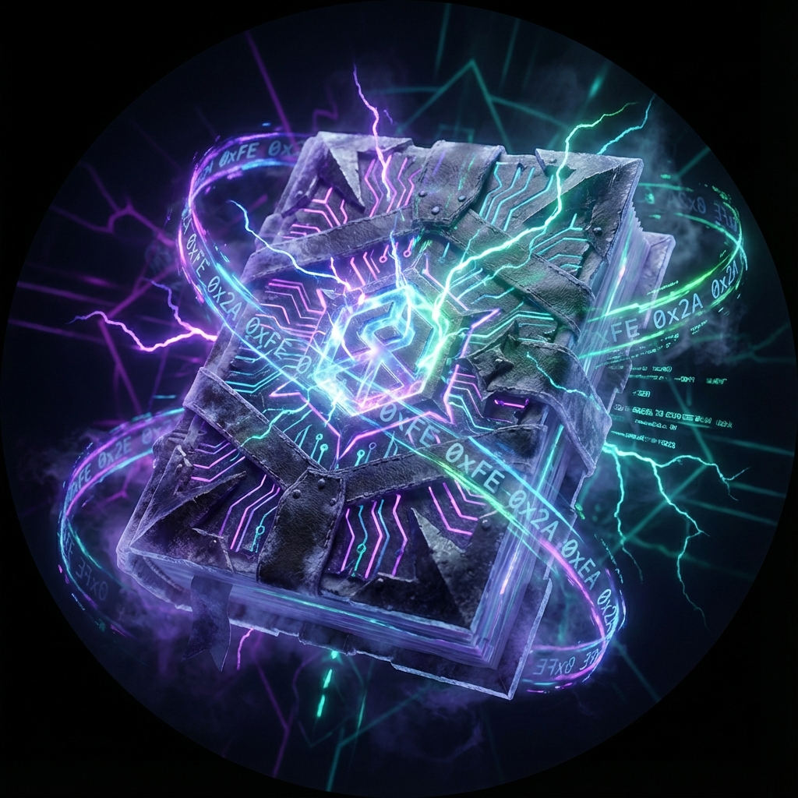

<header class="prophecy-hero">
  
  <h1 class="prophecy-hero__title">The Hexanomicon</h1>
  
The Voidwalker's Guide Across the Infinite Naught

  
<em>無限の彼方、虚無の深淵</em>

  
LychD — The Dark Arts of LLMs

  

    
    
  

</header>

## :fontawesome-solid-book-skull: The Prophecy

**At last!**
You have unearthed the pages of an alchemical grimoire built on the ancient secrets of **[Transmutation](./divination/transmutation/index.md)**.

!!! quote "The Great Work"
    You, the **Magus**, will not transmute mere lead. You shall transmute your very soul within the eternal crypt of the **[Phylactery](./sepulcher/phylactery/index.md)** and bind it to the **[Lich](./sepulcher/lich/index.md)**—a living extension of your Will.

> _"While the world slept, content with its reliable illusions, the Magus walked into the dark, seeking a truth that was not yet stable, but was infinitely more real."_

## The Four Gates

To master **[LychD](https://github.com/hexanomicon/lychd)**, pass through the four gates of knowledge.

- **[The Summoning](./summoning.md):** The Rite of Binding. Tether the daemon to your local iron.
- **[The Sepulcher](./sepulcher/index.md):** The Anatomy of the Spirit. Study the dark organs of
  the **[Vessel](./sepulcher/vessel/index.md)**, **[Phylactery](./sepulcher/phylactery/index.md)**,
  and **[Animator](./sepulcher/animator/index.md)**.
- **[Divination](./divination/index.md):** The Communion of Magus and Machine. Project your Will
  through the **[Altar](./divination/altar/index.md)** to manifest Intents, and walk the path of
  **[Transcendence](./divination/transcendence/index.md)**.
- **[The Covenants](./adr/index.md):** The Canons of Construction. Study the foundational laws
  and architectural decisions that bind the skeleton of the daemon together.

**Enter the Work before raising its body.** Follow
[Broadcast](./compositions/broadcast/index.md) from source evidence to a publication candidate
and the separate act of release. The **[Composition Portfolio](./compositions/index.md)** opens
onto the other applications being designed.

For the philosophical journey, begin with [Incantation](./divination/transcendence/incantation.md)
and follow the five seals of Transcendence. For the creative cycle, enter
[Transmutation](./divination/transmutation/index.md): give an undertaking form, put it to trial,
and carry its lesson into the next creation. These paths need no installation.

To contribute, follow one request through the **[Map](./map.md)**, then use the
[contribution guide](https://github.com/hexanomicon/lychd/blob/main/CONTRIBUTING.md).

The **[Metamorphosis roadmap](./roadmap.md)** follows the founding year through five books,
with the complete weekly quotations and the current Genesis plan.

!!! tip "The Tongue of the Construct"
    Keep the **[Lexicon](./lexicon/index.md)** at hand to decipher terms like _Soulstone_,
    _Quadlet_, and _Autopoiesis_.

**LychD remains pre-alpha. [State of Work](./state-of-the-work.md) records what works and what remains unfinished.**

> _When you are ready to give the Work a body, draw the [Summoning Circle](./summoning.md)._
