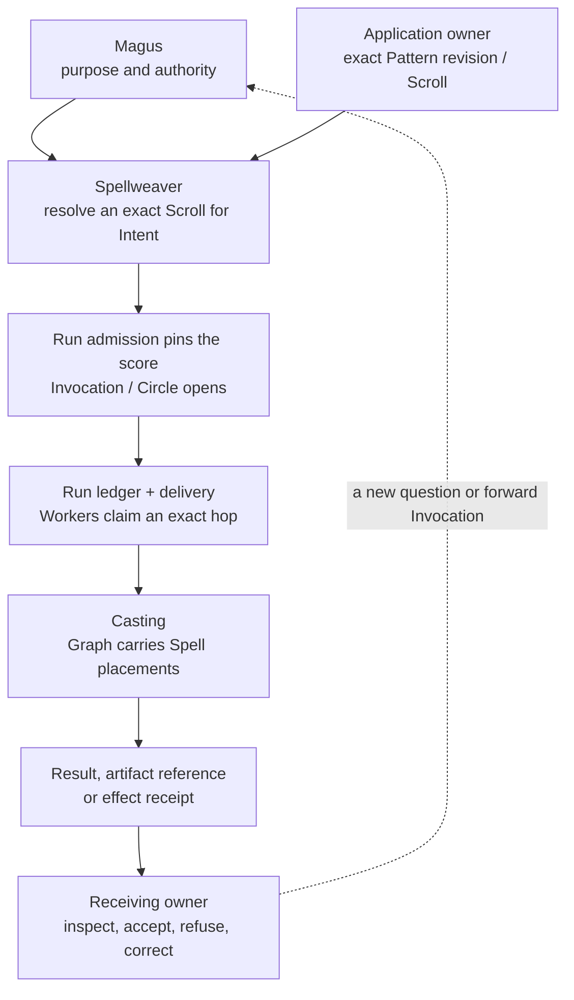
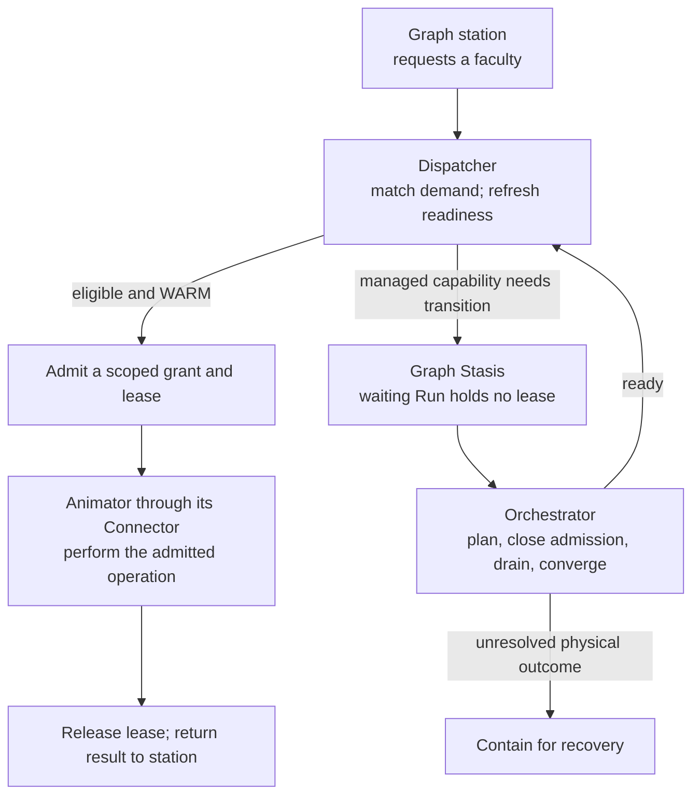

# :material-map-marker-path: Map

_One body, many roads, one return._

Suppose you want to turn a set of sources into a publication. You need a workflow to prepare it,
a model or tool to carry out each step, and a record of what happened. You also need someone to
decide whether the result is fit to publish. Follow that work through LychD below. This map
explains the accepted architecture; [State of Work](./state-of-the-work.md) identifies the parts
the current revision can actually run.

For the larger question of how making becomes learning, enter
**[Transmutation](./divination/transmutation/index.md)**. It follows formation, symmetry, life
and death through the software-development cycle and the Ouroboros return of evaluation and
learning.

## One body in one breath

In Broadcast's [local publication candidate](./compositions/broadcast/index.md#the-local-candidate),
the inputs are frozen sources and an editorial brief. The result is a candidate for an editor to
judge. Preparing that candidate and releasing it are separate acts. Here is how the preparation
passes through the body.

Your request is an **Intent**. [Spellweaver](./sepulcher/extensions/weaver/index.md) resolves the
workflow that will perform it. That workflow belongs to a named Pattern; one
[immutable Pattern revision](./sepulcher/extensions/weaver/pattern-lifecycle.md) is called a
**Scroll**. Pinning the revision keeps the instructions identifiable even if a later version is
published.

When the request is admitted, it opens an **Invocation**. A **Run** gives that execution a durable
identity. Performing the Scroll is its casting: **Graph** carries the work through stations, each
placing a named action called a **Spell**. The diagram follows the request to its result and back
to the person or application responsible for judging it:

## From logical work to iron

When a station requests a model or another service-backed capability,
[Dispatcher](./adr/22-dispatcher.md) chooses an eligible
capability. If it is already warm, Dispatcher can grant scoped use of it directly. If a managed
local service needs to load or change, [Orchestrator](./adr/23-orchestrator.md) makes it ready.
The Run waits in Graph Stasis without holding a capability lease, then asks Dispatcher again.
An unresolved physical outcome leaves the service contained for recovery.

Current grants cover the narrow v1 chat and non-empty toolset path, and the exact local embedding
profile through its dedicated counted lease. General call, job, and session grants remain
designed.

An [Animator](./sepulcher/animator/index.md) presents the selected local Soulstone or remote Portal
through its exact Connector. Remote work also follows the privacy and effect rules
of its [execution road](./sepulcher/extensions/weaver/execution-roads.md). A Portal call, a job in
a delegated coding runtime, and work entrusted to a sovereign A2A peer use different contracts;
choosing one does not authorize another.

## The return has several records

As Broadcast's candidate is prepared, [Ghouls](./sepulcher/vessel/ghouls.md) deliver the work and
record its settlement. The [Phylactery](./sepulcher/phylactery/index.md) retains committed Runs
and checkpoints. A checkpoint identifies a permitted place to resume; the Run ledger establishes
terminal status even when an event is missing from the live view.

[Oculus](./sepulcher/extensions/oculus.md) explains what was observed and where observation ends.
[Drift](./sepulcher/extensions/drift/index.md) evaluates claims about the result. Those findings
help the editor judge the candidate; they do not make the editorial decision. The receiving
owner accepts the result or admits a new correction. Keeping a lesson has a separate decision,
too: [Archive law](./adr/27-memory.md) governs admission to memory. Completing work does not
automatically promote a memory or admit a training example.

## The application road

A [Composition](./compositions/index.md) gives an application such as Broadcast its own records,
judgment, permitted effects, and Pattern catalogue. If the work needs several applications to
start, wait, cancel, or recover together, a [Suite](./compositions/products-and-suites.md) may own
the Pattern that coordinates them. Its parent Run records their relationship. Each member still
has its own Run and authority.

An optional **Product** packages selected Composition or Suite revisions around a profession or
market promise. A **Deployment** is one configured instance of that Product, or of an exact
Composition-owned reference profile. These choices determine what is offered and where it runs;
the Composition continues to own the application's records and decisions.

## Identity, presentation, media, and place

The same Lich may speak, appear in an image, or meet someone in another world. These uses connect
several responsibilities. [Mirror](./sepulcher/extensions/mirror.md) binds Persona identity;
[Avatar](./compositions/avatar/index.md) chooses an eligible presentation. Prism and Echo provide
visual and speech mechanisms, while the application using them decides whether the creative
result is acceptable. A Habitat, game world, physical Familiar, or Companion session keeps the
meaning and consequences of its own encounter.

Use the [ownership tables in Choosing a Home](./compositions/choosing-a-home.md) when deciding
which application should make a particular judgment. [Extensions](./sepulcher/extensions/index.md)
explains where packages may contribute. A Registrant identifies the contribution's provenance;
a Provider identifies a mechanism. Neither designation transfers the application's judgment.

## Choose your road

| You need to find… | Open… |
| --- | --- |
| An organ and its operating guide | [Sepulcher](./sepulcher/index.md) |
| The owner of an application idea | [Choosing a Home](./compositions/choosing-a-home.md) |
| The way separate applications work together | [Products and Suites](./compositions/products-and-suites.md) |
| An undertaking's continuing brief, concerns, and decisions | [Atlas](./divination/altar/atlas.md) |
| A term's exact meaning | [Lexicon](./lexicon/index.md) |
| The decision behind a boundary | [Covenants](./adr/index.md) |
| The purpose behind the whole | [Transcendence](./divination/transcendence/index.md) |

## Continue into the owning chapter {#what-the-map-does-not-own}

Follow the relevant chapter for its records, refusal and recovery rules, and the architectural
decision behind them. Follow State for evidence of what runs. The
[Lich](./sepulcher/lich/index.md) names this connected whole; the
[Great Work](./divination/transcendence/index.md) asks what it should learn and become through
the work it returns.
