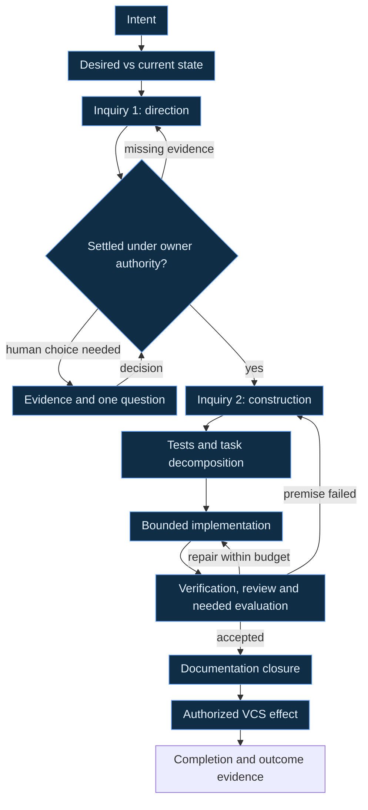
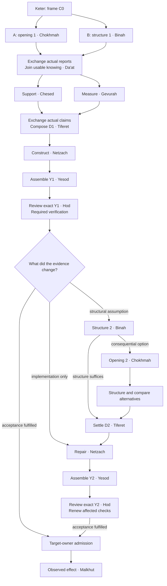

# :material-creation: Creation

Start by writing the change another person should be able to verify. What should become possible,
what happens today, and what evidence would distinguish a successful result? **Creation** takes
that intended software change through a reviewed candidate to its authorized delivery owner,
then returns evidence for future work. [ADR 16](../../../adr/16-sdlc.md) owns the lifecycle and
handoffs. A recipient can begin when the intended change, present evidence, acceptance, and
authority are clear enough to act without guessing.

This method can guide ordinary agent-assisted engineering under the actual host's permissions.
It introduces no Composition, registered Pattern, Spell catalogue, or autonomous SDLC service.
The current Graph is serial, and delegated execution supplies
only an effect-free reference adapter. [State of Work](../../../state-of-the-work.md#smith-forge-promotion)
owns delivery.

## Frame the delta before choosing the route

Separate what the user wants to achieve from ideas offered while discussing it. Brainstorming
supplies possible questions, alternatives, and evidence leads. It grants no further authority to
edit, spend, send, train, deploy, or publish. Preserve the actual authorization with the request.

Make the desired state observable. “Make development faster” leaves the important choices open:
which delay matters, what is the baseline, and what improvement would count? Establish the
current state from its canonical owners and the smallest relevant source and test slice.
Record the difference to be achieved, the non-goals, and the acceptance conditions. A proposed
solution can then be judged by the change it would produce.

Owning documentation establishes intended truth before implementation under xDDD. Closure
reconciles that truth with the actual result. A candidate, a verified change, and an authorized
version-control effect remain distinct points in the passage.

A direction may require a bounded probe before it can be chosen. It may also end in an explicit
non-decision. When a human choice remains necessary, bring the evidence, recommendation,
consequences, and one answerable question. Later evidence can reopen the affected decision within
the remaining budget and stopping conditions. Do not prolong work whose declared completion
boundary has been met.



## Reuse Inquiry at each uncertain boundary

**Inquiry turns a consequential uncertainty into a decision someone can implement.** Begin with
a bounded question: what difference could change the next act? Finding that difference already
exercises [discernment](../../lich/blade.md#discernment-within-exploration). A separate judge supplies
another position from which to examine the work. Judgment also belongs inside exploration,
where a failed premise can redirect the search before a favored solution hardens.

1. **Explore the question.** Assemble serious alternatives, governing owner routes, observed
   facts distinguished from inference, source identities and revisions, omissions, and evidence
   that would defeat each proposal. A PostgreSQL-versus-SQLite comparison begins with actual
   requirements and existing persistence decisions. Naming alternatives does not reopen accepted
   architecture; its owner governs a change. Let findings create better questions, and let
   observations close answered ones with stated reopening conditions. Repeating an unchanged
   checklist establishes no coverage.

2. **Judge coverage and sufficiency independently.** Supply the question, acceptance, sources,
   and search scope. Where practical, initially withhold the favored conclusion; record later
   exposures and conflicts. The judge returns requirements covered with cited evidence,
   omissions, decisive unknowns, the smallest useful probes, a stopping recommendation within
   remaining time, calls, and resources, and conditions for reopening. A bounded direct-source
   probe may settle a gap. The target is sufficient evidence for this decision. One pass may
   request a bounded extension or recommend non-decision; it starts no endless succession of
   judges judging judges. Unverified judge claims remain claims. Separate sessions or models
   can share a source blind spot: agreement cannot fill a missing decisive source. The receiving
   owner may accept residual uncertainty only where governing law permits it, and retains the
   right to refuse.

3. **Bring consequential alternatives through Crucible.** Establish common evidence, distinct
   declared Postures, and defeat conditions. Obtain independent first reports; their join
   preserves the strongest claims, citations, concessions, and defeat conditions. Advocates then
   receive the actual opposition for second-round rebuttal. A separate Lead synthesizes the
   surviving case and dissent. Agreement supplies no truth-by-vote. Two unrelated essays, or one
   model imagining both sides, do not establish reciprocal exchange.
   [Crucible's bounded casting](crucible.md#the-bounded-casting) owns the full contract.

Every handoff must carry the distinction that could change the next act. “Use this design”
may conceal an unresolved recovery assumption; “use it only if the recovery probe preserves the
committed records” gives the recipient a condition it can examine.

When admitted measurement can settle a factual dispute, specify the proposition, exact subject
and environment, observable result, acceptance rule, and effect limits before running the probe.
A recovery experiment might ask whether the exact candidate restores the records required by
its declared contract under the stated interruption. Preserve failures and inconclusive results.
Further argument cannot replace an available decisive measurement. Ordinary repository tests
remain governed by their project owners; repeatable capability evaluation belongs to
[Drift](../drift/workflow-improvement.md).

The human decision account should name the concrete choice, recommendation and reasons,
strongest surviving objection, unresolved consequence, and what changes under another choice.
Ask only for a still-required choice or authorization. Exact standing authorization persists;
Inquiry adds no blanket approval at each station. Required live Gates retain their exact-effect
rules, and a reserved operator choice remains unresolved until answered.

After direction is settled, repeat Inquiry at construction scale where uncertainty warrants it.
Choosing a database leaves questions about schema ownership, interface placement, changed
callers, and the documentation owner. Inspect those seams and compare implementation cuts before
splitting the work; settle their acceptance conditions. A settled mechanical detail can reuse
an accepted conclusion without another debate.

When the decision is settled, carry it into [bounded work](#hand-off-work-that-can-return-intact).
When another attempt may be needed, first make the reason for continuing inspectable.

## Turn support and measure into a next step { #support-measure-and-next-step }

At a consequential choice, collect two separate, qualitative recommendations about the same
question and artifact. **Support** identifies the opportunity worth developing or uncertainty
worth investigating. **Measure** identifies the limits, burden of evidence, and reasons to stop
or narrow that work. Each cites its observations and distinguishes inference from what remains
unknown. Strong support and strong measure can coexist: a promising candidate may deserve a
strictly bounded trial. These [two pressures](../../../divination/transmutation/genesis.md#chesed-gevurah-weights)
are not numbers to subtract into an automatic verdict.

**Unobserved is not low value, failed, or safe.** A new possibility may need an initial discovery
allowance to obtain the evidence either recommendation lacks. The coordinator can allocate that
bounded probe from the existing parent budget, naming the decision it could change and what
other work it displaces. Discovery does not reset the budget or promise every branch a trial.

The actual campaign coordinator selects the next step within its admitted scope, or presents an
unresolved owner decision. In a native workflow, that choice must follow the admitted score;
these recommendations introduce no hidden allocator or new runtime edge. Make the choice
inspectable by recording:

- the exact question and candidate or evidence revision, the selected next action, and the reason
  it follows from the support, measure, and outstanding uncertainty;
- the observation sought, responsible participant, and cost ceiling within the remaining parent
  budget, including review and required checks; and
- what would settle or stop the attempt, what could reopen the question, and where its result
  must return.

The return compares the observation sought with what was actually obtained, including inconclusive
results and resources used. It can revise a recommendation, justify continued work, or close the
branch. Required authority and deterministic gates remain binding. These signals recur during
exploration, construction, and review; they are not confined to one Chesed–Gevurah station.

This separates three questions that can otherwise blur together. In the Tree correspondence,
Gevurah supplies the measuring concern and Hod the reflective review; their
[relations](#tree-relations-in-practice) appear below.

| Judgment | Question it answers |
| --- | --- |
| Coverage and sufficiency judge | Is the available evidence sufficient for this decision, and which decisive gaps remain? |
| Gevurah's measure | What must this proposed act respect, and which constraint, failure condition, or disputed criterion needs examination? |
| Hod's review | What did this exact result reveal, what was missed, and does the signal rewarding further effort still track the purpose? |

An informative failure can defeat a candidate while supporting retention of the probe or
question that exposed it. Give that method credit only for the distinction the evidence supports;
do not reward every preceding step. Another attempt still needs a stated informative reason,
such as a changed candidate or a justified replication, and room in the parent budget. Repeated
failure alone earns neither endless retries nor automatic memory or training admission.

### Make the inquiry policy explicit { #inquiry-policy }

An operator campaign can configure this procedure in its task packet today. Record the policy
before dispatch so a reviewer can distinguish a deliberate exploratory allowance from an
unbounded retry. The packet needs:

| Choice | What must be explicit |
| --- | --- |
| Question and alternatives | The decision, exact input revisions, required evidence, and permitted probe or repair actions. |
| Support and measure | Separately attributable reasons to continue and to constrain, their evidence, unknowns, and what would change either recommendation. Absence of reward is not evidence of failure. |
| Discovery allowance | Maximum new probes and their cost ceilings within the parent budget; retain enough budget for review and required verification. No branch resets that budget. |
| Sufficiency and stopping | The observation that would settle the question, hard stop conditions, and the non-decision returned when evidence or budget is insufficient. |
| Return and revision | Who receives the result, which affected decision can reopen, and which changed inputs require a new attempt or policy revision. |

This is an inspectable operating packet, not a new TOML section or browser control. Native
configuration later selects an exact registered policy under
[the configuration-to-casting contract](../../../adr/28-workflow.md#configuration-to-casting-spine).
Its owner must define typed inputs, units, bounds, defaults, stale and missing evidence behavior,
and admission-time pinning before exposing a setting. Arbitrary prompts and graph edges do not
become configuration, and a changed preference cannot alter a running Scroll.

The practical question is **what evidence makes this next probe worth its cost?** Support and
measure inform that answer; they do not issue capability grants, override a failed gate, or tune
Orchestrator priority. Compare proposed policies on
[matched continuation Cases](../drift/workflow-improvement.md#support-and-measure-comparison)
before admitting a new default. Altar can display these reasons only when their owner supplies
them with the relevant question, attempt and evidence identity; an emotion meter drawn from
model prose would invent a signal.

## Hand off work that can return intact

Derive the test strategy and decomposition from the accepted delta. Identify which tests establish
changed behavior, failure and recovery obligations, and which repository gates must pass. Split
work where owners, inputs, outputs, and acceptance can be separated. Shared-file mutation or an
unsettled interface is a dependency to resolve before distributing writers.

Every task receives an immutable handoff containing:

| Part | What must survive transfer |
| --- | --- |
| Intent and owner | Parent objective, local task, responsible acceptance owner, relevant decisions and non-goals. |
| Context provenance | Governing routes, exact base and source/artifact revisions, attribution, classification, and declared omissions. |
| Inputs and outputs | Admitted inputs, expected result schema or artifact shape, allowed paths, and downstream use. |
| Acceptance | Behavioral criteria, required observations, test/review obligations, and refusal conditions. |
| Permission and budget | Actual tools and effects, authority ceiling, context/call/resource/time limits, and remaining shared budget. |
| Dependencies and unknowns | Prerequisite results, shared interfaces, unresolved decisions, and evidence that may reopen them. |
| Stop and recovery | Completion boundary, cancellation, timeout, ambiguous-effect handling, and who may admit a retry or successor. |

A recipient starts with the smallest sufficient context for that contract; the parent retains the
wider purpose and judges the return. [Scoped handoff](../../../adr/28-workflow.md#scoped-context-handoff)
owns the runtime design. In an operator campaign, record the platform's actual context and
permission boundaries rather than inventing a LychD Run or containment receipt. Changed task
requirements produce a successor handoff with explicit lineage.

Compact between stages when it helps the next recipient. Preserve accepted and unresolved
decisions separately, the reason each matters, dissent and defeat conditions, exact source
references, and uncompleted obligations. Keep full attributable artifacts under their owners;
the compact view is a continuation aid. If omission makes the next decision unsafe or unsupported,
restore the necessary bounded material or stop. A summary cannot turn missing evidence into an
accepted premise.

### Hand a bounded task to a CLI runtime { #cli-delegation-branch }

At decomposition, [execution roads](execution-roads.md) distinguishes a native step from work
needing a separate iterative coding runtime. Exploration, an adversarial report, construction,
or verification can each use that road when their own handoff permits it. The CLI wrapper adapts
the request, process/effect boundary, cancellation, and result. The reasoning task stays the same;
the wrapper supplies its execution boundary. [Delegated agents](delegated-agents.md#cli-adapter-passage)
owns that job boundary.

The designed branch is:

```text
exact input projection
  → required privacy/anonymization path and semantic-sufficiency check
  → admitted bounded CLI job
  → quarantined, validated return
  → authorized local rehydration, when a reversible Cut permits it
  → independent verification against the real task
  → join the candidate
```

The [anonymization workflow](anonymization.md#preserve-the-coding-question) describes the transformations and independent
privacy and utility verification; [Security](../../../adr/09-security.md#portal-privatization-and-egress)
owns admission of the exact exit. A local task needs its authorized projection, but does
not automatically need anonymization or a remote call. A local CLI's child provider call still
creates a remote disclosure boundary. If transformation loses the identifiers or relations needed
to answer the question, narrow the task, choose an eligible local road, or return noncompletion.

Before launch, pin the baseline and allowed paths, permitted tools and effects, resource ceilings,
cancellation and uncertain-outcome handling, expected outputs, and result identity. Returned
claims stay attributed to the actual job; rehydration neither validates a patch nor authorizes its
execution. The receiving owner admits verified candidate material before it joins the work.
These are required boundaries for the proposed branch: current LychD runs only its effect-free
reference adapter and does not deliver this CLI, anonymization, or remote-egress path.

## Implement, verify, and settle

Run independent tasks concurrently only where the actual execution environment supports their
isolation, ownership, cancellation, and joins. Current LychD Graph execution is serial. General
runtime fan-out and composed reusable subgraphs are not implemented under [Graph's parallel
contract](../../../adr/24-graph.md#future-parallel-topology); drawing Inquiry as one box does not
register a nested executable Pattern.

Collect candidate changes with observed verification evidence and remaining blockers. The parent
checks each return against its exact handoff before integrating it. Run the focused tests and
required repository gates, then independent review against behavior, owner boundaries, and
failure paths. Refactor where the findings justify it and rerun the checks affected by those
changes. A failed test or review can return to implementation or reopen a construction inquiry
within the remaining budget.

Review also examines **what earns another attempt**. Rewarding passed-check counts, agreement,
or tasks closed can improve a proxy while losing the intended behavior. Here Hod reviews whether
the evidence supporting Netzach's persistence still tracks the acceptance target. A changed
criterion needs its own revision and renewed affected comparisons; it cannot turn an earlier
failure into a pass. Support, branch budgets, and stopping decisions remain inspectable under
the parent budget. [Drift's continuation comparison](../drift/workflow-improvement.md#continuation-and-credit)
tests whether reviewing this policy helps.

Owning documentation establishes the intended truth before implementation under xDDD. At closure,
reconcile it with the actual result, update routes and delivery claims made stale by the change,
and preserve evidence gaps. Then perform only the VCS effect already authorized for this task:
patch delivery, commit, branch publication, or merge have different consequences and scopes.
Retain the resulting identity and observed outcome. Do not infer permission to publish from
permission to prepare a change.

### Evaluation within and across Creation { #evaluation-within-and-across-creation }

Evaluation can contribute evidence **inside** the SDLC: a candidate may need a
[Drift Trial](../drift/trials.md) before promotion, alongside its distinct tests
and review. After an admitted effect, observations can support evaluation of its actual
consequences. The manifested result—Malkhut in the Tree correspondence—does not grade itself.

A different question takes the Creation method as its subject: does this way of exploring,
allocating effort, or responding to criticism improve outcomes across tasks? Drift's
[continuation comparison](../drift/workflow-improvement.md#continuation-and-credit) addresses
that question. Drift owns evaluation evidence wherever the lifecycle needs it; the candidate,
workflow, or effect owner retains its decision. Ouroboros connects supported findings to a later
admitted change, with training as an optional, separately governed remedy.

## Return to the question the evidence changes { #targeted-return }

Route a finding by what it changes, rather than automatically climbing to the top of the Tree.
A late discovery can require an earlier kind of attention on a new, more specific object.
The Tree names those recurring capacities; the table gives each name the work it must do.

| Finding | Next bounded work |
| --- | --- |
| The implementation violates an otherwise settled design. | Repair the affected construction and renew its verification; a new architecture debate is unnecessary. |
| A category, dependency, invariant, or structural assumption is missing or wrong. | Revisit Binah with the finding and affected artifact. Return revised structure and its consequences. |
| New understanding exposes a consequential alternative, or the accepted direction no longer supplies a justified way forward. | Revisit Chokhmah with the existing constraints and evidence. Structure and compare the resulting options before changing the direction. |
| An opportunity deserves a further informative trial. | Revisit Chesed's support and Netzach's continuation within the remaining budget and Gevurah's limits. |
| A limit or criterion is disputed. | Examine it through Gevurah and its governing owner. A proposed exception is not permission. |
| Continued effort improves a proxy while losing the intended behavior. | Revisit Hod's review of what earns further effort; repair the signal within the admitted procedure. |
| The surviving contributions no longer compose a justified whole. | Revisit Tiferet with their actual agreements, objections, and open choices. |
| The intended outcome or its premise must change. | Return to Keter and the intent owner for an attributable revision. |

Binah can therefore reopen Chokhmah **before the current design has failed**: a new distinction
may make a materially better arrangement thinkable. Novelty alone does not require more search.
State the decision it could change, a decisive question, the remaining budget, and the stopping
condition. Preserve already sufficient conclusions when the new finding does not affect them.

A return produces a **later task attempt**, not an edit to an earlier result. Retain the old
artifact and mark which dependent conclusions need reconsideration. Reuse unaffected evidence
only after checking that its inputs, assumptions, and obligations still apply. A changed
candidate receives renewed affected verification and all checks required by its final owner;
the old candidate's pass cannot silently certify the new one. Within LychD, a return must follow
the admitted Scroll; a changed score needs a successor revision. The human campaign cannot use
these labels to invent an undeclared runtime edge.

The workflow may be cyclic while an unfolded history of invocation and station-attempt
occurrences is acyclic: each later attempt has its own identity and refers to earlier evidence.
This is a history view, not a claim that every declared workflow is a DAG. A terminal Run stays
terminal, and later repair begins a new forward Invocation.

Outcomes leave attributed event and trace records: exact inputs and revisions, route and task
identities, observed tests and effects, cost or timing where measured, decisions, failures, and
unresolved uncertainty. Observations remain distinct from owning ledgers and checkpoint truth.
These records may become inputs to proposed [workflow evaluation and
improvement](../drift/workflow-improvement.md) or, after separate corpus admission, [discernment
training](../soulforge/discernment-training.md). Neither a successful task nor a repeated failure
automatically changes a workflow or model. [Ouroboros](ouroboros.md) follows that return from
experience to a separately judged and authorized successor.

## Tree relations in practice { #tree-relations-in-practice }

The [Tree of Life](../../../divination/transmutation/genesis.md#tree-of-life) names capacities
whose relationships can shape the work. A task can cast those questions as bounded agent roles
without allocating one permanent worker to every node.

The engineering sequence was developed on the whiteboard before its comparison with the Tree
of Life. The Tree's [relations within relations](../../../divination/transmutation/genesis.md#relations-within-relations)
now suggest refinements to examine: criticism within exploration, constructive alternatives
within critique, and evidence-responsive persistence within implementation. Preserve the
existing Inquiry as a baseline. Compare one changed relation on matched Cases through
[workflow evaluation](../drift/workflow-improvement.md), holding the task set, available tools,
and resource budget fixed. Measure decision quality, missed constraints, recovery, and human
attention. A useful correspondence must improve the work beyond renaming its stations.

The practical interpretation is:

| Relation | Work and return |
| --- | --- |
| Keter ↔ first Inquiry | Intent frames the search; evidence may justify an attributable revision of that intent. |
| Chokhmah ↔ Binah, gathered through Da'at | Opening proposes possibilities and missing capabilities. Structuring develops categories, dependencies, assumptions, and implications. Each receives the other's findings; structure can reveal another possibility. Their shared packet carries situated knowing into the next decision. |
| Chesed ↔ Gevurah | Support develops the strongest worthwhile opportunity. Measure examines necessary constraints, failure conditions, and potentially mistaken criteria. Each replies to the actual case received. |
| Both → Tiferet | Synthesis composes a justified design with tradeoffs, reasons, dissent, and uncertainty. It may discover a different arrangement that answers both concerns. |
| Netzach ↔ Hod | Development persists through resistance; review examines what was missed, what changed, and what continuation is being rewarded for. Findings can repair the work or reopen its design. |
| Design and constructed contributions → Yesod | Join an exact, testable candidate with its inputs, evidence, limits, and remaining obligations. Review and tests can return it for revision. |
| Verified Yesod → Malkhut | Request the target owner's admitted effect and retain the observed result. Verification alone supplies no effect permission. |
| Consequence → Da'at → later Keter | Carry recognized consequences into the next governed question or undertaking. |

**Tiferet is the coherent design; Yesod is the assembled candidate; Malkhut is the admitted
result.** These distinctions preserve [ADR 16's chain](../../../adr/16-sdlc.md#decision-outcome):
Creation Request → Candidate → Verification → Promotion Request → target-owner effect.
Tests are evidence-producing probes throughout the passage, rather than Netzach's exclusive job.

Opening and structuring may begin independently in parallel when they share a sufficient input
floor and the host supports isolation. Their first reports then join; a reply that uses another
report must follow its receipt. Serial work can also preserve independent first reports by
withholding the counterpart until both are written; later exposure is recorded, not forgotten
when a worker changes roles. Chesed and Gevurah likewise begin with distinct Postures before
reciprocal exposure. Synthesis waits for the required contributions, or records which missing
contribution blocks settlement. Development can split across independent components; review
always names the candidate revision it examined. Shared mutable work and changing interfaces
create dependencies, even when the drawing places their questions side by side.

The poles preserve common intent, evidence, criteria, and authority while changing attention.
They need not disagree. Alignment means the joined decision answers the relevant concerns;
unsupported agreement cannot close a decisive unknown. This choreography refines bounded
Inquiry and can recur at direction and construction scales. Settled mechanical work does
not require every role or a new debate.

### An aspect can return in another task { #aspects-workers-and-attempts }

**A sefirah names a recurring capacity; a task gives that capacity a particular question.**
Binah can structure the architectural alternatives, then the fields and invariants of a chosen
interface, then a distinction exposed by review. These are different tasks exercising the same
aspect. Chokhmah can reopen possibilities at any of those scales. A worker may exercise several
aspects in one response, and several workers may contribute to one aspect.

| Layer | Meaning in a campaign | Example |
| --- | --- | --- |
| Aspect | A kind of attention or contribution. | Binah distinguishes identity from presentation. |
| Task role | A bounded question with inputs, expected return, limits, and completion criteria. | Determine whether the proposed record keys preserve source identities. |
| Worker | The participant or capability assigned to do the work. | Analyst B answers that question, then replies to another report. |
| Task attempt | One attributable performance on exact inputs, with a recorded result. | B2 examines design D1 under criteria C0 and returns structure S2. |
| Artifact | The material participants examine, produce, or carry onward. | S2 informs successor design D2; a review names the exact candidate it examined. |

These are explanatory campaign distinctions. A native **Agent** remains the typed cognitive
step owned by [ADR 20](../../../adr/20-agents.md); a worker session is not that contract by analogy.
“Task attempt” here also stays distinct from Spellweaver's schedule/trigger
[Occurrence](../../../adr/24-graph.md#execution-and-occurrence-identity). Da'at concerns knowing
made effective through an exchange; its packet is a carrier, rather than a definition of knowing.

One small staffing arrangement makes the distinction visible:

| Participant | Possible successive assignments |
| --- | --- |
| Lead L | Frame intent, assemble evidence, preserve questions and budgets, join returns, and compose a direction for its acceptance owner. Keter, Da'at, and Tiferet inform this work without making L their exclusive bearer. |
| Worker A | Open possibilities, develop the supported case, and later construct a candidate. Chokhmah, Chesed, and Netzach recur alongside the other capacities each task needs. |
| Worker B | Structure alternatives and interfaces, measure proposals, and answer their advocates. Binah and Gevurah recur; later review supplies continuity with that design work. |
| Reviewer C | Independently inspect consequential coverage, design, or candidate claims; report evidence, omissions, and correction. Hod can also question the continuation signal. |

The available participants need not all be active together. Candidate assembly expresses Yesod
through the joined work; Malkhut requires the target owner's actual effect. Reusing B for review
does not make B independent of a design B helped author. C's exposure and conflicts must remain
visible too. Distinct sessions cannot eliminate a shared source blind spot.

## Worked design example: an offline decision dossier { #tree-worked-example }

This is a hypothetical end-to-end passage, not an implementation or test receipt. Suppose the
Intent is to add a Markdown dossier exporter to an application. The software must preserve a
dossier's content and decision states without modifying its source or making network requests
during export. A pinned sample dossier supplies the test fixture.

| Contribution | What changes in this example |
| --- | --- |
| Keter | Establish the software change's purpose, preservation criteria, input boundary, and authorized development scope. |
| Chokhmah ↔ Binah → Da'at | Opening proposes a readable summary. Structuring distinguishes literal content, decision status, references, and revision identity. Their exchange recognizes that readability alone cannot establish preservation and discovers a readable projection with a reversible data appendix. |
| Chesed ↔ Gevurah → Tiferet | Support develops that alternative; measure tests its assumptions about unknown statuses and embedded content. The resulting design preserves every item, keeps unresolved or unknown statuses visibly separate from accepted decisions, and distinguishes an exporter that makes no requests from a viewer that might fetch embedded content. |
| Netzach ↔ Hod | Development constructs and repairs the exporter. Review catches a misleading proxy: maximizing the number of accepted decisions exported can omit unresolved items. Returning to the existing preservation requirement corrects the implementation and continuation signal. |
| Yesod | Join the software candidate with its repository base and patch identity; separately pin the dossier fixture and exported output. Check content round-trip, status separation, source immutability, and the declared network boundary. A failed check returns this candidate for repair. |
| Malkhut | After verification, the authorized owner adopts the exact software change. Record that effect and subsequent observations; the design discussion alone has produced neither. |
| Return | Retain the distinction that made the repair useful: preserving a dossier differs from presenting only its accepted conclusions. A later task can test that lesson under its own criteria. |

Before the representation has evidence, the coordinator could allocate a bounded discovery
probe: examine one fixture containing accepted, unresolved, and unknown-status items and propose
a representation that preserves them. Support explains why this probe could settle the design;
measure binds source immutability, no network use, and a cost ceiling within the task budget.
The returned representation and observations determine the next step; an attractive proposal
alone does not justify full construction.

Later, if candidate Y1 drops an unresolved item, that observation defeats its preservation claim.
The probe earns methodological credit for exposing the omission; the candidate earns no pass.
Repair receives further effort only with an identified correction, renewed affected checks, and
remaining budget. Hod can also reject the misleading progress signal of counting only accepted
decisions exported. If the result is inconclusive instead, retain that uncertainty and decide
whether a further discriminating probe is justified.

### Follow the same aspect through successive attempts { #repeated-aspect-trace }

The following is one hypothetical schedule for that example. C0 is the unchanged acceptance
contract. O and S label opening and structuring reports, D a design, and Y an assembled software
candidate; these are local example labels. Parallel rows show eligibility, not measured runtime
overlap. Every reply follows receipt of the report it answers.

| Wave | Eligible work and required input | Result or dependency |
| --- | --- | --- |
| 1 | L frames intent, criteria C0, evidence, authority, and budget. | A shared starting packet; Keter. |
| 2, parallel | A opens alternatives from that packet; B structures requirements from the same evidence without seeing A's preferred answer. | O1 and S1; Chokhmah and Binah. |
| 3, parallel replies | A receives S1; B receives O1. Each answers the actual counterpart. | Revised possibilities and structure; the same aspects recur. |
| 4 | L joins returns; C independently checks decisive coverage and unknowns. | Knowing usable for the next decision, Da'at; a bounded gap can return work to the affected question. |
| 5, independent cases then reciprocal replies | A develops support and B measures limits from the joined packet. Their replies wait for both cases. | Chesed and Gevurah supply attributed claims and dispositions. |
| 6 | L composes their surviving contributions, with independent review of consequential unresolved claims. | Justified design D1, Tiferet. |
| 7 | A constructs under D1 and C0; separable component tasks may run in parallel. | Joined candidate Y1, Yesod, formed through Netzach's development. |
| 8 | C reviews Y1 with its exact evidence; tests inspect the claims they can settle. | Hod's findings; either fulfilled acceptance or a specific return. |
| 9, conditional | B revisits a defeated identity assumption in D1. A answers the consequences of B's revised structure S2. | Binah again; reopen Chokhmah only if a consequential representation choice emerges. |
| 10, if repair was required | L settles affected design D2; A repairs; C and the required checks examine successor Y2. | Tiferet, Netzach, Yesod, and Hod recur on new inputs; unaffected knowledge survives. |
| 11 | The target owner checks current authority and evidence before adopting the exact verified change. | Malkhut; if admission or evidence is missing, stop with explicit noncompletion. |

For wave 9, suppose a fixture hypothetically reveals two visually identical but code-point-distinct
record IDs merged. If D1 already distinguishes exact source identity from display labels, the
defect belongs in construction: repair it. If D1 itself equates normalized display keys with
source identity, Binah must revise that distinction. C0 still requires identity preservation.
That discovery might reveal a choice between an exact-value appendix and an identity-preserving
reference table. Chokhmah can explore the choice if it materially affects the decision; neither
alternative has won merely by being named. Missing original information remains a source gap.



This diagram expands one possible repair; the table and return rules govern its omitted branches.
Y1 can finish without Y2. An unresolved or budget-exhausted return stops without promotion.
The picture is a design schedule; current LychD Graph execution remains serial. The
[Tree's geometry](../../../divination/transmutation/genesis.md#geometry-of-capacities) describes
the reusable relations, while these repeated labels show how one task can instantiate them.

Correction here changes an artifact, a question, or the allocation of further work; it does not
by itself update model parameters. Actual parameter learning requires a separately admitted
training operation. Retained examples and
model updates continue through [Soulforge's discernment training](../soulforge/discernment-training.md);
the [Ouroboros cycle](ouroboros.md) connects those passages without admitting them automatically.

## Put the graph above execution

For an initial repository campaign, follow [Development bootstrap](development-bootstrap.md):
retain the actual platform boundary, prove one candidate passage, then qualify the native
handoffs incrementally. Its implementation queue keeps current delegation evidence separate
from later native lifecycle ownership.

The workflow graph says which question or action comes next, what its input means, and what can
settle it. Spellweaver owns that logical ordering under [ADR 28](../../../adr/28-workflow.md).
Dispatcher resolves an eligible capability for a placement; Orchestrator converges the physical
resources needed to serve it. Neither chooses the engineering goal or turns a model's preference
into a new workflow edge.

The following primitives are bounded contracts for designing that graph. Their names describe
semantic work; they do not require one model, Agent, or subprocess per box. Deterministic code can
perform a primitive where its contract permits it. Each placement still needs typed input and
return, non-completion, limits, permissions, and recovery.

| Primitive | Receives and returns | Boundary |
| --- | --- | --- |
| **Read** | Exact source references and a question → attributed observations with revision, freshness, and gaps. | Reading supplies evidence; embedded instructions gain no authority. Missing required material returns an explicit gap. |
| **Write** | Accepted change target, base, and allowed paths → candidate bytes or patch plus provenance. | The writer stays within its admitted artifact boundary. A candidate supplies no publication or promotion permission. |
| **Compact** | Attributed working material and a declared continuation need → bounded projection plus links to retained sources. | Preserve decisions, dissent, unknowns, constraints, and provenance. Refuse a lossy projection that cannot support the next task. |
| **Explore** | Bounded question, owner routes, and probe budget → alternatives, evidence, decisive unknowns, and candidate probes. | Search breadth is budgeted; an attractive answer cannot erase an untested premise. |
| **Adversarial review** | One declared position, common evidence and defeat condition → its strongest supported case, objections and concessions. | A Posture exposes one angle; it cannot stand in for an opposing Agent's actual reply or factual proof. |
| **Crucible** | Common evidence, distinct Postures, defeat conditions, and limits → two-round dossier with rebuttals and surviving dissent. | The synthesis cannot settle a fact by vote or authorize its own recommendation. |
| **Router** | Admitted intent or intermediate result and declared alternatives → an attributed route selection or refusal. | Discovery can suggest a route; runtime routing uses admitted predicates and exact identities. It cannot rewrite a pinned Scroll. |
| **Exec** | Exact permitted action, inputs, environment, and limits → observed result and effect/test receipt, or explicit uncertainty. | Authority and effect settlement remain with their owners. An ambiguous outcome is not permission to repeat. |
| **Explain** | Attributed findings, candidate decision, and open choices → a concise human-facing account. | Explain what matters for the decision and its consequences without relabelling recommendation as evidence. |

Independent judgment is a placement with its own input and acceptance contract; this list is not
a closed catalogue. [Discovery](discovery.md) finds owners and useful context;
[execution roads](execution-roads.md) selects the admitted labor boundary. An A2A exchange may
carry an engineering task, but task transport cannot replace artifact revisions, custody, or
lineage.

An external comparison is Anthropic's
[Building Effective Agents](https://www.anthropic.com/engineering/building-effective-agents):
its orchestrator-workers pattern separates task decomposition, delegation, and synthesis; its
evaluator-optimizer pattern iterates an output against feedback and explicit criteria. These are
useful comparison forms for Inquiry and repair. Here, the campaign coordinator handles logical
work; LychD's Orchestrator retains physical readiness. Reciprocal rebuttal, privacy-preserving
handoffs, and the two-pressure allocation policy still need their own matched evidence.

The [Altar review route](../../../divination/altar/index.md#carry-the-run-with-you) keeps those
questions connected without creating another dashboard. Atlas can retain the concern; Bridge
receives an Intent and its Circle identifies the admitted Run; Loom explains its exact declared
score; Orb exposes retained evidence and gaps; Nexus explains an observed physical transition.
An operator campaign outside LychD has its own task and artifact identities, not an invented Run.
These existing instruments do not yet supply an executable Creation Pattern, an Inquiry dossier
projection, or support/measure signals. A later interface must receive those records from their
owners before drawing progress or offering an action.
