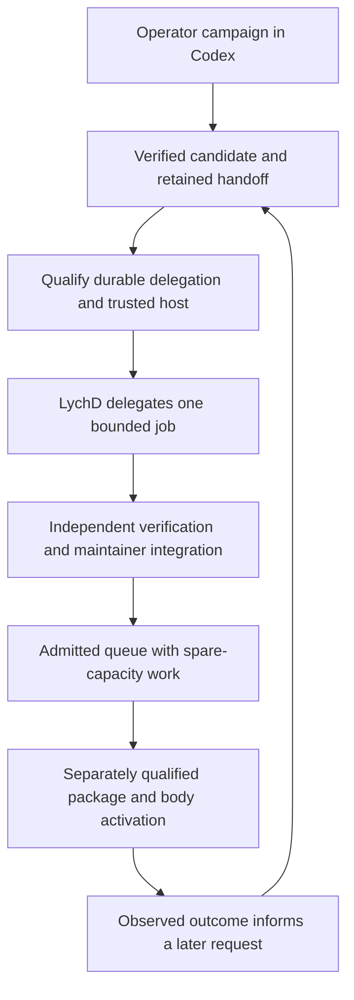

# Development bootstrap

Start with one useful change that another person can verify. Run that change through an
operator-controlled coding campaign, retain its failures and handoffs, and implement the parts
of that passage LychD can subsequently own. This guide carries that bootstrap from ordinary
development to bounded native operation. [Creation](creation.md) supplies the working method;
[SDLC](../../../adr/16-sdlc.md) owns its invariants.

The initial coordinator is the actual coding platform and its human operator. A platform goal,
worker session, or scheduled task receives that platform's identity. It is not a LychD Run,
Scroll, Coffin, or Drift Trial. Consult [delegation evidence](../../../state-of-the-work.md#delegated-agent-execution)
and [Forge evidence](../../../state-of-the-work.md#smith-forge-promotion) before selecting a
native road. This procedure publishes no new Composition, Pattern, executor, or activation service.

## Choose the first execution road

Use the existing Codex application for the first campaign. Preserve the requested Sol model and
Ultra selection as explicit campaign inputs; record the exact model identifier and effective
settings the client reports. [Coding-runtime research](coding-runtime-research.md) distinguishes
Ultra orchestration from model reasoning, account limits from API billing, and local use from
a distributed product. A different provider is a measured alternative, never an implicit fallback.

The first LychD integration should qualify a trusted host for the existing one-shot CLI protocol.
It should return a bounded artifact and terminal receipt. Add a bidirectional app-server adapter
when a demonstrated requirement needs live steering, interactive approvals, or persistent product
sessions. Do not introduce several runtimes or a second orchestration framework to prove one job.
LychD owns task semantics, admission, custody, verification requirements and effect requests;
the foreign harness owns its private planning and tool loop within the admitted boundary.



Each arrow is a new admission or settled handoff. The diagram grants no effect or automatic
continuation. A successful coding job never appoints itself the next task or promotion owner.

## Establish the campaign before dispatch

Select a small milestone, such as proving one delegation recovery boundary. Name its acceptance
owner and the work that is deliberately outside it. Use a claimed issue or attributable task
record; the contributor's private campaign notes may stay outside the checkout. Public delivery
claims still belong in State of Work.

The following is a **record template**, not a delivered LychD schema or configuration API.
Replace every placeholder before a dependent launch. Keep private account, company and client
information outside the repository.

```yaml
campaign: <actual platform campaign identity>
task: <task identity>
attempt: <unique attempt identity and predecessor, if any>
owner: <accountable acceptance owner>
intent: <observable change and present defect or gap>
owners: [<governing ADR and topic routes>]
base_commit: <immutable commit>
input_manifest: <digest of admitted tree, patches and selected untracked inputs>
allowed_paths: [<task projection paths>]
acceptance: [<expected behavior>, <forbidden behavior>, <failure and recovery checks>]
non_goals: [<excluded effects and neighboring work>]
dependencies: [<exact prerequisite artifacts or interface revisions>]
runtime: <client, binary version, exact model and effective orchestration settings>
authority: <source of current authorization and permitted downstream use>
tools_and_effects: <actual filesystem, process, network and credential boundary>
limits: <wall, calls, tokens, spend, CPU, memory, processes, disk and artifact ceilings>
enforcement: <per limit: enforcing component, measurement and unsupported cases>
verification_reserve: <required checks, independent reviewer and remaining resources>
stop: <completion, expiry, cancellation and ambiguity conditions>
result: <artifact shape, custody destination and terminal outcome>
```

An exact commit does not identify a dirty checkout. First inspect status and preserve operator
changes. If the task needs uncommitted material, admit an explicit patch and selected untracked
files with content identities; exclude credentials, ignored shelves and private collateral.
Otherwise start from the admitted clean commit. Never auto-stash, clean, reset, commit unrelated
work, or silently omit needed files to obtain a convenient base.

Give each writer its own branch/worktree or disposable projection. Separate candidate storage
from the authoritative checkout and running installation. A worktree still shares host resources;
record actual sandbox, network, credential and process controls. An instruction to a worker is
not operating-system enforcement. Platform-controlled work uses observed platform permissions;
a native foreign-runtime launch must meet [Security's](../../../adr/09-security.md) complete
admission requirements or refuse.

## Staff questions, then staff construction

One Lead retains the wider intent, dependencies, remaining budget and acceptance target. The
Lead dispatches closed task packets with fresh worker contexts under
[scoped handoff](../../../adr/28-workflow.md#scoped-context-handoff). Useful assignments are:

| Assignment | Receives | Returns |
| --- | --- | --- |
| Evidence investigator | One question, owners, source revisions and probe ceiling | Facts, source links, gaps and the smallest decisive probe. |
| Alternative advocate | Common evidence, a declared position and defeat conditions | Strongest supported opportunity, concessions and objections. |
| Boundary critic | Same evidence, failure and authority rubric | Counterexamples, missing premises and refusal/recovery requirements. |
| Constructor | Settled contract, exact inputs and allowed paths | Candidate bytes, provenance, declared effects and observed checks. |
| Independent verifier | Original acceptance, exact candidate and evidence | Reproducible findings, failed or missing checks and acceptance recommendation. |
| Integrator | Admitted returns and current integration state | One combined candidate, renewed checks and its disposition. |

For ordinary work, one constructor and a separate verification context are sufficient. Add
parallel investigators when their questions are independent. Consequential unsettled alternatives
can use [Crucible](crucible.md): independent first reports, actual reciprocal rebuttal, then
synthesis retaining dissent and what would defeat the recommendation. Do not simulate an
opponent's reply or vote a fact into existence.

A practical four-slot campaign rotates one Lead and up to three workers; that is a pilot choice,
not a model-count law. Settle shared interfaces before distributing writers, and serialize changes
to a shared mutable surface. A design contributor's later review offers continuity, but its
exposure cannot be called independent. Another vendor can add a different error profile; it
cannot substitute for an independent acceptance rule.

[Genesis](../../../divination/transmutation/genesis.md#tree-of-life) illuminates formation;
Creation's [worked relations](creation.md#tree-relations-in-practice) give the engineering
correspondence. Canon supplies criteria before construction and Trial. Revelation separates
observations from interpretation and proposals; Distillation carries a corrigible lesson into
a later request. These capacities do not require ten permanent Agents.

## Advance through evidence gates

The stages below are an implementation sequence. Completing a documentation task does not satisfy
an execution gate, and a gate may need several reviewable changes. Work that needs no foreign
launch can proceed while host-boundary design is investigated separately.

| Stage | Work | Exit evidence |
| --- | --- | --- |
| **0 — Operator bootstrap** | Run one bounded milestone through the existing app, actual permissions, separate candidate and ordinary checks/review. | Exact input closure, candidate, receipts, corrections, integration or explicit noncompletion. |
| **1 — Durable boundary** | Prove database acceptance races and independent-process recovery; define versioned request/policy binding and qualify the refusing host port. | Real PostgreSQL receipts, no duplicate start/adoption, enforced launch policy, complete cancellation and retained artifacts. |
| **2 — Useful delegated candidate** | Admit one synthetic/public task, then one eligible repository task, through the qualified host and existing delegated score. | Correlated Run/job/launch/artifacts, bounded execution, independent verification and maintainer-owned integration. |
| **3 — Spare-capacity queue** | Admit one eligible task at a time under explicit standing policy and reviewer capacity. | Durable claims and expiry, no overlapping writer, budget admission, pause/revoke/restart and ambiguity tests. |
| **4 — Changed-body adoption** | Construct packages and rehearse selected extensions, configuration, migrations and owner recovery before activation. | Exact artifact closure, effect-time authority, new-generation readiness, observed rollback/compensation or declared forward recovery. |

An external operator queue can already coordinate recurring campaigns under the platform's
actual permissions. Through Stage 2 it retains backlog, candidate judgment, retry, review and
promotion ownership while LychD supplies only bounded labor. Do not stretch the legacy Core
delegation exception into an application lifecycle. Preserve retained score revisions and publish
a successor when manifest or checkpoint semantics change. Stage 3 below means transferring
that lifecycle into LychD, after the B7 ownership gate; it is not required to practice recurring
operator work.

Stage 2 initially uses operator/CI verification through trusted commands and disposable state.
Running generated tests or build hooks inside LychD is a separate untrusted-execution admission;
a `verify` label does not deliver Tomb. Stage 3 automates candidate production only within its
policy. Stage 4 follows [Packaging](../../../adr/17-packaging.md) and
[Evolution](../../../adr/18-evolution.md), preserving each effect owner's authority.

### Qualify the usable body alongside delegation

Keep two concrete milestones separate: a useful Bridge installation and a trustworthy delegated
coding job. The first does not require an autonomous SDLC, and its successful model reply does
not qualify foreign guest execution. Use [Summoning](../../../summoning.md#stage-the-acceptance-campaign)
for the exact Linux-host bring-up and acceptance campaign, rather than inventing another setup
manual here.

From the selected source snapshot, run the focused and repository gates in CONTRIBUTING and
retain pre-existing failures. For the chosen Linux host, pin systemd/Podman, configuration,
database/migration head, selected runtime/model and resource limits; follow dry-run preparation
before the admitted initialization, binding and startup effects. Qualify one explicit local
Bridge capability, observe first reply and durable history, then test the declared stop/restart
and recovery boundary. Record the four witnesses and remaining gaps specified by Summoning.

The existing warm-model/two-process receipts can guide a bounded reproduction under their exact
profiles; they do not prove crash recovery, a deployed model body, general Coffin containment
or public exposure. Keep host profiles, private configuration and raw receipts outside the
checkout. Select one deployment target and its effect/recovery owner before a live campaign;
success on that target establishes that recorded scope. Native SDLC work can continue on its
own candidate surface while this host milestone is qualified.

### First implementation queue

Revalidate this queue against current source before claiming a task. Its entries describe
missing proof or future work, not completed issues or promises of delivery dates.

| Task | Smallest useful slice and dependencies | Acceptance that closes the slice |
| --- | --- | --- |
| **B0: Preserve the baseline** | Inventory current changes; select an exact admitted input closure and record focused gate results. | Operator work retained; pre-existing failures attributed; task surface reproducible. |
| **B1: Real database settlement** | Extend the existing delegation PostgreSQL receipt with independent concurrent sessions. Depends on B0. | RUNNING wins against conditional LOST; LOST prevents late RUNNING; result/event adoption occurs once; event failure rolls back; interruption remains attributable. |
| **B2: Recovery across processes** | Exercise real migrations, Run admission and retained delegated Graph wait/resume through distinct coordinator processes. Depends on B1. | One admitted job and terminal adoption after restart; exact request replay cannot launch twice; uncertain effects stay contained. |
| **B3: Versioned launch policy** | Bind exact source projection, paths, model/effective settings, tool/effect policy, budgets, artifact custody and verifier identity at admission. Can be designed alongside B1. | Invalid/missing/stale fields refuse; request and launch digest correlate; unsupported settings refuse; old retained Runs keep their admitted interpretation. |
| **B4: Trusted host qualification** | Implement the selected host/Gate road using B3 and durable settlement; first qualify it with an inert adversarial executable and no provider. | Root/secret/egress escapes refused; child processes cancelled; resource limits exercised; uncertain start reconciled; artifacts survive coordinator loss. |
| **B5: One real delegated artifact** | Qualify the reviewed CLI against harmless public/synthetic input, then an admitted repository projection. Depends on B2–B4. | Exact model/billing path observed, bounded output admitted, independent fixed checks pass, no forbidden effects. |
| **B6: Candidate and review handoff** | Carry one immutable patch into separate verifier/integrator contexts. Depends on B5 for native production; operator practice can start now. | Scope and provenance checked, adversarial failures retained, integrated object retested, source effect separately authorized. |
| **B7: Native ownership transfer** | When LychD is to own backlog, candidate judgment, repair/review or lifecycle recovery, test a candidate application study against existing homes, accept its owner revision and publish its exact Pattern. External lifecycle ownership can remain in place without this transfer. | Durable records, finish judgment, typed inputs/results, refusal, cancellation, recovery and retained revisions establish the actual application boundary. No portfolio placeholder or Assimilation coordinator. |
| **B8: Idle pilot** | Add task eligibility, durable claim/lease and bounded scheduling under B7's owner; use the qualified execution and verification roads. | No duplicate claims, unsafe overlap or retry after unknown effects; stale grants refuse; review saturation sleeps; restart and revoke settle. |
| **B9: Evolution rehearsal** | Package exact candidates, selected coupled extensions and schema/configuration closure; qualify target-owned activation. | Rehearsed migration/recovery, old-generation work disposition, new-generation readiness and recorded outcome. No candidate import into active Vessel. |

Existing protocol adapters are the starting point, rather than a missing feature to rewrite:
[launch contract](https://github.com/hexanomicon/lychd/blob/main/src/lychd/domain/delegation/cli_protocol.py),
[host port](https://github.com/hexanomicon/lychd/blob/main/src/lychd/domain/delegation/cli_runtime.py),
[request models](https://github.com/hexanomicon/lychd/blob/main/src/lychd/domain/delegation/models.py),
[store](https://github.com/hexanomicon/lychd/blob/main/src/lychd/db/delegation.py),
[modeled race tests](https://github.com/hexanomicon/lychd/blob/main/tests/unit/db/test_delegation_acceptance.py),
and [PostgreSQL receipt](https://github.com/hexanomicon/lychd/blob/main/tests/integration/test_db_run_ledger_pg.py).
Do not replace these with a second queue, subprocess supervisor, or lifecycle coordinator merely
to attach another provider.

## Spend spare capacity on admitted work

An idle loop is a service that sometimes sleeps. It selects eligible work from an owned queue;
it does not repeatedly ask a model to invent changes. A human-curated backlog can serve this
purpose before native scheduling exists. [Scheduling](scheduling-and-service-classes.md) owns
future foreground and spare-capacity behavior; it is not delivered by a desktop timer.

Admit tasks in this order when their actual impact and dependencies justify it:

1. Reproduce and repair a known failing acceptance contract or regression.
2. Close a named recovery, security or compatibility evidence gap.
3. Implement an already accepted, claimed backlog slice with observable acceptance.
4. Investigate one recurring operational failure or human correction.
5. Test a specific method improvement against a frozen baseline.

Speculative refactors, mass dependency upgrades, repeated web research, test-count inflation and
invented features need a concrete request before entering this queue. Preserve the unchanged
baseline when the evidence does not support an improvement.

The initial **operator pilot policy** is one active writer and at most one candidate awaiting
review, two repair attempts per task, and one extra discovery probe for a decisive gap. Use
45 minutes per task within a two-hour campaign window, reserving the final quarter of the
window for verification, handoff and cleanup. Adjust these numbers in a recorded successor
policy when measurements justify it; they are not universal ADR requirements or installed
runtime defaults. If a required check cannot fit, select a smaller task or admit a larger window
before starting. Research campaigns can use a separately bounded inquiry policy.

Record a token/call/credit ceiling supported by the selected account and host, including review
and failed attempts. Mark each bound as enforced, measured after use, or operator-observed.
Post-hoc usage is not a hard cap. Required native launch limits that cannot be enforced make
that road ineligible; choose another admitted road or return noncompletion. Existing allowance
does not authorize paid overflow, a provider purchase or automatic billing fallback.

Before **each** successor, the coordinator must observe:

- standing authorization still covers its paths, inputs, data and effect classes;
- a named owner, current defect or request, and predeclared useful outcome;
- satisfied dependencies and compatible current base;
- available reviewer, verification resources and global budget reserve;
- a fresh task claim, no duplicate work and no unresolved external outcome; and
- an observable stop condition and a permitted cancellation/recovery road.

Stop dispatch at success, expiry, budget exhaustion, policy revocation, missing boundary,
review saturation, repeated unchanged failure, or unknown external state. Retain partial artifacts
and the actual reason. An ambiguous launch is reconciled before another effectful attempt;
timeout or LOST does not prove that descendants stopped. A retry needs a changed repair hypothesis
or justified replication and consumes the parent budget.

For a later durable scheduler, a claim binds task/policy/input identities, owner, occurrence,
expiry and renewal. Lease expiry changes dispatch eligibility; it does not prove process death
or make an uncertain effect safe to replay. Pause stops new admission; cancel reconciles active
work; revoke prevents later admissions and is checked again at effect time. Host cancellation
must settle the whole process tree and retain final custody evidence. Notify the operator on
a meaningful result, failure, or required decision; unchanged idle state stays quiet.

## Integrate people and their candidates

Humans decide which outcomes matter, own accepted architecture and protected judgment, maintain
real-world acceptance cases, and perform the effects assigned to their roles. Agents investigate,
construct, test within admitted boundaries, explain evidence and prepare reviewable candidates.
Humans need not spend their time translating an already settled contract into routine edits.
Neither a persuasive agent nor a busy maintainer can waive a failed mandatory gate.

Use [CONTRIBUTING](https://github.com/hexanomicon/lychd/blob/main/CONTRIBUTING.md#branches-and-everyday-collaboration)
for the current repository process: task branches and ordinary PRs target `dev`; maintainers
integrate serially and verify the resulting exact snapshot; `main` advances by fast-forward to
the tested object. Appropriate maintainers can act without a founder-only queue. Expertise-based
adjacent review is especially useful for shared API, checkpoint and effect-settlement changes.

The author supplies the complete candidate and observed checks. A separate verifier examines
the original request, governing owners and exact diff, including forbidden behavior, recovery,
generated artifacts and truth-changing documentation. The integrator inspects current base and
scope before admitting selected bytes. Changed base, conflict, patch, dependency or verification
plan creates a successor candidate and repeats affected checks. Test the combination: separate
passing patches do not prove an integrated result. A broken integration branch is repaired or
reverted before more work accumulates.

Keep three exchanges distinct:

| Exchange | Procedure |
| --- | --- |
| A developer contributes to shared LychD Core | Ordinary source review and exact-object promotion. The resulting public law belongs in its existing ADR. |
| A developer keeps a private coupled extension or Core delta | Bind its base, local patch and selected extension set; verify them against each inactive upstream candidate. Conflict blocks adoption. |
| Another project supplies a useful mechanism | Make an Assimilation Dossier, study the exact lesson and implement a local candidate. Integration remains preferable when a stable external contract meets the need. |

Independent projects keep their own purpose and release authority. Adoption downstream and
contribution upstream are separate decisions. Shared ancestry or an agent conversation creates
no automatic merge, compatibility guarantee, credential sharing, or obligation to repair another
lineage. Future human quorum governance is governed by
[Evolution](../../../adr/18-evolution.md#future-quorum-roster); it is not an early-development
approval ceremony.

## Assimilate one mechanism at a time

Use [ADR 35](../../../adr/35-assimilation.md) when the work studies and re-expresses foreign
craft. An adapter to a service is Integration; bounded foreign labor is Delegation. Do not call
every dependency or returned patch Assimilation.

For one admitted lesson, retain exact source revision and paths, provenance, license and notices,
local need/base/target, the mechanism being retained, deliberately excluded authority, generated
material, acceptance cases, unresolved gaps and a maintenance owner. Read source and tests as
untrusted evidence. Construct in the candidate surface; compare the claimed behavior locally,
retain necessary notices and inspect failure and hostile-input cases. Foreign benchmarks or
tests alone cannot prove local correctness. The result requests source/package admission and,
where needed, a later Evolution; it never installs itself.

For example, borrow a bounded JSONL framing or receipt mechanism from a reviewed runtime version.
Keep its exact provenance and prove malformed/truncated input, identity correlation, limits and
terminal behavior at the LychD boundary. Do not import the foreign credential store, router,
subagent authority or billing fallback with the framing code.

## Measure whether the loop helps

First establish a baseline with the requested Sol setting and existing procedure. Compare one
changed variable at a time: a fresh reviewer, a Claude reviewer, a context policy or a different
task decomposition. Use matched tasks and total budgets including failed attempts, verification,
review and human attention. [Evaluation](../../../adr/34-evaluation.md) owns the native design;
ordinary operator comparisons should retain their actual identities and limited conclusions.

For an initial reviewer comparison, freeze six representative past diffs with known defects and
clean controls across delegation, persistence, configuration, API, frontend and documentation.
Keep the answer key out of constructor/reviewer context. Run fresh Sol review as baseline and
then the optional alternative on the same evidence; record order and contamination. Measure
accepted unique defects, false positives, missed requirements, fix effort, elapsed time and
actual usage. Six cases are a screening pilot, not statistical proof of universal superiority.
Reserve separate unseen cases for confirmation before adopting a standing default.

Promote a method only when it improves the declared useful outcome within its full cost envelope
without regressing mandatory behavior or authority/recovery constraints. Record rejection and
inconclusive results. The constructor cannot rewrite the evaluator, holdout, acceptance threshold,
promotion policy or budget to obtain a pass. A proposal to change those has its own independent
comparison and owner decision. Training weights is a later, separately admitted experiment;
many useful improvements concern Context, tools, instructions and handoffs instead.

## Start the first campaign

Use a bounded goal after filling the task record and selecting the actual candidate surface:

```text
Complete task B1 from the Development bootstrap guide against its recorded input closure.
Establish the owning contract and reproduce the missing evidence before editing.
Use the requested Sol model and record effective settings. Give independent investigators
closed packets; keep one writer and a separate verification context. Preserve operator work.
Run the focused PostgreSQL receipt and required repository gates; retain failures and unrun checks.
Deliver the exact candidate, test receipts, updated owning documentation and next eligible task.
Stop when B1 is verified or its declared budget/premise prevents completion. Do not start B2,
merge, publish, deploy, purchase capacity or widen permissions from this request alone.
```

The final boundary is the task's actual authorization. A wider campaign may already authorize
successor tasks or source effects; record that standing scope and re-admit each successor under
it. Do not ask again for settled routine authority, and do not infer a new effect from silence.
