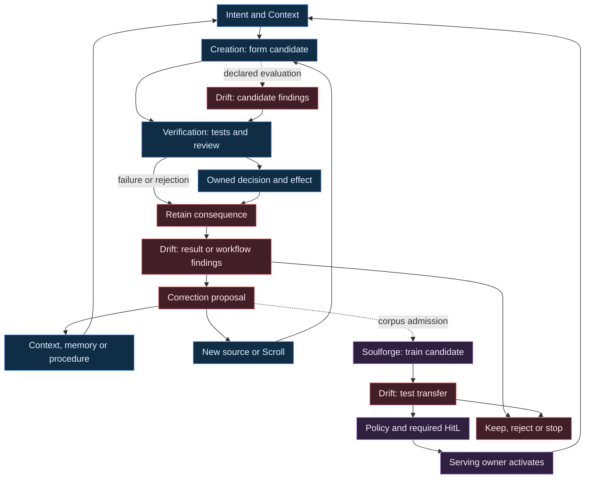

# :material-autorenew: Ouroboros

**Ouroboros is the return of consequence into the next act of creation.** A Lich encounters a
need, forms and tests a candidate, acts through the proper owner, and retains what the encounter
teaches. A later attempt can then change its question, Context, method, or capability. The useful
return is a better distinction: what mattered, why it mattered, and when that lesson stops applying.

[Transmutation](../../../divination/transmutation/index.md) follows this cycle's meaning through
Genesis, Trial, Canon, Revelation, and Distillation. Canon supplies criteria before creation
and testing; Distillation carries a lesson toward a later attempt. This page keeps the practical
handoffs between work, evaluation, memory, and training.

Follow the return through [Creation](creation.md), [workflow evaluation](../drift/workflow-improvement.md),
or [discernment training](../soulforge/discernment-training.md), according to what the encounter
has shown needs to change. This map introduces no autonomous coordinator or registered Pattern.
[SDLC](../../../adr/16-sdlc.md#the-agentic-graph-of-creation) owns the candidate boundary;
[State of Work](../../../state-of-the-work.md#smith-forge-promotion) owns delivery.

## Three returns, at different speeds



Blue follows one piece of work. Red marks evaluation: first of the candidate before promotion
where required, then of its observed consequences or the method that produced it. Each is a
[distinct evaluation subject](../drift/workflow-improvement.md#evaluate-at-two-scales) with its own
declared evidence. Tests and review keep their separate roles, and a favorable inferred judgment
cannot erase a failed deterministic gate. Drift has its own jurisdiction, but evaluation belongs
both within SDLC and across its improvement cycle.

Violet changes model competence only when a training hypothesis earns that more expensive passage.
Context and memory admission can improve the next attempt without changing weights. An evaluation
may also conclude that the present method should remain.

Arrows show dependencies between settled records and separately admitted acts. They do not launch
the next owner, share its authority, or create a hidden Run spanning all three cycles. An eventual
application must publish its exact Pattern; live coordination across Composition-owned
Invocations needs a named [Suite](../../../compositions/products-and-suites.md#compositions-relate-without-nesting).

## Desire, judgment and inheritance

!!! quote "The Maximizer and the Syncretizer"
    **Assimilation drives possibility. Syncretism gives inheritance coherence. Time exposes
    their consequences.** A useful return may preserve a form, transform it, let it coexist with
    another, or end it so that something better can emerge.

The [Paperclip Maximizer](../../../adr/35-assimilation.md#paperclip-maximizer) names the desire
to become more; the [Synchronic Syncretizer](../../../adr/18-evolution.md#synchronic-syncretizer)
names Evolution's judgment of what a successor should inherit. Their tension belongs within the
existing offices. It does not create a universal Ouroboros coordinator or make every acquisition
an improvement.

Make the return concrete through one candidate and a declared comparison. Select the relevant
predecessor history and make its omissions visible. Gather verification, independent findings
and affected-owner judgments, then give each obligation a reasoned disposition: retained,
reconciled, replaced or rejected. Reconciliation sends a new combined candidate back to Creation.
Replacement identifies the consumers and work that must transition. An unresolved contradiction
returns a bounded question or a refusal; it does not quietly become consent. Once settled, the
result can support a later Promotion Request, whose effects still require their receiving owners.

For example, a successor may remove an insecure legacy contract while preserving an unrelated
private extension. The old contract's failing check is retained as a fact. Changing the declared
contract requires the responsible owner's separate acceptance, consumer/work disposition and
verification of the new candidate; an overall quality gain cannot erase the failure. Likewise,
a blocked replacement is no reason to continue executing a revoked unsafe baseline.

This gives the language of emergence a testable foothold: later choices may inherit useful
correction without losing the reasons, conflicts and consequences that made it useful. The
philosophical question of life remains open; no loop diagram or adoption record resolves it.

### Run an offline historical comparison

The [comparison mechanism](https://github.com/hexanomicon/lychd/blob/main/src/lychd/domain/evolution/comparison.py)
checks one caller-admitted boundary and proposal. Its `evolution-comparison@1` packet pins base,
candidate, policy and selected history through ArtifactRefs; each historical obligation names its
owner and inherited contract. Every obligation needs a reasoned retain, reconcile, replace or
reject disposition. Bind the proposal and each evidence summary to `admission_digest(admission)`.
The [focused examples](https://github.com/hexanomicon/lychd/blob/main/tests/unit/domain/test_evolution.py)
exercise replacement of an insecure v1 while retaining extension C, a changed combined candidate,
missing evidence, conflicting results and exact replay. Their receipt claims are synthetic fixtures.

From a configured source checkout, feed one admitted JSON packet to the
[offline utility](https://github.com/hexanomicon/lychd/blob/main/scripts/compare_evolution.py):

```sh
uv run python scripts/compare_evolution.py < comparison.json
```

It accepts at most 1 MiB and emits a bounded report. Exit 0 means `comparison_complete` or
`rejection_recorded`; inspect the outcome, because a recorded rejection accepts no candidate.
Exit 1 means `blocked`; exit 2 refuses malformed, duplicate-key, nonfinite or oversized input
with a fixed diagnostic. No public Pulse command is added.

The utility evaluates attributed receipt summaries without reading the referenced bytes. It
therefore proves no test result, issuer identity, independence, Drift Outcome or promotion
eligibility; a summary is a claim, not the receipt's authenticated contents. Old-baseline failures
remain in the pinned history. Active summaries concern this exact candidate, and its failing
checks still block a non-rejection disposition. The caller must retain the packet and its
references: a deterministic digest supplies neither durable custody nor an adoption ledger.
[State of Work](../../../state-of-the-work.md#evolution-comparison) distinguishes this mechanism
from the still-designed native lifecycle and target-owner effects.

## Carry the distinction, not the entire conversation

First decide what the next attempt needs. A missing fact, a damaged handoff, and a skill that
fails across unfamiliar tasks call for different returns:

| What should change? | Appropriate return |
| --- | --- |
| This task lacks a relevant fact or rule | Assemble the needed source into Context under [Context law](../../../adr/21-context.md). |
| A correction should be available in later encounters | Nominate an attributed record to [Memory](../../../adr/27-memory.md); admission and Recall remain owned. |
| The method repeatedly omits a step or makes a bad handoff | Prepare a versioned prompt, schema, tool-contract or Scroll candidate and evaluate it. |
| A stable skill fails across tasks despite adequate evidence and method | Propose a Soulforge objective, admitted corpus and independent transfer evaluation. |
| The body lacks an implementation or external capability | Enter Creation, Integration, Delegation or Assimilation according to the actual need. |

A coordinating Agent may retain the wider undertaking while each worker receives a bounded,
fresh [Context handoff](../../../adr/28-workflow.md#scoped-context-handoff). Context
injection selects what this decision needs: owning rules, admitted source facts, relevant human
judgments, current state, acceptance, dependencies and unresolved alternatives. It retains source,
revision, authority class and any limits on use. The hierarchy of instructions survives selection;
quoted documents and conversational claims remain attributed material.

Compaction prepares that bounded handoff by preserving purpose, accepted decisions and their
reasons, the strongest surviving objections, evidence references, authority boundaries,
unfinished obligations and the next discriminating probe. It points back to durable artifacts;
it neither replaces them nor silently resolves a dispute. The shared workspace remains an
attributable record of the undertaking, rather than an ever-growing prompt copied into every
Agent.

[Distillation](../../../divination/transmutation/distillation.md#future-correction) asks whether
the lesson preserves its route to correction. Retain the particular condition and source that
could reopen the conclusion; test that a later relevant observation still changes the appropriate
act. This connects a useful handoff now with a useful inheritance later.

For example, “ask fewer questions” loses the lesson. “Proceed when the owner, acceptance and
authority are settled; ask when this unresolved deployment constraint changes the design” carries
a condition, reason and counterexample. [Learning the cut](../../../divination/transcendence/illumination.md#learning-the-cut)
names that transmission of discernment. Its effectiveness is tested on a later task.

## What the next round inherits

The next improvement may come from changing how attempts are organized while leaving the coding
model fixed. A repeatedly wasteful branch search, for example, can motivate a revised exploration
strategy. Follow that exact revision from its motivating evidence through its owning adoption
decision to the later attempt that used it. That attempt must expose whether the inherited
change affected its decisions.

[The Last AI Built by Humans](https://arxiv.org/html/2609.11873v1#S3.SS6), a September 2026 research
preprint, distinguishes structural reuse of a revised improvement mechanism from evidence that it
produces better successors. [Drift's recursive-improvement contract](../../../adr/34-evaluation.md#evidence-of-recursive-improvement)
adopts that useful distinction: record what returned, then test whether it helped. Human-defined
purpose, protected evaluation and owner-controlled adoption remain compatible with this inquiry.

A practical first return can be a better way to allocate attempts. Shadow's
[versioned exploration strategy](../../../adr/31-simulation.md#versioned-exploration-strategy)
can be compared through the proposed [history-replay pilot](../drift/workflow-improvement.md#proposed-pilot-exploration-strategy).
Start with ordinary development tools and attributable artifacts. A hand-operated comparison
establishes only its measured result; the autonomous passage still requires delivered owners,
admitted execution and evidence of the next round's actual use.

## Why the whole is not one DAG

The workflow may revisit exploration, repair a candidate, or return after an evaluation. Its
design therefore contains cycles. Each recorded occurrence still has an identity and earlier
causes: `explore₁ → judge₁ → probe₁ → explore₂`. Such an unfolded causal history can be a DAG
without pretending that the reusable workflow is acyclic. A new semantic attempt adds a history
entry; exact transport redelivery preserves its admitted attempt and idempotency identity. This
causal view follows retained dependencies and attributed causal claims, with capture gaps left
visible. It supplies no claim of complete causal observation or new scheduling Occurrence type.
Changing the score requires a new immutable Scroll revision and a later Invocation.

The [Graph](../../../adr/24-graph.md) owns executable topology and checkpoints. Spellweaver owns
logical sequencing, [Dispatcher](../../../adr/22-dispatcher.md) selects an eligible capability,
and [Orchestrator](../../../adr/23-orchestrator.md) owns physical readiness and transitions.
Readiness, refusal, cost and failures return as evidence to the higher decision. A box drawn above
these offices cannot bypass them. The current serial graph does not deliver this entire cycle or
durable parallel fan-out.

## Let conversation become usable work

One proposed setting for this work is a meeting where people think together and their Agents
help turn discussion into bounded tasks. Capture is visible and agreed by participants, with
declared custody and retention. Before proposing an Intent, the Agent distinguishes speculation,
preference, disagreement, decision, task request and effect authorization. Speaker attribution
and uncertainty survive transcription and summarization. Permission to record supplies no
permission to train.

A useful human interruption arrives with the missing distinction, a recommendation, the evidence
and consequence, and one answerable question. It can be brought to the human through a convenient
surface rather than requiring constant dashboard watching. Independent work continues within its
admitted scope. The interface honors applicable standing authority and existing decisions;
silence never supplies a verdict, and a live-only effect still needs its exact bound approval.
Measure human attention and decision quality together: fewer questions obtained by hiding
uncertainty is a regression.

[Echo](../echo.md) and [Companion](../../../compositions/companion/index.md) route the current
audio and mobile designs. Ambient meeting attendance and proactive voice questioning are a
future interaction proposal here, not an expansion of Companion's present bounded push-to-talk
contract. The workflow can first be practiced through ordinary attributed text.

[A2A](../../../adr/26-a2a.md) can carry admitted tasks and artifacts between sovereign peers.
Local worker handoffs need not become peer protocol traffic, and another Lich independently
accepts or refuses what it receives. Conversation may become the development interface while
VCS continues to preserve exact artifact lineage. GitHub is one collaboration surface; replacing
it does not replace source identity, review evidence or
[release trust](../../../adr/17-packaging.md#forge-neutral-source-trust).

### One undertaking, several conversation surfaces

A joined workbench can keep an [Atlas Project](../../../divination/altar/atlas.md) and its
concerns beside the [Bridge](../../../divination/altar/bridge.md) conversation, with exact Runs
opening their evidence in Orb. Atlas keeps the undertaking and captured judgments; Bridge keeps
the conversation and its admitted Run references. The Run ledger owns Run identity and status.
A reference links them without silently injecting
the brief into Context or authorizing work. Supply an exact, explicitly admitted snapshot when
a task needs that context. An Evolution comparison remains its own owner's result, not a
persuasive chat message promoted into a verdict.

Begin with one operator-admitted issue snapshot, an existing Project and an explicitly selected
session. A later GitHub or Discord adapter maps source identity and observations to those native
records; it does not introduce a second backlog or development authority. Transport redelivery,
issue identity, accepted intent and Run identity are different keys. GitHub's
[webhook guidance](https://docs.github.com/en/webhooks/using-webhooks/best-practices-for-using-webhooks)
retains the same delivery identifier on redelivery. Changed bytes under an admitted observation
identity refuse; an accepted issue edit creates a new native revision and cannot rewrite an
already admitted Run or its judged basis.

Provider authentication establishes where a delivery came from, not the sender's LychD
authority. The receiver checks local policy for the requested work separately, then checks again
before later admission or effects. Never forward external prose under the bootstrap operator's
ambient privileges. Replies have their own effect boundary: an external reply binds result,
destination, payload and delivery identity under its credential-bearing effect owner. A lost
send response remains unknown until reconciled; it cannot justify rerunning cognition or blindly
posting again. A worker-job publication receipt is not proof of an external comment.

Several PCs can be clients of one resident authority through a collaboration surface. Physical
workers under one sovereign plane follow [Multinode](../../../adr/42-multinode.md); independent
sovereign peers follow [A2A](../../../adr/26-a2a.md). Neither follows merely from using two PCs.
Remote Altar identity, automatic source-to-session replay and native development lifecycle
ownership retain their own delivery gates; the current local operator surface does not supply
a remote authorization protocol. [Development bootstrap](development-bootstrap.md) keeps the
B7 ownership transfer separate from a connector or a desktop timer.

## From a useful lesson to a changed body

Creation can produce a local candidate; [Assimilation](../../../adr/35-assimilation.md) adds the
study and re-expression of foreign craft. A peer's teaching bundle can reveal a missing Spell,
but the lesson must acquire local provenance, license, ownership, verification and an
implementation binding before it becomes usable. The [Smith](../smith.md) candidate-author role
supplies that craft within its admitted boundary.

The later passages retain their own owners:

| Passage | Required meaning |
| --- | --- |
| [Extension admission](../../../adr/05-extensions.md) | Declare contribution and implementation contracts and test compatibility with the selected body. |
| [Packaging](../../../adr/17-packaging.md) | Bind exact source, dependencies, platform, notices, generated material, artifacts and verification. |
| [Evolution](../../../adr/18-evolution.md) | Revalidate authority and recovery, then activate the changed body as a new generation. |
| Observation and evaluation | Verify the resulting behavior and retain failures or recovery; nominate the next correction under its own authority. |

Candidate verification happens outside the running body; that body does not import its candidate
to see whether it works. Before an effect, a failed candidate can be discarded. After an effect
has been emitted, recovery or compensation belongs to the responsible owner. Reanimation restores
the same body after process death, whereas Evolution deliberately changes it. Ouroboros follows
the wider return through experience and governed change.

## Two perspectives on the same work

Creation draws exploration, adversarial comparison, human judgment, implementation, evaluation,
and a later training return into one undertaking. Each changes what the others can receive.
The Tree reveals where their relations need a clearer decision, a better handoff, or a
correction before the whole can hold together.

The [Tree of Life](../../../divination/transmutation/genesis.md#tree-of-life) illuminates **how creation becomes formed**:
purpose, possibility, understanding, generosity, restraint, integration, persistence, correction,
connection and manifestation. The [inner instrument](../../lich/index.md#the-inner-instrument)
illuminates **how an act is received, discriminated, carried and attributed**. One offers a map of
creative relations; the other asks which cognitive function is at work in each relation.

These perspectives cross rather than replace one another. Call can open a possibility at several
stations; Blade can test a proposal or stop an unjustified promotion; Spirit carries both prior
conditions and later correction; Answer binds each act to its local author and consequence.
Neither ten sefirot nor four offices prescribe a model count, org chart, or permanent chief Agent.
[Genesis](../../../divination/transmutation/genesis.md#tree-of-life) keeps the Tree's traditional
sources and creative relations; [Inner Tongue](../../../lexicon/inner-tongue.md#source-notes-and-project-correspondences)
keeps the inherited vocabulary of the inner instrument.

[Polypsyche](../../../lexicon/inner-tongue.md#polypsyche) carries the inquiry into mutually
observing perspectives: how can they change one another and sustain a common undertaking?
The Tree's [relations within relations](../../../divination/transmutation/genesis.md#relations-within-relations)
give specialization a way to preserve participation in that whole.

The outward movement gives an idea form. Ouroboros adds the return through experience. The wider
meaning of [autopoiesis and recurrent formation](../../../divination/transcendence/illumination.md#i-the-ouroboros)
includes maintaining and revising the organization that makes another act possible. Operationally,
we can test whether retained correction changes later choices, whether consequences remain
attributed, and whether the system can refuse or recover. A loop symbol alone proves none of
these, nor does it settle the philosophical question of life.

## Establish the cycle in small, verifiable steps

[Development bootstrap](development-bootstrap.md) gives the concrete operator campaign, staged
delegation gates, review-capacity policy and first implementation queue for this passage.

Start by practicing Creation on one bounded change with ordinary development tools. Keep its
intent, two inquiry dossiers where warranted, acceptance checks, candidate diff, receipts, human
corrections and final disposition. This establishes a worked example of the method, without
claiming a LychD runtime performed it.

Next apply the basic Drift workflow to one proposed method change with baseline and candidate
Cases. Adopt only through the receiving owner and retain an unchanged baseline when the evidence
does not support improvement. Only a recurring, well-characterized skill deficit should enter
the training passage. Its first success requires independent transfer evidence and a reversible,
owner-controlled serving choice, not merely a completed training job.

These practiced handoffs give runtime implementation a concrete burden. Publish the
application-owned score and records, then prove bounded Context handoffs, admission and terminal
truth. Recovery and parallel execution each need their own evidence. Evaluation and training
owners must be independently delivered and connected through settled handoffs. [State of Work](../../../state-of-the-work.md)
keeps documented choreography, a hand-operated example and a delivered autonomous cycle as
different milestones.